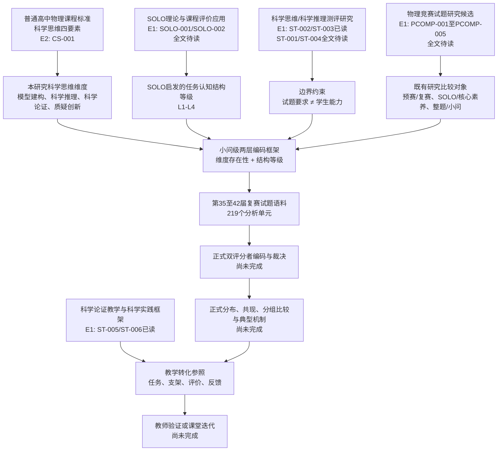

# G2-06-PREP 概念关系图与研究空白候选清单

## 任务定位

本文件启动 `G2-06 形成概念关系图和研究空白`。当前依据的是已经登记的官方课程标准、SOLO阶段性来源核验、物理竞赛试题研究候选来源、科学思维测评与教学研究候选来源，以及项目内部语料和编码准备材料。

本文件不是正式文献综述，也不能作为“研究空白已经证明”的证据。除 `CS-001` 课程标准科学思维定义外，多数文献仍处于候选或全文待读状态。

## 当前证据基础

| 主题块 | 已有材料 | 证据等级 | 当前可支持 | 当前不能支持 |
|---|---|---:|---|---|
| 课程标准科学思维 | `CS-001`、`curriculum_standard_verification.md` | E2 | 科学思维四要素的官方课程依据 | 编码框架有效性、试题结果或教学效果 |
| SOLO理论边界 | `SOLO-001`、`SOLO-002`、`solo_taxonomy_source_verification.md`、`solo_fulltext_access_audit.md` | E1 | SOLO原始来源已定位；只能保守表述为“SOLO启发” | 具体页码、完整层级定义、试题分析适用性已证明 |
| 物理竞赛试题研究 | `PCOMP-001` 至 `PCOMP-005`、`physics_competition_review_prep.md` | E1 | 已发现预赛量化、复赛SOLO、核心素养和整体竞赛试题研究候选 | 既有研究结论、统计结果、已证明研究空白 |
| 科学思维测评与教学研究 | `ST-001` 至 `ST-006`、`scientific_thinking_review_prep.md`、`scientific_thinking_st002_reading_notes.md`、`scientific_thinking_st003_reading_notes.md`、`scientific_thinking_st005_reading_notes.md`、`scientific_thinking_st006_reading_notes.md` | E1 | 已完成ST-002作者站PDF阅读、ST-003开放全文内容摘录、ST-005开放仓储PDF阅读和ST-006官方在线章节阅读；ST-001/ST-004仍待读 | 测评工具适用于本研究、教学策略有效 |
| 本项目试题语料 | 第35至42届复赛试题、219个分析单元、内部试编码 | E2/E3（内部准备） | 可支持语料范围、分析单位和内部预演 | 正式统计结果、学生能力结论、教学效果结论 |

## 概念关系图

## 概念边界表

| 概念 | 本研究中的暂定含义 | 不能等同于 | 正式定稿前还需 |
|---|---|---|---|
| 科学思维维度 | 试题任务要求中可识别的模型建构、科学推理、科学论证、质疑创新要求 | 学生真实科学思维水平 | 科学思维测评文献、编码手册正式冻结、评分者一致性 |
| SOLO启发等级 | 某一维度出现时的任务认知结构复杂性 | 题目难度、公式数量、学生学习结果等级 | SOLO全文阅读、任务分析争议文献、专家/评分者边界确认 |
| 小问级分析单位 | 能回到原题与答案页的独立小问或拆分分析单元 | 整题粗略标签、解题步骤任意切分 | 人工校对销项、正式编码单位确认 |
| 物理竞赛试题研究 | 与竞赛题分析相关的预赛、复赛、核心素养、SOLO或量化研究 | 培训机构题解或单题赏析本身 | PCOMP候选文献全文阅读与筛选 |
| 教学转化 | 将试题分析结果转化为任务、支架、评价和反馈链条 | 教学策略有效性证明 | 教师证据或课堂迭代材料 |

## 研究空白候选清单

| 编号 | 候选空白 | 当前依据 | 证据状态 | 可写入正文的条件 |
|---|---|---|---|---|
| GAP-01 | 竞赛试题研究需要更清楚地区分预赛、复赛、整题、小问和单题赏析等对象 | PCOMP-001至PCOMP-005候选来源；本项目219个小问级分析单元 | 候选，E1/E2 | 阅读PCOMP全文后确认其样本和分析单位；补充本项目语料构建证据 |
| GAP-02 | 复赛试题研究若使用SOLO，需要说明“试题任务要求”与“学生学习结果”的边界 | SOLO-001/002阶段性核验；PCOMP-002候选；AGENTS.md理论边界 | 候选，E1 | 获得SOLO原书、1989论文和PCOMP-002全文后，记录页码和迁移限制 |
| GAP-03 | 只统计知识模块或解题步骤不足以说明科学思维要求，需把维度存在性与结构等级分开 | CS-001课程标准；ST候选测评文献；本项目内部编码逻辑 | 候选，E1/E2 | 补充ST全文和内容分析方法文献；完成正式评分者一致性 |
| GAP-04 | 竞赛试题分析的结果不能直接推出学生科学思维水平，需要学生作答或测评证据另行支持 | ST-002/ST-003已读；ST-001/ST-004候选；第二章当前边界说明 | 部分核验，E1 | 继续获取ST-001/ST-004全文；补充学生作答或测评证据后才能讨论能力表现 |
| GAP-05 | 教学转化不能停留在一般策略建议，应落到任务、支架、评价和真实反馈 | ST-006官方在线章节已读；ST-005开放仓储PDF已读；MASTER_PLAN教学转化链 | 部分核验，E1 | 继续补充设计型研究和物理教育课堂文献，并获得真实教师或课堂材料 |
| GAP-06 | 本项目的可复现价值在于保留试题语料、编码表、脚本、结果和边界说明 | 项目已有CSV、脚本、内部准备包 | 内部准备，E3（非正式结果） | 完成正式编码、裁决和可复现分析脚本后才能作为论文贡献 |

## 对第二章写作的最低可用主张

当前可以谨慎写入核验式草稿，但不能作为定稿结论的主张：

1. 课程标准为四个科学思维维度提供官方依据；
2. 本研究分析的是试题任务要求，不是学生真实能力；
3. SOLO当前只能作为任务认知结构等级的启发来源；
4. 已发现物理竞赛试题研究和科学思维测评研究候选来源，正式综述需待全文核验；
5. 教学转化需要真实教师或课堂证据，当前不能写教学效果。

## 正式写作门槛

| 门槛 | 对应文件 | 未满足时的写法 |
|---|---|---|
| SOLO全文阅读与页码 | `solo_fulltext_request_packet.md`、`solo_taxonomy_source_verification.md` | 保留“SOLO启发”“全文待读” |
| 物理竞赛研究全文筛选 | `physics_competition_screening_matrix.csv` | 只写“候选来源已定位”，不写研究空白 |
| 科学思维测评全文筛选 | `scientific_thinking_screening_matrix.csv` | 只写“候选来源已定位”，不写测评结论 |
| 内容分析与一致性方法文献 | 待G2后续补充 | 第三章方法只保留内部流程草稿 |
| 正式双评分者编码 | `formal_coding_rater_A_template.csv`、`formal_coding_rater_B_template.csv` | 结果章继续使用“内部预演，不入正文” |
| 教师或课堂证据 | G5/G6材料 | 教学转化只能写设计框架，不能写效果 |

## 下一步

1. 继续补齐G2-03至G2-05全文阅读；
2. 启动内容分析与评分者一致性方法文献核验；
3. 将 `C2-02`、`C2-04`、`C2-05`、`C2-06` 加入 `claim_evidence_matrix.csv`，但状态保持“待核验”；
4. 全文阅读后再把本文件中的候选空白升级、合并或删除。
