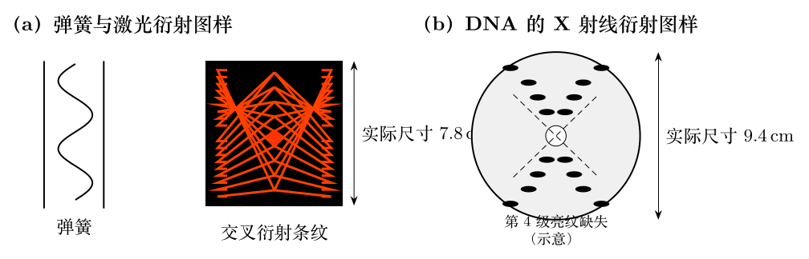

> 本文件由项目已校订的LaTeX题干、参考解答和TikZ图件生成。评分时以本文件为主要阅读文本；需核对原始措辞时查看包内对应届次原始PDF。

# 第35届复赛第7题：弹簧衍射与DNA X射线衍射类比

## 题干

用波长 $\lambda=633\,\mathrm{nm}$ 的激光水平照射竖直圆珠笔中的小弹簧，在距离弹簧 $L=4.2\,\mathrm m$ 的光屏上形成衍射图像，如图（a）。该图像与用波长 $\lambda'=0.15\,\mathrm{nm}$ 的平行X射线照射DNA样品、在距离 $L'=9.0\,\mathrm{cm}$ 的底片上获得的图（b）相似。

求：（1）利用图（a）的尺寸信息估算弹簧钢丝直径 $d_1$、弹簧半径 $R$ 和螺距 $p$；（2）利用图（b）的尺寸信息估算DNA螺旋半径 $R'$ 和螺距 $p'$。已知两段互成角度的细铁丝的衍射干涉图像，与两条成同样角度、相同宽度的狭缝图像一致。

## 参考解答整理

#### （1）弹簧的衍射测量。

由图（a）测得两组条纹中点连线夹角 $$\phi=30^\circ.$$ 远场小角近似下，第 $n$ 级暗纹满足 $$d\sin\theta_n\simeq d\theta_n=d\frac{x_n}{L}=n\lambda,$$ 故相邻暗纹间距为 $$X=x_{n+1}-x_n=\frac{\lambda L}{d}.$$ 图中长、短空间周期分别为 $X_1=7.9\,\mathrm{mm}$、$X_2=1.7\,\mathrm{mm}$，从而 $$d_1=\frac{\lambda L}{X_1}=\boxed{0.34\,\mathrm{mm}},\qquad
d_2=\frac{\lambda L}{X_2}=\boxed{1.6\,\mathrm{mm}}.$$ 将螺旋线在平面展开，结合交叉细丝夹角，有 $$p=\frac{d_2}{\cos(\phi/2)}
=\frac{\lambda L}{X_2\cos(\phi/2)}
=\boxed{1.6\,\mathrm{mm}},$$ $$R=\frac{d_2}{2\pi\sin(\phi/2)}
=\frac{\lambda L}{2\pi X_2\sin(\phi/2)}
=\boxed{0.96\,\mathrm{mm}}.$$

#### （2）DNA螺旋参数。

由图（b）量得 $$\phi'=84^\circ,\qquad X'=4.7\,\mathrm{mm}.$$ 先由衍射周期得到相邻分子链间距 $$d'=\frac{\lambda'L'}{X'}=\boxed{2.9\,\mathrm{nm}}.$$ 套用同一螺旋展开几何关系， $$p'=\frac{d'}{\cos(\phi'/2)}
=\frac{\lambda'L'}{X'\cos(\phi'/2)}
=\boxed{3.9\,\mathrm{nm}},$$ $$R'=\frac{d'}{2\pi\sin(\phi'/2)}
=\frac{\lambda'L'}{2\pi X'\sin(\phi'/2)}
=\boxed{0.68\,\mathrm{nm}}.$$
