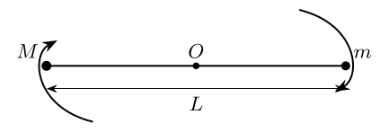

> 本文件由项目已校订的LaTeX题干、参考解答和TikZ图件生成。评分时以本文件为主要阅读文本；需核对原始措辞时查看包内对应届次原始PDF。

# 第37届复赛第7题：LIGO双黑洞引力波辐射估算

## 题干

在双黑洞并合的旋近阶段，将质量为 $M$、$m$ 的双黑洞近似为绕共同质心运动的质点，间距为 $L$，如图。系统仅通过引力波辐射损失能量，采用牛顿引力理论近似。

（1）设辐射功率与 $G$ 以及 $I$、$\omega$、$c$ 有关，推导量纲表达式。（2）初始间距为 $L_0$，求绕质心转动一周的时间。（3）求间距减为 $L_0/2$ 时已转过的角度。

## 参考解答整理

#### （1）量纲分析。

令 $$P=\alpha GI^\lambda\omega^\xi c^\sigma.$$ 由 $[P]=\mathrm{ML^2T^{-3}}$ 得 $$\lambda=2,\qquad \xi=6,\qquad \sigma=-5,$$ 故本题近似模型为 $$\boxed{P=\frac{\alpha GI^2\omega^6}{c^5}.}$$ 该式只用于题设的量纲分析和牛顿近似，不是完整的广义相对论辐射公式。

#### （2）转动一周所需时间。

近似圆周运动满足 $$\omega^2=\frac{G(M+m)}{L^3},\qquad I=\frac{Mm}{M+m}L^2,$$ $$E=-\frac{GMm}{2L}=-\frac{G^{2/3}Mm}{2(M+m)^{1/3}}\omega^{2/3}.$$ 由 $P=-\mathrm dE/\mathrm dt$ 得 $$\omega^{-11/3}\frac{\mathrm d\omega}{\mathrm dt}=\frac{3\alpha G^{5/3}Mm}{c^5(M+m)^{1/3}},$$ $$\omega(t)=\left[\omega_0^{-8/3}-\frac{8\alpha G^{5/3}Mm}{c^5(M+m)^{1/3}}t\right]^{-3/8}.$$ 令转角增加 $2\pi$，得到 $$\boxed{t_{360^\circ}=\frac{c^5L_0^4}{8\alpha G^3Mm(M+m)}
\left\{1-\left[1-\frac{10\pi\alpha G^{5/2}Mm\sqrt{M+m}}{c^5L_0^{5/2}}\right]^{8/5}\right\}.}$$

#### （3）间距减半时的转角。

当 $L=L_0/2$， $$t=\frac{15c^5L_0^4}{128\alpha G^3Mm(M+m)},$$ 从初态起的转角为 $$\boxed{\Delta\theta=\frac{(1-\sqrt2/8)c^5L_0^{5/2}}{5\alpha G^{5/2}Mm\sqrt{M+m}}\frac{180^\circ}{\pi}.}$$
