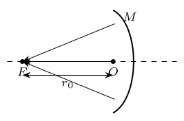

> 本文件由项目已校订的LaTeX题干、参考解答和TikZ图件生成。评分时以本文件为主要阅读文本；需核对原始措辞时查看包内对应届次原始PDF。

# 第38届复赛第1题：平凸/平凹透镜曲面设计

## 题干

宽束平行光正入射到折射率为 $n$ 的平凸透镜平面侧后汇聚于焦点 $F$；透镜顶点 $O$ 到 $F$ 的距离为 $r_0$，如图。求凸面形状。随后插入折射率为 $n'$、顶点到 $F$ 的距离为 $r_0'$ 的平凹透镜，使出射光重新平行，求凹面形状及入、出平行圆光束半径比。

## 参考解答整理

#### （1）平凸透镜的凸面形状。

以 $F$ 为极点，有等光程关系 $$r=n(r\cos\theta-r_0)+r_0,
\qquad r=\frac{(1-n)r_0}{1-n\cos\theta}.$$ 以从 $F$ 指向 $O$ 的方向为 $x$ 轴，凸面满足 $$\boxed{\frac{\left(x-\frac{n}{n+1}r_0\right)^2}{\left(\frac{r_0}{n+1}\right)^2}-\frac{y^2}{\left(\frac{\sqrt{n^2-1}}{n+1}r_0\right)^2}=1.}$$ 因此凸面为旋转双曲面。对平凹透镜完全类似：

#### （2）（i）平凹透镜的凹面形状。

$$r'=\frac{(1-n')r_0'}{1-n'\cos\theta},$$ $$\boxed{\frac{\left(x-\frac{n'}{n'+1}r_0'\right)^2}{\left(\frac{r_0'}{n'+1}\right)^2}-\frac{y^2}{\left(\frac{\sqrt{n'^2-1}}{n'+1}r_0'\right)^2}=1.}$$ 凹面也是旋转双曲面。

#### （2）（ii）入射与出射圆光束的半径比。

若汇聚光最大夹角为 $\theta_{\max}$，半径比为 $$\boxed{k=\frac{(1-n)(1-n'\cos\theta_{\max})r_0}{(1-n')(1-n\cos\theta_{\max})r_0'}.}$$
