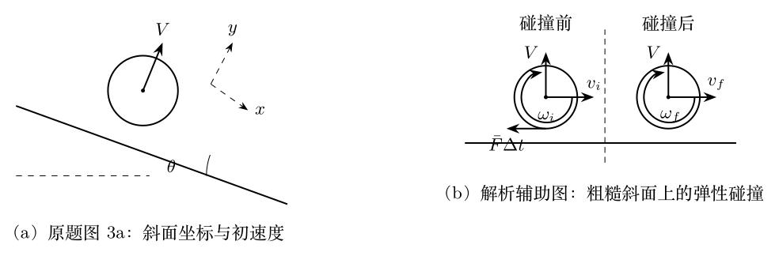

> 本文件由项目已校订的LaTeX题干、参考解答和TikZ图件生成。评分时以本文件为主要阅读文本；需核对原始措辞时查看包内对应届次原始PDF。

# 第39届复赛第3题：斜面上实心球的反复弹性碰撞

## 题干

如图（a），质量为 $m$、半径为 $R$ 的匀质实心球从倾角为 $\theta$ 的无限长固定斜面上发射。球心初速度垂直斜面、大小为 $V$，初始角速度为零。取 $x$ 轴沿斜面向下、$y$ 轴垂直斜面向上。碰撞弹性、碰撞时间极短，碰撞前后垂直斜面的速度大小相同；斜面足够粗糙，使接触点无相对滑动。已知 $I=2mR^2/5$。

求：（1）首次碰撞前的球心速度与角速度；（2）首次碰撞后的球心速度与角速度；（3）第 $n$ 次碰撞后的 $x$ 向速度和角速度；（4）前 $n$ 次碰撞中斜面对球的总冲量。

## 参考解答整理

#### （1）首次碰撞前。

飞行阶段仅受重力，故 $$a_x=g\sin\theta,\qquad a_y=-g\cos\theta,$$ $$v_x=gt\sin\theta,\qquad v_y=V-gt\cos\theta.$$ 由 $y(T)=0$ 得 $T=2V/(g\cos\theta)$，因而首次碰撞前 $$\boxed{v_x=2V\tan\theta,\qquad v_y=-V,\qquad \omega=0.}$$ 记每段飞行增加的沿坡速度为 $w=2V\tan\theta$。

#### （2）粗糙弹性碰撞映射。

设某次碰撞前、后的 $x$ 向速度为 $v_i,v_f$，角速度为 $\omega_i,\omega_f$。摩擦冲量、角动量定理和动能守恒给出 $$v_f-v_i=-\frac25R(\omega_f-\omega_i),$$ $$v_f^2-v_i^2=-\frac25R^2(\omega_f^2-\omega_i^2).$$ 除去无摩擦的平凡根后，碰撞映射为 $$v_f=\frac37v_i+\frac47R\omega_i,\qquad
R\omega_f=\frac{10}{7}v_i-\frac37R\omega_i.$$ 首次碰撞后由 $v_i=w$、$\omega_i=0$ 得 $$\boxed{v_1=\frac67V\tan\theta,\qquad \omega_1=\frac{20}{7R}V\tan\theta,}$$ 且球心速度为 $V[(6/7)\tan\theta\,\hat{x}+\hat{y}]$。

#### （3）第 $n$ 次碰撞后的递推结果。

在相邻两次碰撞间，$x$ 向速度增量为 $w$，因而 $$v_n=\frac37(v_{n-1}+w)+\frac47R\omega_{n-1},\qquad
R\omega_n=\frac{10}{7}(v_{n-1}+w)-\frac37R\omega_{n-1}.$$ 答案给出等价的奇偶结果： $$\boxed{\begin{aligned}
n\ \text{为偶数}:&\quad v_n=\frac{10}{7}nV\tan\theta,\quad \omega_n=\frac{10}{7R}nV\tan\theta;\\
n\ \text{为奇数}:&\quad v_n=\frac27(5n-2)V\tan\theta,\quad \omega_n=\frac{10}{7R}(n+1)V\tan\theta.
\end{aligned}}$$ 答案另给出线性组合、两步递推及矩阵三种等价求法，其中矩阵 $$A=\frac17\begin{pmatrix}3&4\\10&-3\end{pmatrix},\qquad A^2=\mathrm{I}.$$

#### （4）前 $n$ 次碰撞的总冲量。

每次碰撞的 $y$ 向冲量为 $2mV$，而 $x$ 向冲量求和后为 $J_x=mv_n-nmw$。因此 $$\mathbf J=m(v_n-nw)\hat{x}+2nmV\hat{y}.$$ 代入上式后： $$\boxed{\begin{aligned}
n\ \text{为偶数}:&\quad \mathbf J=\frac27nmV(-2\tan\theta\,\hat{x}+7\hat{y});\\
n\ \text{为奇数}:&\quad \mathbf J=\frac27nmV\left[-2\left(1+\frac1n\right)\tan\theta\,\hat{x}+7\hat{y}\right].
\end{aligned}}$$
