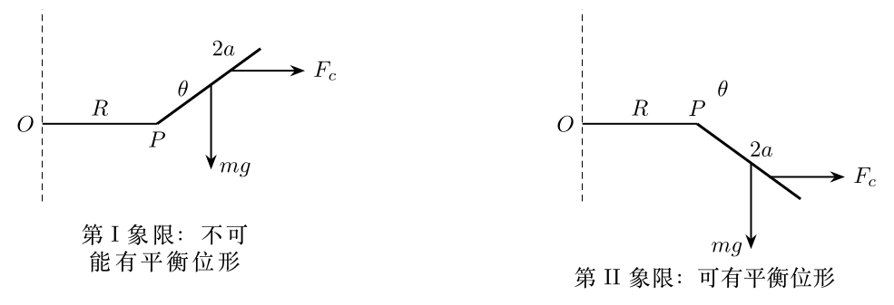

> 本文件由项目已校订的LaTeX题干、参考解答和TikZ图件生成。评分时以本文件为主要阅读文本；需核对原始措辞时查看包内对应届次原始PDF。

# 第39届复赛第4题：旋转圆环上铰接细杆的平衡与稳定性

## 题干

如图，长度为 $2a$、质量为 $m$ 的匀质刚性细杆的一端以小孔套在半径为 $R$ 的水平圆环固定点 $P$ 上。圆环及 $P$ 点以角速度 $\omega$ 绕过圆心 $O$ 的竖直轴转动；细杆可绕 $P$ 无摩擦转动，并始终位于 $OP$ 所在竖直平面内。细杆与竖直方向夹角为 $\theta$，重力加速度为 $g$。

求：（1）分别在实验室系 $L$ 与随 $OP$ 转动的参考系 $S$ 中写出细杆机械能；（2）在 $S$ 系导出平衡条件；（3）图解分析四个象限中平衡位形数及参数条件；（4）分象限画出对 $P$ 点力矩有贡献的受力示意并检验图解结论；（5）讨论各平衡位形的稳定性。

## 参考解答整理

#### （1）两参考系的机械能。

细杆质心到转轴的距离为 $R+a\sin\theta$。以圆环平面为重力势能零点，实验室系机械能可写为 $$E_L=mga\cos\theta+\frac23ma^2\dot\theta^2
+\frac12m\left[(R+a\sin\theta)^2+\frac13a^2\sin^2\theta\right]\omega^2.$$ 在随 $OP$ 转动的 $S$ 系中，杆绕端点的转动惯量为 $I_P=4ma^2/3$；还应计入离心势能。因此 $$\boxed{E_S=\frac23ma^2\dot\theta^2+mga\cos\theta
-\frac12m\left[(R+a\sin\theta)^2+\frac13a^2\sin^2\theta\right]\omega^2.}$$

#### （2）平衡条件。

令有效势能对 $\theta$ 的导数为零，或直接令相对 $P$ 的合力矩为零，均得 $$mga\sin\theta+ma\omega^2\left(R+\frac43a\sin\theta\right)\cos\theta=0,$$ 即 $$\boxed{\tan\theta+\frac{4a\omega^2}{3g}\sin\theta+\frac{R\omega^2}{g}=0.}$$

#### （3）图解判定。

令 $A=4a\omega^2/(3g)$、$B=R\omega^2/g$，则 $A,B>0$，平衡方程化为 $$-\tan\theta=A\sin\theta+B.$$ 图重绘答案的图解曲线。另将原方程写为 $$-\cot\theta=A'\cos\theta+B',\qquad A'=\frac{4a}{3R},\quad B'=\frac{g}{R\omega^2},$$ 也得到图的等价图解。

由曲线交点可知：第I象限无平衡位形；第II、IV象限各恰有一个。第III象限可能有 $0$、$1$ 或 $2$ 个。临界时两曲线相切，故 $$A^{2/3}=B^{2/3}+1,
\qquad
\boxed{\left(\frac{4a}{3}\right)^{2/3}-R^{2/3}=\left(\frac{g}{\omega^2}\right)^{2/3}.}$$ 左端小于右端时第III象限无平衡位形；等号时有一个临界位形；左端大于右端时有两个。

#### （4）受力检验。

图按答案解题图4b重绘。重力 $mg$ 作用于杆的中点；离心力是分布力，图中以对 $P$ 点力矩等效的合力 $F_c$ 表示。各象限的力矩方向与上面的交点结论相符。

#### （5）稳定性。

在平衡位置 $\theta_E$ 附近令 $\theta=\theta_E+\Delta\theta$。若微小偏移后合力矩为恢复力矩，则平衡稳定。答案的微扰法和有效势能二阶导数法给出一致判断：第II象限位形稳定，第IV象限位形不稳定；第III象限有两个位形时，较大的根稳定、较小的根不稳定；临界相切时 $\theta_E=\theta_0$ 是势能拐点，亦不稳定。
