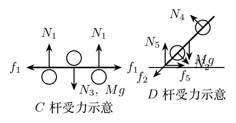

> 本文件由项目已校订的LaTeX题干、参考解答和TikZ图件生成。评分时以本文件为主要阅读文本；需核对原始措辞时查看包内对应届次原始PDF。

# 第40届复赛第4题：编木拱桥的几何与静力平衡

## 题干

北宋《清明上河图》中的编木拱桥以及类似实物模型，都利用杆件间的支持力与静摩擦力保持结构稳定。现取由三个单元组成的左右对称简化模型，只研究竖直平面内的平衡。每对长杆等效为质量为 $M$ 的杆，结构由短杆 $A,A',B$ 和长杆 $C,D,D'$ 组成。各短杆质量为 $m$、半径为 $R$；各长杆长度为 $L$；短杆 $B$ 表面光滑，其余杆间静摩擦因数为 $\mu$，杆与地面间的静摩擦因数为 $\mu'$。$D,D'$ 与水平面夹角均为 $\theta$，如图。

1.  若 $D$ 杆下端至与 $A$ 杆接触点的长度为 $a$，求其至与 $B$ 杆接触点的长度 $b$。

2.  分析 $A,B,C,D$ 四杆受力，画出 $C,D$ 的受力图，并列出平衡方程。

3.  当 $M=6m$、$\theta=45^\circ$、$L=30\,\mathrm{cm}$、$a=16\,\mathrm{cm}$、$R=2(\sqrt2-1)\,\mathrm{cm}$ 时，求保持平衡的 $\mu,\mu'$ 条件。

## 参考解答整理

#### （1）接触位置的几何关系。

圆柱杆接触的几何关系给出 $$b=a+4R\cot\frac\theta2.$$

#### （2）受力与平衡方程。

$C,D$ 两杆的受力关系以图表示。对 $A,B,C,D$ 分别列平衡条件，可写为 $$N_1+mg=N_2\cos\theta+f_2\sin\theta,\quad
f_1+f_2\cos\theta=N_2\sin\theta,\quad f_1=f_2,$$ $$N_3=2N_4\cos\theta+mg,\qquad 2N_1=N_3+Mg,$$ $$N_5+N_4\cos\theta=N_2\cos\theta+f_2\sin\theta+Mg,
\quad f_5+N_2\sin\theta=N_4\sin\theta+f_2\cos\theta.$$ 以 $D$ 杆与地面的接触点取力矩， $$N_2a+Mg\left(\frac L2\cos\theta-R\sin\theta\right)=N_4b+2Rf_2.$$

#### （3）代入数值。

先得 $b=24\,\mathrm{cm}$。由上述方程组， $$N_1=10.427mg,\qquad f_1=f_2=4.733mg,\qquad N_5=\frac{21}{2}mg,\qquad f_5=2.194mg.$$ 杆件接触处需满足 $f_1\leq\mu N_1$、$f_2\leq\mu N_2$，地面处需满足 $f_5\leq\mu'N_5$。因此保持平衡的条件为 $$\mu\geq0.454,\qquad \mu'\geq0.209.$$
