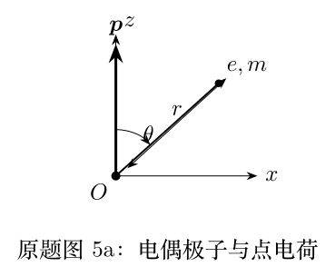
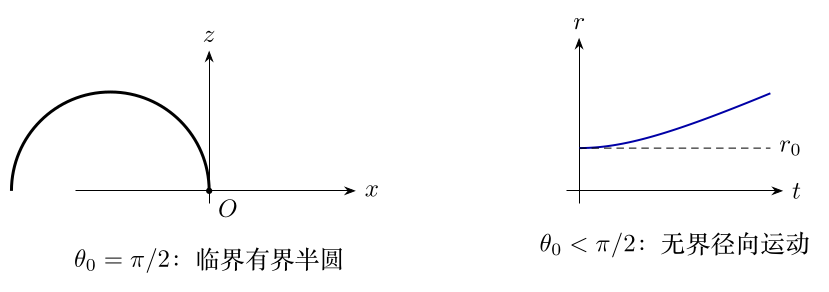

> 本文件由项目已校订的LaTeX题干、参考解答和TikZ图件生成。评分时以本文件为主要阅读文本；需核对原始措辞时查看包内对应届次原始PDF。

# 第40届复赛第5题：电偶极子场中点电荷运动

## 题干

质量为 $m$、电荷量为 $e$ 的正点电荷在固定于原点 $O$ 的电偶极子场中运动，电偶极矩 $\boldsymbol p$ 沿 $z$ 轴正向。设点电荷的位置矢量为 $\boldsymbol r(t)$，其大小为 $r(t)$，与 $\boldsymbol p$ 的夹角为 $\theta(t)$。已知 $r(0)=r_0>0$、$\theta(0)=\theta_0$，真空介电常量为 $\varepsilon_0$。电偶极子的电场和电势分别为 $$\boldsymbol E=\frac{3(\boldsymbol p\cdot\hat{\boldsymbol r})\hat{\boldsymbol r}-\boldsymbol p}
{4\pi\varepsilon_0r^3},
\qquad
\varphi=\frac{\boldsymbol p\cdot\boldsymbol r}{4\pi\varepsilon_0r^3},$$ 其中 $\hat{\boldsymbol r}$ 为 $\boldsymbol r$ 的单位方向矢量。

（1）假定点电荷在垂直于 $z$ 轴的平面内绕 $z$ 轴作匀速圆周运动，确定 $\theta_0$ 以及圆周运动速度 $v_0$。

（2）假定 $t=0$ 时点电荷静止：（i）求角动量大小 $L(\theta)$；（ii）求径向速率 $v_r(r)$；（iii）求运动有界的条件，并确定边界情形下的竖直平面轨道；（iv）运动无界时求 $r(t)$。

## 参考解答整理

#### （1）匀速圆周运动。

$z$ 向合力为零给出 $\cos\theta_0=\pm1/\sqrt3$；向心力方向要求取负根，故 $$\boxed{\cos\theta_0=-\frac1{\sqrt3},\qquad v_0=\sqrt{\frac{3ep}{6\pi\varepsilon_0mr_0^2}}}.$$

#### （2）（i）角动量随极角的变化。

角动量定理给出 $$\boxed{L^2=\frac{mep}{2\pi\varepsilon_0}(\cos\theta_0-\cos\theta)}.$$

#### （2）（ii）径向速率。

能量守恒进而给出 $$\boxed{v_r^2=\frac{ep\cos\theta_0}{2\pi m\varepsilon_0}\left(\frac1{r_0^2}-\frac1{r^2}\right)}.$$

#### （2）（iii）有界条件与临界轨道。

所以 $\theta_0\ge\pi/2$ 时运动有界；临界 $\theta_0=\pi/2$ 时 $r=r_0$，轨道为 $\pi/2\le\theta\le3\pi/2$ 的半圆。

#### （2）（iv）无界运动的径向距离。

若 $\theta_0<\pi/2$，则 $$\boxed{r(t)=\sqrt{r_0^2+\frac{ep\cos\theta_0}{2\pi\varepsilon_0mr_0^2}t^2}}.$$

