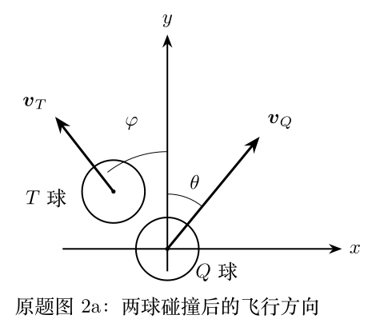
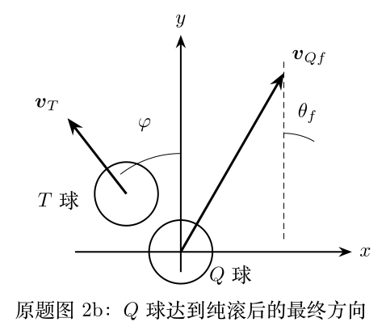
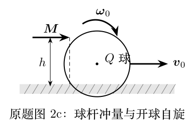

> 本文件由项目已校订的LaTeX题干、参考解答和TikZ图件生成。评分时以本文件为主要阅读文本；需核对原始措辞时查看包内对应届次原始PDF。

# 第41届复赛第2题：台球弹性碰撞、滑动摩擦与30度经验规则

## 题干

质量、半径相同的均匀实心台球 $Q$、$T$ 发生完全弹性碰撞，球间无摩擦。碰撞前 $Q$ 球质心速度 $\boldsymbol v_0$ 沿 $y$ 方向，角速度为 $\boldsymbol\omega_0$。碰撞后，$T$ 球以与 $y$ 轴夹角 $\varphi$ 飞出，$Q$ 球以夹角 $\theta$ 飞出；随后 $Q$ 球在桌面摩擦下过渡至纯滚。

（1）求碰撞后两球飞行方向的夹角、$Q$ 球质心速度和角速度。（2.1）求碰撞后瞬间接触点 $C$ 相对桌面的速度；（2.2）求达到纯滚所需时间；（2.3）求纯滚前的质心轨迹；（2.4）求纯滚后的运动方向。（3）求使开球后立即纯滚的击球高度。（4.1）在该击球条件下求碰撞后至纯滚前的轨迹；（4.2）求最终方向角 $\theta_f$；（4.3）求 $\theta_f$ 的极大值及题定角度附近的数值，以检验30度经验规则。

## 参考解答整理

#### （1）碰撞后的速度与角速度。

取碰撞连心线为 $y'$ 方向。由动量守恒和完全弹性条件，碰撞后的两球飞行方向满足 $$\boxed{\theta+\varphi=90^\circ},\qquad \boxed{\boldsymbol\omega=\boldsymbol\omega_0},$$ 且 $Q$ 球质心速度分量为 $v_{Qx}=v_0\sin\varphi\cos\varphi$、$v_{Qy}=v_0\sin^2\varphi$。答案中的质心系速度几何关系如图所示。

#### （2.1）碰撞后瞬间接触点速度。

碰撞后接触点的初速度为 $$\boldsymbol v_{C0}=(v_0\sin\varphi\cos\varphi-R\omega_{0y})\boldsymbol i+(v_0\sin^2\varphi+R\omega_{0x})\boldsymbol j,$$

#### （2.2）达到纯滚所需时间。

$$\Delta t=\frac{2|\boldsymbol v_{C0}|}{7\mu g}.$$

#### （2.3）与（2.4）纯滚前后的轨迹。

在滑动阶段，摩擦力方向与接触点速度相反，质心轨迹为抛物线；达到纯滚后摩擦力消失，质心作匀速直线运动。

#### （3）使开球后立即纯滚的击球高度。

开球冲量满足 $M=mv_0$、$(h-R)M=I\omega_0$。对均匀实心球 $I=2mR^2/5$，使开球即纯滚的击球高度为 $$\boxed{h=\frac{7R}{5}}.$$

#### （4.1）碰撞后至纯滚前的质心轨迹。

在第（3）问的击球条件下，滑动阶段有 $$x(t)=v_0\sin\varphi\cos\varphi\,t-\frac12\mu g\sin\varphi\,t^2,$$ $$y(t)=v_0\sin^2\varphi\,t+\frac12\mu g\cos\varphi\,t^2.$$

#### （4.2）纯滚后的最终方向。

答案给出 $$\tan\theta_f=\frac{\sin\varphi\cos\varphi}{\sin^2\varphi+\frac25}=\frac{5\sin2\varphi}{9-5\cos2\varphi}.$$

#### （4.3）最大方向角及邻近角度。

极大值出现于 $\cos2\varphi_m=5/9$，即 $\varphi_m=28.1^\circ$；相应 $\theta_m=33.7^\circ$。题目表格的五个结果为：

::: center
   $\varphi$    $\varphi_m$    $\varphi_m+5^\circ$   $\varphi_m+10^\circ$   $\varphi_m-5^\circ$   $\varphi_m-10^\circ$  
  ------------ -------------- --------------------- ---------------------- --------------------- ---------------------- --
   $\theta_f$   $33.7^\circ$      $33.3^\circ$           $32.0^\circ$          $33.1^\circ$           $30.7^\circ$      
:::
