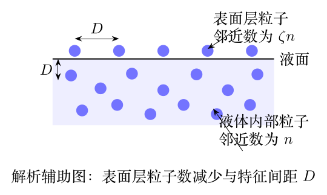

> 本文件由项目已校订的LaTeX题干、参考解答和TikZ图件生成。评分时以本文件为主要阅读文本；需核对原始措辞时查看包内对应届次原始PDF。

# 第41届复赛第3题：油水混合物的表面张力与微观表面层模型

## 题干

题目给出石油与含表面活性物质的水混合后，表面张力系数与温度 $T$、压强 $p$ 的经验关系： $$\frac{\sigma}{10^{-3}\,\mathrm{N\,m^{-1}}}=60+0.065\frac{T}{\mathrm K}-24.0\frac{p}{\mathrm{bar}}+3.15\frac{p^2}{\mathrm{bar}^2},\qquad \beta=7.28\times10^{-3}\,\mathrm{bar\,K^{-1}}.$$ 石油初温为 $100^\circ\mathrm C$，密度、比热容分别为水的 $80\%$、$60\%$。恒容抽油并注入等体积水时，要求在表面张力最小时确定注入水温。第（2）问假定表面张力完全源于表面层和内部粒子邻近数的差异，表面层邻近数为内部的 $\zeta$ 倍，要求导出表面张力表达式。

## 参考解答整理

#### （1）使表面张力最小的注入水温。

恒容条件给出 $dp=\beta\,dT$；又因参考状态有 $p=\beta T$，代入题设关系后得到 $$\frac{\sigma}{10^{-3}\,\mathrm{N\,m^{-1}}}=60-110\times10^{-3}\frac{T}{\mathrm K}+167\times10^{-6}\frac{T^2}{\mathrm K^2}.$$ 令 $d\sigma/dT=0$，有 $T_f=329\,\mathrm K$，即 $t_f\approx56^\circ\mathrm C$。该二次关系的极小点及混合过程由下图辅助说明；该图为解析辅助图，并非原题图。

对等体积的石油和水作热量守恒， $$c_i\rho_i(t_i-t_f)=c_w\rho_w(t_f-t_w).$$ 代入 $c_i=0.6c_w$、$\rho_i=0.8\rho_w$、$t_i=100^\circ\mathrm C$、$t_f\approx56^\circ\mathrm C$，得到注入水温 $$\boxed{t_w\approx35^\circ\mathrm C}.$$

#### （2）表面层微观模型。

设内部每个粒子有 $n$ 个邻近粒子，表面层有 $\zeta n$ 个。形成单位面积表面所需功对应表面层粒子的相互作用能减少；令特征粒子间距为 $D$，则 $D^2=\Delta A_S/N_S$。下图仅用于说明该微观模型的符号关系。

由 $L_m=N_A(|\epsilon|/2)n$、$D^3N_A=\mu/\rho$，最终获得 $$\boxed{\sigma=(1-\zeta)\frac{L_m}{N_A}\left(\frac{\rho N_A}{\mu}\right)^{2/3}}.$$
