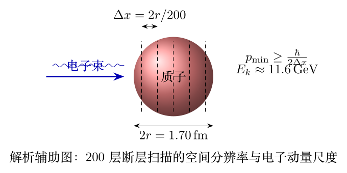

> 本文件由项目已校订的LaTeX题干、参考解答和TikZ图件生成。评分时以本文件为主要阅读文本；需核对原始措辞时查看包内对应届次原始PDF。

# 第41届复赛第4题：高能电子探测与质子散射的不确定度估计

## 题干

第（1）问以质子半径 $r=0.850\,\mathrm{fm}$ 为尺度，要求用电子完成200层断层扫描，确定电子的最小动能，并比较狭义相对论和极端相对论近似。第（2）问讨论质量为 $m_0$、电荷为 $Z_1e$ 的入射粒子与电荷为 $Z_2e$ 的固定靶之间的非相对论散射；要求写出总能量，并在两个质子中心距离的测量不确定度约等于该距离时，估计入射质子的速率。

## 参考解答整理

200层扫描对应空间分辨率 $\Delta x=2r/200=r/100$。由不确定关系与相对论能量动量关系， $$\Delta x\,\Delta p_x\geq\frac{\hbar}{2},\qquad E_{k,\min}=\sqrt{\left(\frac{\hbar c}{2\Delta x}\right)^2+m_e^2c^4}-m_ec^2.$$ 代入 $\Delta x=r/100$ 后，答案给出的最小电子动能为 $$\boxed{E_{k,\min}\approx11.6\,\mathrm{GeV}}.$$ 极端相对论近似为 $E_{k,\min}\approx\hbar c/(2\Delta x)$，与狭义相对论结果的差别远小于1%。答案第9式的焦耳单位指数与同式的 GeV 值不一致，故此处不转写该冲突的焦耳数，仅保留两种表达式共同支持的 GeV 结论。

第（2）问中系统总能量为 $$E_t=\frac{p^2}{2m_0}+\frac{Z_1Z_2e^2}{4\pi\varepsilon_0r}.$$ 令 $p=m_0v$，结合 $\Delta p\geq\hbar/(2\Delta r)$ 和能量守恒条件，得到 $$\frac{\Delta r}{r}=\sqrt{\frac{\varepsilon_0vh}{Z_1Z_2e^2}}.$$ 对质子--质子情形 $Z_1=Z_2=1$，且 $\Delta r/r\simeq1$，答案给出 $$\boxed{v\approx0.044\times10^8\,\mathrm{m\,s^{-1}}\approx0.015c}.$$

