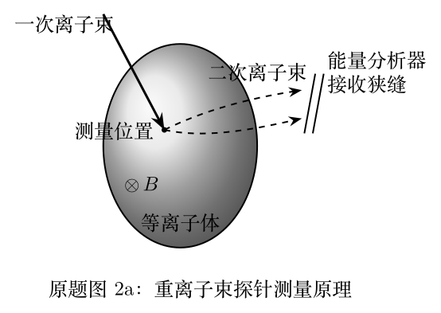

> 本文件由项目已校订的LaTeX题干、参考解答和TikZ图件生成。评分时以本文件为主要阅读文本；需核对原始措辞时查看包内对应届次原始PDF。

# 第42届复赛第2题：重离子束探针与平行板能量分析器

## 题干

重离子束探针向等离子体入射电荷量为 $q_1=e$、初始动能为 $K_1$ 的一次离子束；在测量位置电离产生电荷量为 $q_2=2e$ 的二次离子束，后者由外磁场引出并进入能量分析器。（1.1）求接收点水平距离；（1.2）确定二级聚焦条件；（1.3）分析入射偏移与接收偏移的关系。（2.1）在工程安装误差和动能波动下求中心入射 $l=0$ 对应的接收偏移 $s$；（2.2）由接收板上、下半平面电流反推二次离子动能；（2.3）由电离过程的能量守恒求等离子体电势。

## 参考解答整理

#### （1.1）至（1.3）平行板分析器与二级聚焦。

在板间均匀电场中，二次离子以角度 $\theta_I$ 入射。由斜抛运动与 $K_2=Mv^2/2$，其接收点水平距离为 $$X_D(\theta_I)=\frac{2K_2d\sin(2\theta_I)}{q_2V_A}+(Y_{D1}+Y_{D2})\cot\theta_I.$$ 二级聚焦要求 $X_D$ 对入射角微扰的一次、二次项均消失，答案给出 $$\theta_I=\frac\pi6,\qquad V_A=\frac{K_2d}{2q_2(Y_{D1}+Y_{D2})},\qquad X_D=3\sqrt3(Y_{D1}+Y_{D2}).$$ 若入射位置相对狭缝中心偏移 $l$，接收板位置偏移满足 $$s=-\frac{\sin(\theta_I+\theta_a)}{\sin(\theta_I+\theta_b)}l.$$

#### （2.1）中心入射时的接收偏移。

一般安装条件下，对中心入射 $l=0$， $$s=\frac{X_D\tan\theta_I-(Y_{D1}+Y_{D2})-4K_2d\sin^2\theta_I/(q_2V_A)}{\cos\theta_b\tan\theta_I+\sin\theta_b}.$$

#### （2.2）由上下半平面电流反推动能。

通过上、下半平面电流 $i_U,i_L$ 的分配，答案将二次离子动能写为 $$\begin{aligned}
K_2={}&\frac{q_2V_A}{4d\sin^2\theta_I}\biggl\{\frac w2\frac{i_U-i_L}{i_U+i_L}(\cos\theta_a\tan\theta_I+\sin\theta_a)\\
&\qquad+X_D\tan\theta_I-(Y_{D1}+Y_{D2})\biggr\}.
\end{aligned}$$

#### （2.3）测量位置处的等离子体电势。

电离前后忽略电子动能、离化能和其他损失时，$K_1-q_1\Phi\simeq K_2-q_2\Phi$，故测量位置处的电势为 $$\boxed{\Phi=\frac{K_2-K_1}{q_2-q_1}=\frac{K_2-K_1}{e}}.$$
