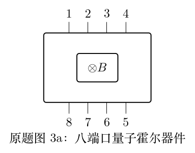
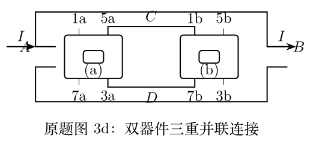

> 本文件由项目已校订的LaTeX题干、参考解答和TikZ图件生成。评分时以本文件为主要阅读文本；需核对原始措辞时查看包内对应届次原始PDF。

# 第42届复赛第3题：量子霍尔器件的接触电阻与并联测量

## 题干

题目把八端口量子霍尔器件等效为含理想电源、端口固有电阻 $r=R_H/2$ 和接触电阻 $R_{ci}$ 的电路。（1）寻找不受接触电阻影响的单器件测量接法并证明。（2.1）比较两个器件在连接开关断开与闭合时的霍尔电阻及误差阶。（2.2）研究三重并联系统的霍尔电阻，并证明接触电阻造成的相对误差阶数。

## 参考解答整理

#### （1）不受接触电阻影响的接法。

例如在端口1、5通电流，在端口3、7测电压，答案给出 $$R_{1,5;3,7}=2r=R_H,$$ 该接法与端口接触电阻无关。

#### （2.1）双器件连接的开关比较。

双器件连接中，开关断开时 $$R_{1a,5b;3a,7b}=4r\left[1+\frac{R_{c5a}+R_{c1b}}{4r}\right],$$ 相对误差为 $\epsilon$ 阶；闭合7a与3b之间连接后，修正项改为两组接触电阻的乘积，故相对误差为 $\epsilon^2$ 阶。

#### （2.2）三重并联的接触电阻误差。

三重并联连接下，在题设 $R_{c5a}=R_{c5b}=R_{c6a}=R_{c6b}=R_{c7a}=R_{c7b}=0$ 条件下，答案得到 $$\begin{aligned}R_{A,B;C,D}=r\biggl[1+&\frac{(R_{c1a}-R_{c1b})(R_{c2a}+R_{c2b})(R_{c3a}-R_{c3b})}{(4r+R_{c1a}+R_{c1b})}\\&\times\frac1{(4r+R_{c2a}+R_{c2b})(4r+R_{c3a}+R_{c3b})}\biggr].\end{aligned}$$ 因此相对误差为 $\epsilon^3$ 阶，显示并联拓扑对接触电阻误差的逐阶抑制。
