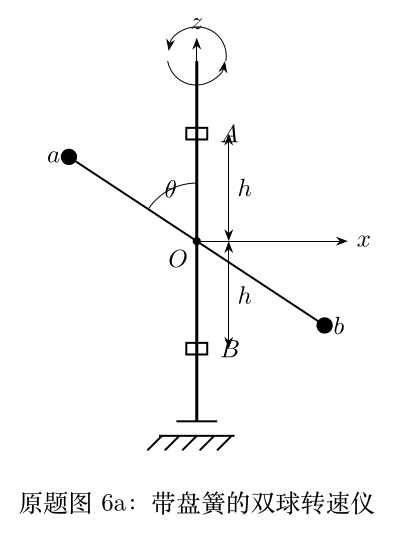

> 本文件由项目已校订的LaTeX题干、参考解答和TikZ图件生成。评分时以本文件为主要阅读文本；需核对原始措辞时查看包内对应届次原始PDF。

# 第42届复赛第6题：带盘簧的双球转速仪

## 题干

转速仪的竖直转轴由轴承 $A,B$ 约束；质量为 $m_1,m_2$ 的小球固定在长为 $2l$ 的细杆两端，细杆中心绕 $O$ 点水平轴转动，并受回复力矩 $k\theta$。（1.1）求以固定倾角 $\theta_0$ 匀速转动的角速度及其存在条件；（1.2）求角动量与轴承受力。（2.1）求等质量双球受冲击后的初始角速度变化率；（2.2）求小振动频率；（2.3）求转轴角速度 $\omega(t)$ 至振幅 $\delta_0$ 的一阶近似。

## 参考解答整理

#### （1.1）匀速转动角速度与存在条件。

匀速转动的力矩平衡给出 $$\omega_0=\sqrt{\frac{k\theta_0-(m_1-m_2)gl\sin\theta_0}{(m_1+m_2+M/3)l^2\sin\theta_0\cos\theta_0}}.$$ 根号内必须为正；因此需分别结合 $m_1>m_2$、$m_1\leq m_2$ 以及 $\theta_0$ 位于 $\pi/2$ 两侧讨论允许范围。

#### （1.2）角动量与轴承受力。

相对 $O$ 点的总角动量为 $$\boldsymbol L=(m_1+m_2+M/3)l^2\sin\theta_0\,\omega_0(\cos\theta_0\boldsymbol e_x+\sin\theta_0\boldsymbol e_z).$$ 系统质心到 $O$ 点的距离为 $$r_C=\frac{m_1-m_2}{m_1+m_2+M}l,$$ 故平动方程给出 $$F_{Ax}+F_{Bx}=(m_1-m_2)\omega_0^2l\sin\theta_0,
\qquad F_{Ay}+F_{By}=0.$$ 再由相对 $O$ 点的角动量定理，或对轴承力与盘簧力矩列矩方程，得到 $$h(F_{Ax}-F_{Bx})=k\theta_0,
\qquad F_{Ay}=F_{By}=0.$$ 因此 $$\boxed{F_{Ax}=\frac{(m_1-m_2)\omega_0^2l\sin\theta_0}{2}
+\frac{k\theta_0}{2h}},$$ $$\boxed{F_{Bx}=\frac{(m_1-m_2)\omega_0^2l\sin\theta_0}{2}
-\frac{k\theta_0}{2h}},
\qquad F_{Ay}=F_{By}=0.$$

#### （2.1）冲击后的初始角速度变化率。

当 $m_1=m_2=m$ 时，竖直轴角动量守恒给出 $$\omega(\theta)=\frac{\sin^2\theta_0}{\sin^2\theta}\omega_0.$$ 冲击后的初始角速度变化率满足 $$\Omega_0=\sqrt{\frac{k}{(2m+M/3)l^2}}\sqrt{\theta_0\tan\theta_0\left(\frac{\sin^2\theta_0}{\sin^2\theta_M}-1\right)+\theta_M^2-\theta_0^2}.$$

#### （2.2）细杆的小振动频率。

小幅振动频率为 $$\omega_\theta=\sqrt{\frac{k}{(2m+M/3)l^2}\left[1+\frac{\theta_0(2\cos^2\theta_0+1)}{\sin\theta_0\cos\theta_0}\right]}.$$

#### （2.3）转轴角速度的一阶近似。

若 $\theta(t)=\theta_0+\delta_0\sin(\omega_\theta t)$，则一阶近似为 $$\omega(t)\approx\left[1-2\cot\theta_0\,\delta_0\sin(\omega_\theta t)\right]\omega_0.$$
