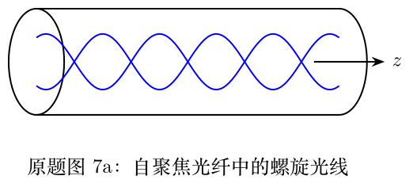

> 本文件由项目已校订的LaTeX题干、参考解答和TikZ图件生成。评分时以本文件为主要阅读文本；需核对原始措辞时查看包内对应届次原始PDF。

# 第42届复赛第7题：自聚焦光纤中的螺旋光线

## 题干

圆柱形自聚焦光纤的折射率满足 $$n(\rho)=n_0\sqrt{1-\alpha^2\rho^2}.$$ 光线以 $z$ 为参数，其柱坐标为 $\rho(z),\theta(z)$。（1）导出 $\rho(z)$、$\theta(z)$ 满足的微分方程。（2）在 $\rho(0)=\rho_0$、$\rho'(0)=k_1>0$、$\theta(0)=0$、$\theta'(0)=k_2>0$ 的条件下求离轴最远距离。（3）在同一边界条件下求直角坐标轨迹 $x(z),y(z)$。

## 参考解答整理

#### （1）光线的微分方程。

几何共面条件给出角向方程 $$\rho\theta''+2\rho'\theta'=0,\qquad \frac{\mathrm d}{\mathrm dz}(\rho^2\theta')=0.$$ 折射定律给出另一条方程 $$\frac{\mathrm d}{\mathrm dz}\left[\frac{n}{\sqrt{\rho'^2+\rho^2\theta'^2+1}}\right]=0.$$ 于是两个不变量可写为 $$\rho^2\theta'=c_1=\rho_0^2k_2,\qquad
\frac{n}{\sqrt{\rho'^2+\rho^2\theta'^2+1}}=c_2.$$

#### （2）离轴最远距离。

在最远处 $\rho'=0$，答案给出 $$\rho_{\max}=\sqrt{\frac{(n_0^2-c_2^2)+\sqrt{(n_0^2-c_2^2)^2-4n_0^2\alpha^2c_1^2c_2^2}}{2n_0^2\alpha^2}}.$$

#### （3）直角坐标轨迹。

令 $$q=\alpha\sqrt{\frac{k_1^2+\rho_0^2k_2^2+1}{1-\alpha^2\rho_0^2}},$$ 直角坐标轨迹可写成 $$x(z)=\rho_0\cos(qz)+\frac{k_1}{q}\sin(qz),\qquad
y(z)=\frac{\rho_0k_2}{q}\sin(qz).$$
