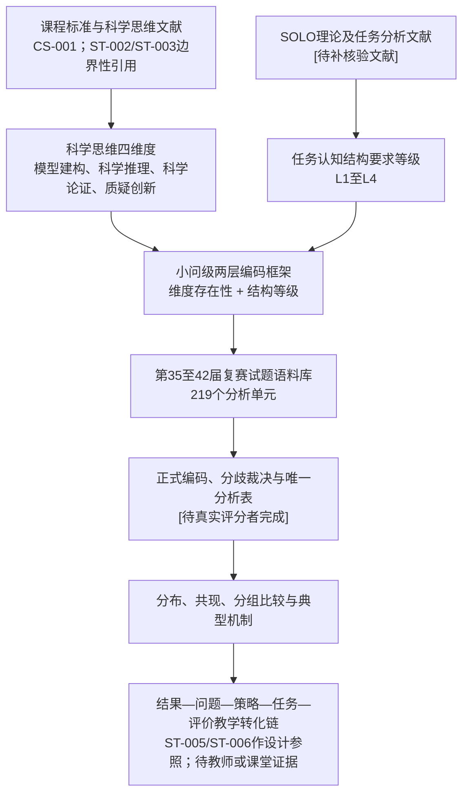

# 第二章 理论基础与分析框架

本章拟回答的问题是：为什么可以从“科学思维维度”和“认知结构要求”两个层面分析物理竞赛复赛试题，以及这些理论概念如何被转化为可编码、可复核的分析框架。

当前版本为核验式草稿。课程标准科学思维要素已完成官方来源核验；ST-002、ST-003、ST-005、ST-006和METH-004已有阅读笔记并只用于其可支持的边界性主张；项目也已形成当前编码—证据链。`SOLO-001`已限于原书第2章关键页阅读，`SOLO-002`已完成受限全文阅读；五篇国内竞赛研究已限于用户提供PDF的E1页码级映射，`PCOMP-001`也已读但因文本层劣化未纳入正文候选，`PCOMP-005`及目标版本为2018年第4版的`METH-001`仍待核验。因此，本章中的文献性表述仍需保留来源ID、`[待补核验文献]` 或边界说明，不能把题录、摘要或项目内编码替代为理论证据。

## 2.1 科学思维理论

本研究暂以“模型建构、科学推理、科学论证、质疑创新”四个方面组织试题认知要求分析。教育部《普通高中物理课程标准（2017年版2020年修订）》将科学思维列为物理学科核心素养之一，并把上述四项列为科学思维的主要要素；该官方来源已在 `02_literature/reference_verification.csv` 与 `02_literature/literature_matrix.csv` 中登记。[引文占位：CS-001；支持科学思维四维度课程标准依据；正式格式待学校规范] 后续仍需补充物理教育研究和科学思维测评文献，说明这些课程要素如何转化为本研究的试题编码指标。[待补核验文献]

在本研究中，科学思维不是被处理为学生已经拥有的稳定能力，而是被处理为试题任务对解题者提出的认知活动要求。换言之，论文分析的是“题目要求学生做什么样的思考”，而不是直接测量“学生实际达到了什么思维水平”。科学推理和科学思维测评研究可为这一边界提供有限支持：学生能力判断需要专门测评任务、作答数据和模型检验，不能由试题文本直接推出。[引文占位：ST-002、ST-003；支持任务要求与学生表现区分；不引用未复核图表号] 这一边界对后续编码非常重要：如果没有学生作答、访谈或课堂材料，就不能把试题编码结果写成学生能力分布。

四个维度的操作化方向如下：

| 维度 | 暂定含义 | 进入正式正文前的证据要求 |
|---|---|---|
| 模型建构 | 从情境中确定研究对象、边界条件、变量关系和理想化假设 | 课程标准或科学思维文献支持；编码手册正反例；正式评分者一致性 |
| 科学推理 | 根据物理规律、题设条件和数学关系建立条件到结论的链条 | 科学推理或物理问题解决文献支持；正式编码证据 |
| 科学论证 | 通过理由、比较、检验、边界分析或假设辩护支持结论 | 科学论证研究支持；与常规推导的边界说明 |
| 质疑创新 | 在题目要求下处理假设、比较替代解释、修正模型或提出方案 | 创新思维、模型修正或开放任务研究支持；保守编码边界 |

正式写作时，本节不能只罗列定义，还需要说明这些维度为什么适合分析复赛试题、为什么不能简单等同于知识点、难度或解法步骤。

## 2.2 SOLO理论及适用边界

SOLO理论在本研究中只作为“认知结构复杂性”的启发来源，用于帮助区分试题任务中要素数量、要素关系和迁移拓展要求的不同层级。已核对Biggs与Collis（1982）原书第2章印刷页22至31：作者将假设认知结构与对特定学习任务的实际反应结构区分，并强调SOLO水平描述的是特定时间的表现质量而不是学生的恒定标签。因此，本研究不能把竞赛试题编码或参考解答直接写成学生学习结果等级；对原书反应结构的任务分析迁移只能操作化为“SOLO启发的任务认知结构要求等级”。[引文占位：SOLO-001；原书印刷页22至31；仅支持反应结构与学生标签、任务要求之间的边界及层级结构线索，不直接验证本项目L1至L4]

本研究不把SOLO层次直接写成学生学习结果等级，也不把一整道试题简单标成某个SOLO层次。原因有三点：

1. 本研究材料是试题和参考解答，不是学生真实作答；
2. 同一道大题中的不同小问可能要求不同的认知结构；
3. 同一小问可能同时涉及模型建构、推理、论证等多个维度，且各维度的结构深度并不必然相同。

已读的相邻应用研究表明，SOLO可以被用于描述试题或测评项目预设的认知复杂性，但分析对象必须明确为任务要求而非学生实际作答；任务的结构复杂性也不能由经验难度、分值、公式数量或区分度直接替代。[引文占位：SOLO-APP-001、SOLO-PHY-001；仅支持任务要求与学生表现、经验难度的区分] 这些研究分别处于巴西小学数学项目和单道高中物理题语境，不能为本项目的L1至L4定义、竞赛语料分布或框架效度提供直接证据。

因此，项目内部暂采用“SOLO启发的任务认知结构要求等级”：

| 等级 | 暂定名称 | 在试题分析中的含义 | 边界提醒 |
|---|---|---|---|
| L1 | 单一要素要求 | 主要调用一个明确对象、关系或判断 | 不等于题目简单；只表示该维度的结构要求较单一 |
| L2 | 多要素并列要求 | 需要并列处理多个对象、条件或关系 | 多个公式并列不必然形成整合 |
| L3 | 多要素关联整合要求 | 需要把多个条件、规律或表征组织为完整链条 | 需要有明确关系整合证据 |
| L4 | 抽象迁移或拓展要求 | 需要在陌生情境中迁移、修正、一般化或构造方案 | 不能因背景新颖或计算复杂而自动判为L4 |

Biggs与Collis关于校本课程与评价的讨论同样把SOLO用于表述课程目标和学生在具体主题中的表现层级，而非把题目文本本身视作学生已经达到的学习结果。这一应用背景进一步提示本研究把“任务要求”和“学生表现”分开保存；它不直接给出当前四维编码或L1至L4的效度依据。[引文占位：SOLO-002；PDF页1、11至12；仅支持课程/评价语境中的任务—学生表现边界，不迁移课程目标、学生水平或教学结论]

正式论文仍需补充教育测评应用研究和任务分析争议文献，并解释为什么本研究暂不使用“前结构”作为试题要求等级；已读原书关键章节与`SOLO-002`均不等于本项目L1至L4的外部效度。[待补核验文献]

## 2.3 试题认知要求的分析逻辑

本研究的分析对象是全国中学生物理竞赛复赛试题中的独立小问或经拆分后的分析单元。分析逻辑不是先给题目贴一个总标签，而是先判断每个科学思维维度是否出现，再判断出现维度的认知结构要求等级。

这一逻辑可以表示为四步：

1. 确定分析单元：优先使用独立小问，必要时将复杂小问拆分为可追溯的分析单元；
2. 判断维度存在性：依据题干要求、参考解答必要步骤和图表条件判断某维度是否出现；
3. 判断结构等级：只对已经出现的维度判断L1至L4，不出现的维度不赋等级；
4. 记录判定证据：每条编码必须能回到题干、参考解答或题图证据。

这种“两层编码”的设计意图，是减少把试题难度、计算长度、知识综合度和科学思维要求混为一谈的风险。它也使结果章可以分别报告维度出现、等级分布和维度共现，而不是制造缺乏依据的综合思维总分。内容分析一致性报告文献提示，正式报告不宜只给总体一致性，而应按变量说明样本、训练、指标和分歧处理。[引文占位：METH-004；支持逐变量一致性报告边界；不设定本项目阈值] 但该设计仍需真实评分者一致性和分歧裁决结果支持，才能写成正式方法贡献。

相邻高中物理试题研究还提示，若同时使用题干、情境、图表与参考答案说明任务结构，应公开分析单位、材料范围、判定规则、示例与汇总方式，并把这些任务材料分析与学生作答、正式分值和成绩证据分开记录。[引文占位：SOLO-PHY-002、SOLO-PHY-003；仅支持透明报告与任务—学生表现区分，不采用其SOLO-LPs乘积、分值加权或学生结论] 因此，本研究的全样本主分析仍只报告小问等权的维度出现、等级与共现；第35届评分标准副本只按E1用户提供材料作本届受控敏感性分析，不以相邻研究的加权方法补足其他届次分值。

本节正式定稿前仍需要补充内容分析、评分者一致性和教育测评编码研究的其余文献依据。`METH-002`与`METH-003`已经受限阅读全文，但只支持一致性指标的前提与解释限制；目标版本为2018年第4版的`METH-001`及`METH-005`仍待核验。[待补核验文献：METH-001、METH-005]

国内竞赛试题研究已呈现不同的分析路径：有研究以预赛典型题及其解答过程讨论数理核心素养，也有研究按题型、分值、知识板块和考查内容对预赛试题作统计；在复赛语境中，龚枭以第26至35届复赛理论题为材料使用SOLO分类组织题目分析，张豇萌以第34至38届复赛理论题建立多因素综合难度模型。另有研究在题目统计之外分别使用地区或决赛成绩资料。由此可见，竞赛试题研究需要清楚交代语料阶段、分析单位、分类/赋值规则以及题目文本与成绩资料的关系。[引文占位：PCOMP-002、PCOMP-003、PCOMP-004、PCOMP-007、PCOMP-008；PDF页码见`physics_competition_page_level_claim_map_v1.csv`；仅支持研究对象/方法透明度与题目—成绩边界]
从研究对象看，预赛与复赛不能被视为可直接合并的同一语料。凌国亮等以第31、32届预赛典型题及其解答过程讨论数理核心素养，属于以少量案例展示题目要求的路径；凌国亮的预赛研究则按2014至2018年预赛题的题型、分值、知识板块和考查内容组织统计。两类研究共同说明，竞赛题研究至少应交代所处阶段、材料范围和分析变量，但其预赛语料、分值结构和素养判断不构成本研究复赛小问级编码的直接依据。[引文占位：PCOMP-004、PCOMP-007；PDF第1/4页与第5/15/18页；仅支持预赛典型题/系统统计两种路径及透明报告边界]

复赛研究同样存在不同的分析取向。龚枭将第26至35届复赛理论题作为材料并以SOLO分类组织分析，说明国内已有面向复赛理论题的SOLO相关任务研究；张豇萌以第34至38届复赛理论题和八因素综合难度模型开展统计，显示复赛题也可以在公开因素和赋值规则的前提下进行难度研究。二者与本研究的共同点是均需面对复赛题语料、单位与规则的说明问题；差异在于，本研究不采用整题SOLO分类、八因素赋值或综合难度总分，而是以可定位小问为单位，分别判断四个维度是否出现及其任务结构要求。[引文占位：PCOMP-002、PCOMP-008；PDF第12/15/24页与第20/23/24/32页；仅支持复赛研究对象、操作规则公开与框架差异]

唐路的研究还将复赛/决赛题目统计、地区或决赛成绩统计和案例分析并列，其后续页面出现具体小题成绩表。这个例子不是用来转述成绩或判断题目难易，而是提醒本研究将题目文本、参考解答、编码记录和任何未来学生表现材料分开保存与报告：题目任务要求的编码不能替代学生得分、样本表现或地区比较。本研究目前没有学生成绩资料，因此第四章只呈现题目任务要求，任何关于学生能力或教学效果的判断均不在本章证据范围内。[引文占位：PCOMP-003；PDF第18/63页；仅支持题目、成绩和案例应分链记录]

这些相邻研究不能直接给出本项目的四维编码、SOLO启发等级或结果结论。其预赛/复赛样本、整题或典型题单位、分值口径、SOLO/综合难度赋值及地区成绩资料均与本项目不同。本研究因此只以独立小问为分析单位，分别保存题目—参考解答编码与任何未来学生表现材料；不使用相邻研究的分布、难度总分、成绩、相关或教学建议来替代本项目证据。

## 2.4 维度、指标和等级

项目已经形成 `04_framework/coding_manual_v2_internal.md` 和 `04_framework/codebook_v2_internal.csv`，作为内部分析准备版本。该版本明确了四个科学思维维度、L1至L4等级、通用排除规则和编码记录要求。

该框架已有RATER-A/B编码回填、ADJ-01裁决、ADJ-02受控更正和876条当前编码—证据链，但评分者身份、独立性及实际过程均只能按自声明登记，项目无法独立验证；同时框架尚无外部专家效度证据。因此，第二章只能将其描述为项目内可追溯的操作化框架，不能写成已经完成外部效度检验的正式工具。

本研究当前的指标结构如下：

| 层次 | 编码对象 | 主要输出 | 正式使用条件 |
|---|---|---|---|
| 维度存在性 | 每个分析单元是否出现四类科学思维要求 | 是/否与判定证据 | 正式评分者独立编码和一致性检验 |
| 结构等级 | 出现维度的认知结构要求深度 | L1至L4与相邻等级说明 | 分歧裁决和正式手册冻结 |
| 组合关系 | 同一小问中多个维度是否共现 | 共现表和典型组合 | 唯一裁决后分析表 |
| 案例机制 | 高代表性小问的题设机制 | 题干证据、解答步骤和机制解释 | 正式案例选择协议和证据表 |

正式文本中，维度和等级的每一项定义都应配套三类材料：理论来源、操作定义、正反例或边界例。当前只有内部操作定义相对完整，理论来源和真实评分者证据仍待补足。

## 2.5 理论框架图

本研究的理论框架可以概括为“课程与文献概念到编码框架，再到试题结果与教学转化”的链条。

该框架图当前表达的是研究设计逻辑，不是已经完成的证据链。图中涉及正式编码、教师证据和课堂证据的节点仍处于待完成状态。

## 2.6 本章小结

本章当前建立了第二章的理论写作骨架：先说明科学思维四维度的操作化方向，再说明SOLO理论在本研究中只用于启发任务认知结构等级，随后提出小问级“两层编码”的分析逻辑。

当前可以保留为设计边界的是：明确研究对象是“试题认知要求”而非学生真实能力；明确维度存在性与等级深度分开编码；明确不建立无依据的综合总分。这些边界目前分别有课程标准、科学思维测评和内容分析一致性报告文献的有限支撑。[引文占位：CS-001、ST-002、ST-003、METH-004；仅支持边界，不支持正式结果] 当前不能保留为定稿结论的部分是：未经阅读全文支持的文献结论、未经真实评分者检验的方法优势、专家审查或评分者一致性的完成性表述。

下一步需要继续完成文献核验闭环：补齐SOLO任务分析争议文献，判断已读`PCOMP-001`是否需要在具备逐句页码条件后纳入，并取得`PCOMP-005`、`METH-001`目标2018年第4版和其他待核方法来源；随后把可支持正文主张的材料逐项登记到 `02_literature/literature_matrix.csv` 和 `reference_verification.csv`。只有当文献证据与主张证据矩阵闭合后，本章才能从核验式草稿转为正式文献综述。
