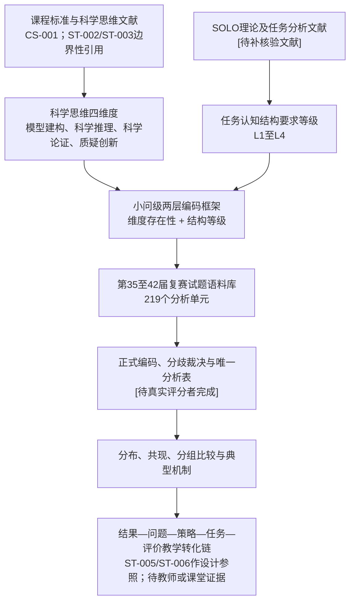

# 第二章 理论基础与分析框架

本章拟回答的问题是：为什么可以从“科学思维维度”和“认知结构要求”两个层面分析物理竞赛复赛试题，以及这些理论概念如何被转化为可编码、可复核的分析框架。

当前版本为核验式草稿。课程标准科学思维要素已完成官方来源核验；ST-002、ST-003、ST-005、ST-006和METH-004已有阅读笔记并只用于其可支持的边界性主张；项目也已形成当前编码—证据链。SOLO原始理论、物理竞赛试题研究及其余内容分析方法文献仍未完成全文核验。因此，本章中的文献性表述仍需保留来源ID、`[待补核验文献]` 或边界说明，不能把题录、摘要或项目内编码替代为理论证据。

## 2.1 科学思维理论

本研究暂以“模型建构、科学推理、科学论证、质疑创新”四个方面组织试题认知要求分析。教育部《普通高中物理课程标准（2017年版2020年修订）》将科学思维列为物理学科核心素养之一，并把上述四项列为科学思维的主要要素；该官方来源已在 `02_literature/reference_verification.csv` 与 `02_literature/literature_matrix.csv` 中登记。[引文占位：CS-001；支持科学思维四维度课程标准依据；正式格式待学校规范] 后续仍需补充物理教育研究和科学思维测评文献，说明这些课程要素如何转化为本研究的试题编码指标。[待补核验文献]

在本研究中，科学思维不是被处理为学生已经拥有的稳定能力，而是被处理为试题任务对解题者提出的认知活动要求。换言之，论文分析的是“题目要求学生做什么样的思考”，而不是直接测量“学生实际达到了什么思维水平”。科学推理和科学思维测评研究可为这一边界提供有限支持：学生能力判断需要专门测评任务、作答数据和模型检验，不能由试题文本直接推出。[引文占位：ST-002、ST-003；支持任务要求与学生表现区分；不引用未复核图表号] 这一边界对后续编码非常重要：如果没有学生作答、访谈或课堂材料，就不能把试题编码结果写成学生能力分布。

四个维度的操作化方向如下：

| 维度 | 暂定含义 | 进入正式正文前的证据要求 |
|---|---|---|
| 模型建构 | 从情境中确定研究对象、边界条件、变量关系和理想化假设 | 课程标准或科学思维文献支持；编码手册正反例；正式评分者一致性 |
| 科学推理 | 根据物理规律、题设条件和数学关系建立条件到结论的链条 | 科学推理或物理问题解决文献支持；正式编码证据 |
| 科学论证 | 通过理由、比较、检验、边界分析或假设辩护支持结论 | 科学论证研究支持；与常规推导的边界说明 |
| 质疑创新 | 在题目要求下处理假设、比较替代解释、修正模型或提出方案 | 创新思维、模型修正或开放任务研究支持；保守编码边界 |

正式写作时，本节不能只罗列定义，还需要说明这些维度为什么适合分析复赛试题、为什么不能简单等同于知识点、难度或解法步骤。

## 2.2 SOLO理论及适用边界

SOLO理论在本研究中只作为“认知结构复杂性”的启发来源，用于帮助区分试题任务中要素数量、要素关系和迁移拓展要求的不同层级。Biggs与Collis的SOLO原书出版信息已定位，其标题明确指向“观察到的学习结果结构”；1989年关于SOLO用于校本课程开发与评价的论文记录也已定位，摘要层面显示SOLO可用于描述学习任务中表现复杂性的增长。当前已完成公开全文获取审计，但尚未通过图书馆、出版社或其他合法渠道获得并阅读全文；因此，本节仍只能使用“SOLO启发”这一保守表述，不能把本研究的试题编码直接写成学生学习结果等级。

本研究不把SOLO层次直接写成学生学习结果等级，也不把一整道试题简单标成某个SOLO层次。原因有三点：

1. 本研究材料是试题和参考解答，不是学生真实作答；
2. 同一道大题中的不同小问可能要求不同的认知结构；
3. 同一小问可能同时涉及模型建构、推理、论证等多个维度，且各维度的结构深度并不必然相同。

因此，项目内部暂采用“SOLO启发的任务认知结构要求等级”：

| 等级 | 暂定名称 | 在试题分析中的含义 | 边界提醒 |
|---|---|---|---|
| L1 | 单一要素要求 | 主要调用一个明确对象、关系或判断 | 不等于题目简单；只表示该维度的结构要求较单一 |
| L2 | 多要素并列要求 | 需要并列处理多个对象、条件或关系 | 多个公式并列不必然形成整合 |
| L3 | 多要素关联整合要求 | 需要把多个条件、规律或表征组织为完整链条 | 需要有明确关系整合证据 |
| L4 | 抽象迁移或拓展要求 | 需要在陌生情境中迁移、修正、一般化或构造方案 | 不能因背景新颖或计算复杂而自动判为L4 |

正式论文需要补充SOLO理论原文、教育测评应用研究和任务分析争议文献，并解释为什么本研究暂不使用“前结构”作为试题要求等级。[待补核验文献]

## 2.3 试题认知要求的分析逻辑

本研究的分析对象是全国中学生物理竞赛复赛试题中的独立小问或经拆分后的分析单元。分析逻辑不是先给题目贴一个总标签，而是先判断每个科学思维维度是否出现，再判断出现维度的认知结构要求等级。

这一逻辑可以表示为四步：

1. 确定分析单元：优先使用独立小问，必要时将复杂小问拆分为可追溯的分析单元；
2. 判断维度存在性：依据题干要求、参考解答必要步骤和图表条件判断某维度是否出现；
3. 判断结构等级：只对已经出现的维度判断L1至L4，不出现的维度不赋等级；
4. 记录判定证据：每条编码必须能回到题干、参考解答或题图证据。

这种“两层编码”的设计意图，是减少把试题难度、计算长度、知识综合度和科学思维要求混为一谈的风险。它也使结果章可以分别报告维度出现、等级分布和维度共现，而不是制造缺乏依据的综合思维总分。内容分析一致性报告文献提示，正式报告不宜只给总体一致性，而应按变量说明样本、训练、指标和分歧处理。[引文占位：METH-004；支持逐变量一致性报告边界；不设定本项目阈值] 但该设计仍需真实评分者一致性和分歧裁决结果支持，才能写成正式方法贡献。

本节正式定稿前仍需要补充内容分析、评分者一致性和教育测评编码研究的其余文献依据。[待补核验文献：METH-001、METH-002、METH-003、METH-005全文待读]

## 2.4 维度、指标和等级

项目已经形成 `04_framework/coding_manual_v2_internal.md` 和 `04_framework/codebook_v2_internal.csv`，作为内部分析准备版本。该版本明确了四个科学思维维度、L1至L4等级、通用排除规则和编码记录要求。

该框架已有RATER-A/B编码回填、ADJ-01裁决、ADJ-02受控更正和876条当前编码—证据链，但评分者身份、独立性及实际过程均只能按自声明登记，项目无法独立验证；同时框架尚无外部专家效度证据。因此，第二章只能将其描述为项目内可追溯的操作化框架，不能写成已经完成外部效度检验的正式工具。

本研究当前的指标结构如下：

| 层次 | 编码对象 | 主要输出 | 正式使用条件 |
|---|---|---|---|
| 维度存在性 | 每个分析单元是否出现四类科学思维要求 | 是/否与判定证据 | 正式评分者独立编码和一致性检验 |
| 结构等级 | 出现维度的认知结构要求深度 | L1至L4与相邻等级说明 | 分歧裁决和正式手册冻结 |
| 组合关系 | 同一小问中多个维度是否共现 | 共现表和典型组合 | 唯一裁决后分析表 |
| 案例机制 | 高代表性小问的题设机制 | 题干证据、解答步骤和机制解释 | 正式案例选择协议和证据表 |

正式文本中，维度和等级的每一项定义都应配套三类材料：理论来源、操作定义、正反例或边界例。当前只有内部操作定义相对完整，理论来源和真实评分者证据仍待补足。

## 2.5 理论框架图

本研究的理论框架可以概括为“课程与文献概念到编码框架，再到试题结果与教学转化”的链条。

该框架图当前表达的是研究设计逻辑，不是已经完成的证据链。图中涉及正式编码、教师证据和课堂证据的节点仍处于待完成状态。

## 2.6 本章小结

本章当前建立了第二章的理论写作骨架：先说明科学思维四维度的操作化方向，再说明SOLO理论在本研究中只用于启发任务认知结构等级，随后提出小问级“两层编码”的分析逻辑。

当前可以保留为设计边界的是：明确研究对象是“试题认知要求”而非学生真实能力；明确维度存在性与等级深度分开编码；明确不建立无依据的综合总分。这些边界目前分别有课程标准、科学思维测评和内容分析一致性报告文献的有限支撑。[引文占位：CS-001、ST-002、ST-003、METH-004；仅支持边界，不支持正式结果] 当前不能保留为定稿结论的部分是：未经阅读全文支持的文献结论、未经真实评分者检验的方法优势、专家审查或评分者一致性的完成性表述。

下一步需要继续完成文献核验闭环：补齐SOLO原始理论全文阅读与关键页码摘录，获取并阅读物理竞赛试题研究全文，继续核验内容分析和评分者一致性方法文献，并把可支持正文主张的材料逐项登记到 `02_literature/literature_matrix.csv` 和 `reference_verification.csv`。只有当文献证据与主张证据矩阵闭合后，本章才能从核验式草稿转为正式文献综述。
