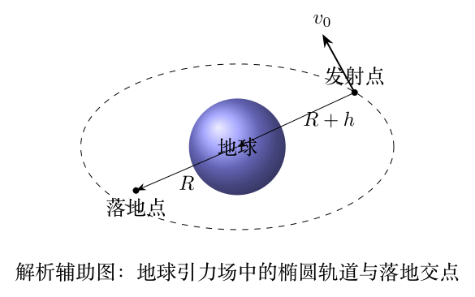

# 第35届复赛第1题：地球引力场中的发射运动

\[\sqrt{\frac{2GMR}{(R+h)(2R+h)}}<v_0<\sqrt{\frac{2GM}{R+h}}.\]

\[v=\sqrt{v_0^2+\frac{2GMh}{R(R+h)}},\qquad v_\theta=\frac{R+h}{R}v_0.\]

\[\alpha=\arccos\left(\frac{(R+h)v_0}{Rv}\right).\]

题面无独立图件；图片为解析辅助图。第35届本题分值边界仍待核实。
