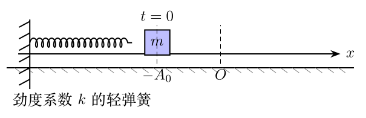

> 本文件由项目已校订的LaTeX题干、参考解答和TikZ图件生成。评分时以本文件为主要阅读文本；需核对原始措辞时查看包内对应届次原始PDF。

# 第35届复赛第2题：弹簧--摩擦阻尼往返运动

## 题干

如图，劲度系数为 $k$ 的轻弹簧左端固定、右端连一质量为 $m$ 的小球。弹簧自然状态时小球位于原点 $O$；小球在粗糙水平面上滑动，动摩擦因数为 $\mu$，最大静摩擦力等于滑动摩擦力。初始时小球静止，弹簧伸长为 $-A_0$，其中 $A_0>0$，重力加速度为 $g$。

1. 小球至多只能向右运动时，求最终位置及 $A_0$ 条件；

2. 小球第一次向右越过原点后至多只能向左运动时，求最终位置及条件；

3. 小球只能完成 $n$ 次往返运动时，求最终位置及条件；

4. 在只能完成 $n$ 次往返运动时，求全过程总路程。

## 参考解答整理

记 $q=\mu mg/k$。每一次由静止位置到下一静止位置的过程中，功能原理给出弹簧势能减少等于摩擦耗散。

#### （1）至多向右运动。

若 $0<A_0\leq q$，初始弹力不足以克服静摩擦，小球停在 $x=-A_0$。若 $A_0>q$，第一次向右停下的位置为 $$x=A_0-2q.$$ 因此在"至多向右运动"的范围内，最终位置分段为 $$x=\begin{cases}
-A_0,&0<A_0\leq q,\\
A_0-2q,&q<A_0\leq2q,\\
A_0-2q,&2q<A_0\leq3q.
\end{cases}$$ 第二、三段分别落在原点左侧（或原点）和右侧；其后均因回复弹力不超过 $\mu mg$ 而静止。

#### （2）至多向左运动。

当 $3q<A_0\leq4q$ 时，第一次向左停下后仍在原点右侧或原点： $$x=4q-A_0\geq0.$$ 当 $4q<A_0\leq5q$ 时，最终停在原点左侧： $$x=4q-A_0=-A_1<0.$$

#### （3）完成 $n$ 次往返后的最终位置。

令第 $n$ 次返回原点左侧的静止位置为 $-A_n$。相邻转折点的伸长量依次相差 $2q$，故 $$A_n=A_0-4nq.$$ 最终位置的完整分段为 $$x=\begin{cases}
4nq-A_0,&4nq<A_0\leq(4n+1)q,\\
A_0-2(2n+1)q,&(4n+1)q<A_0\leq2(2n+1)q,\\
A_0-2(2n+1)q,&2(2n+1)q<A_0\leq(4n+3)q,\\
4(n+1)q-A_0,&(4n+3)q<A_0\leq4(n+1)q.
\end{cases}$$ 其中第二、四段的右端点分别包含原点情形。

#### （4）总路程。

从初态到最终静止位置 $x$ 的能量关系为 $$\frac12kA_0^2-\frac12kx^2=\mu mgs,\qquad s=\frac{k}{2\mu mg}(A_0^2-x^2).$$ 代入上述分段终点，得到 $$s=\begin{cases}
4n(A_0-2nq),&4nq<A_0\leq(4n+1)q,\\
2(2n+1)\bigl[A_0-(2n+1)q\bigr],&(4n+1)q<A_0\leq(4n+3)q,\\
4(n+1)\bigl[A_0-2(n+1)q\bigr],&(4n+3)q<A_0\leq4(n+1)q.
\end{cases}$$
