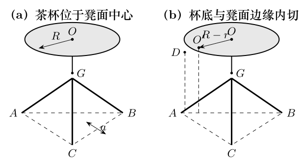

> 本文件由项目已校订的LaTeX题干、参考解答和TikZ图件生成。评分时以本文件为主要阅读文本；需核对原始措辞时查看包内对应届次原始PDF。

# 第36届复赛第1题：旅行车三脚圆凳与茶水杯稳定性

## 题干

半径为 $R$ 的三脚圆凳置于旅行车内，三只凳脚端点构成边长为 $a$ 的水平等边三角形，凳子质心位于轴上 $G$ 点。半径为 $r$、总质量为 $m$ 的圆筒形薄壁茶杯放在凳面中心 $O$ 处；杯底质量为 $m/5$，杯高为 $H$，茶水密度为 $\rho$。求：（1）在茶水尽可能多且保持足够稳定的条件下，茶水的最佳高度；（2）杯底边缘滑移至与凳面边缘内切于 $D$ 点，且 $OD\perp AC$ 时，底板对三只凳脚支持力相对于杯子在中心时的改变量。

## 参考解答整理

#### （1）最佳茶水高度。

以凳面中心为原点、竖直向上为 $y$ 轴。茶杯及茶水整体质心为 $$y_{\mathrm{CM}}=
\frac{\dfrac{4m}{5}\dfrac H2+\rho\pi r^2h\dfrac h2}
{m+\rho\pi r^2h}.$$ 令 $\lambda=\rho\pi r^2$，在质心最低处满足 $\mathrm dy_{\mathrm{CM}}/\mathrm dh=0$。舍去负根得到 $$\boxed{
h_{\max}=\frac{m}{\rho\pi r^2}
\left[\sqrt{1+\frac{4\pi\rho r^2H}{5m}}-1\right].
}$$

#### （2）凳脚支持力的改变量。

记凳子质量为 $M$，并设

$$Q=(m+\lambda h_{\max})g,\qquad P=Mg,\qquad R'=R-r.$$ 杯子滑移后，几何关系和对称性给出 $$O'A=O'B=\frac{a}{\sqrt3},\qquad
O'O''=\frac{a}{2\sqrt3},\qquad N_A=N_C.$$ 竖直方向和绕对称轴的平衡方程为 $$N_A+N_B+N_C=Q+P,$$ $$Q R'+N_B\frac{a}{\sqrt3}-2N_A\frac{a}{2\sqrt3}=0.$$ 与滑移前的平均支持力 $(P+Q)/3$ 比较，得到 $$\boxed{
\Delta N_B=-\frac{2\sqrt3}{3}\frac{R-r}{a}
\sqrt{1+\frac{4\pi\rho r^2H}{5m}}\,mg,
}$$ $$\boxed{
\Delta N_A=\Delta N_C=\frac{\sqrt3}{3}\frac{R-r}{a}
\sqrt{1+\frac{4\pi\rho r^2H}{5m}}\,mg.
}$$ 即靠近滑移方向对侧的凳脚 $B$ 支持力减小，另外两脚的支持力等量增加。
