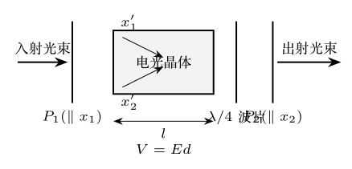

> 本文件由项目已校订的LaTeX题干、参考解答和TikZ图件生成。评分时以本文件为主要阅读文本；需核对原始措辞时查看包内对应届次原始PDF。

# 第37届复赛第8题：电光调制器与调制效率

## 题干

电光晶体的折射率随电场改变。起偏器 $P_1$、电光晶体、$\lambda/4$ 波片和检偏器 $P_2$ 构成调制器；晶体两主轴与偏振方向成 $45^\circ$，如图。已知 $$n_{x_1'}=n_0-\frac12n_0^3\gamma E,\qquad n_{x_2'}=n_0+\frac12n_0^3\gamma E.$$ 求半波电压、四分之一波片的线性化作用，以及等效电路在高频和并联谐振下的调制效率。

## 参考解答整理

#### （1）相位差与半波电压。

两偏振分量通过长度 $l$ 的晶体后，相位差为 $$\Delta\varphi=\frac{2\pi l}{\lambda_0}n_0^3\gamma E
=\frac{2\pi}{\lambda_0}n_0^3\gamma V.$$ 晶体内两分量的总光强保持不变。令 $\Delta\varphi=\pi$，得 $$\boxed{V_\pi=\frac{\lambda_0}{2n_0^3\gamma}.}$$

#### （2）透过率的线性化。

不加 $\lambda/4$ 波片时 $$T=\sin^2\frac{\Delta\varphi}{2}
=\sin^2\left[\frac{\pi V_m\sin\omega_mt}{2V_\pi}\right]
\approx\left[\frac{\pi V_m\sin\omega_mt}{2V_\pi}\right]^2,$$ 与电压呈非线性关系。加入 $\lambda/4$ 波片后引入固定 $\pi/2$ 相位差： $$\boxed{T=\sin^2\frac{\Delta\varphi+\pi/2}{2}
\approx\frac12\left(1+\frac{\pi V_m}{V_\pi}\sin\omega_mt\right).}$$ 因此 $\lambda/4$ 波片将工作点移至近似线性区。

#### （3）高频加载电压。

晶体等效阻抗为 $[1/R+i\omega_mC]^{-1}$，从而 $$|V_c|\approx\frac{|V|}{\sqrt{1+C^2R_m^2\omega_m^2}}.$$ 当 $\omega_m\gg(R_mC)^{-1}$，有 $|V_c|\ll|V|$，调制效率低。

#### （4）并联谐振补偿。

加入电感和负载后 $$\frac1Z=\frac1{R_L}-i\left(\frac1{\omega_mL}-\omega_mC\right).$$ 在 $\omega_m=1/\sqrt{LC}$ 时，$Z$ 取最大值 $R_L$；若 $R_L\gg R_m$，则 $$\boxed{|V_c|\approx|V|.}$$
