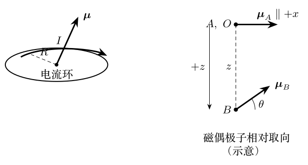

> 本文件由项目已校订的LaTeX题干、参考解答和TikZ图件生成。评分时以本文件为主要阅读文本；需核对原始措辞时查看包内对应届次原始PDF。

# 第38届复赛第4题：两枚小永磁针的相互作用与平衡

## 题干

一枚小永磁针可视为半径很小的电流环，其磁矩大小为 $\mu=IS$，其中 $I$ 为环电流强度、$S=\pi R^2$，磁矩方向与电流环平面垂直并满足右手螺旋关系。两枚小磁针 $A$、$B$ 的磁矩大小均为 $\mu$、质量均为 $m$。取竖直向下为 $z$ 轴正向，$A$ 固定在原点 $O$，磁矩沿 $x$ 轴正向；$B$ 位于 $A$ 正下方。已知真空磁导率 $\mu_0$ 和重力加速度大小 $g$。

设 $B$ 的质心坐标为 $(0,0,z)$，且 $z\gg R$；其磁矩与 $x$ 轴夹角为 $\theta$。求：（1）$A$、$B$ 间的相互作用势能；（2）在 $z$ 不变时的稳定平衡角 $\theta_{\text{稳}}$；（3）当 $\theta=\theta_{\text{稳}}$ 而 $z$ 可变化时的受力平衡位置，并判断其稳定性。

## 参考解答整理

#### （1）远场磁场与相互作用势能。

把 $A$ 看作磁偶极子。由毕奥--萨伐尔定律在 $z\gg R$ 下展开并对环积分，$B$ 所在位置的磁场为 $$\mathbf B_A=-\frac{\mu_0\mu}{4\pi z^3}\,\mathbf e_x.$$ 取 $\boldsymbol\mu_B$ 与磁场垂直时的势能为零，则 $$\boxed{E_p=-\boldsymbol\mu_B\cdot\mathbf B_A
=\frac{\mu_0\mu^2\cos\theta}{4\pi z^3}.}$$

#### （2）磁矩指向的稳定平衡。

在 $z$ 固定时，重力势能不影响对 $\theta$ 的判定，总势能可写为 $$V(\theta)=\frac{\mu_0\mu^2\cos\theta}{4\pi z^3}-mgz.$$ 外力矩大小为 $$M=-\frac{\mathrm dV}{\mathrm d\theta}
=\frac{\mu_0\mu^2\sin\theta}{4\pi z^3}.$$ 因此可能的平衡角为 $\theta=0,\pi$。又有 $$\frac{\mathrm d^2V}{\mathrm d\theta^2}
=-\frac{\mu_0\mu^2\cos\theta}{4\pi z^3}.$$ 在 $\theta=0$ 处二阶导数为负，在 $\theta=\pi$ 处为正，故 $$\boxed{\theta_{\text{稳}}=\pi.}$$

#### （3）竖直方向的受力平衡。

令 $\theta=\pi$，以竖直向下为 $z$ 正向。由 $F=-\mathrm dV/\mathrm dz$ 得 $$F=-\frac{3\mu_0\mu^2}{4\pi z^4}+mg.$$ 令 $F=0$，受力平衡位置为 $$\boxed{z_0=\left(\frac{3\mu_0\mu^2}{4\pi mg}\right)^{1/4}.}$$ 在该处 $$\frac{\mathrm d^2V}{\mathrm dz^2}
=-\frac{3\mu_0\mu^2}{\pi z_0^5}<0.$$ 故该点为势能极大值，对竖直扰动不稳定：$B$ 下移时重力占优而继续下落，上移时磁吸引占优而趋向 $A$。
