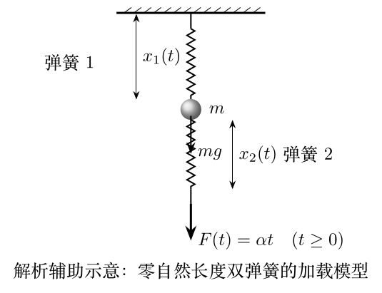

# 第39届复赛第5题：快慢拉动双弹簧断裂模型

## 题目整理

两根相同的零自然长度弹簧以质量 $m$ 的小球相连。弹簧1上端固定，对弹簧2下端加载 $F(t)=\alpha t$。两弹簧达到临界长度即断裂，问题比较慢拉与快拉时哪根先断。

## 解答要点

小球的运动方程为
\[
m\ddot{x}_1=-kx_1+mg+F(t),\qquad \omega^2=\frac{k}{m}.
\]
在 $F(t)=\alpha t$ 下，初始条件 $x_1(0)=mg/k$、$\dot{x}_1(0)=0$ 给出
\[
x_1(t)=\frac{mg}{k}+\frac{\alpha}{k}t-\frac{\alpha}{\omega k}\sin\omega t,
\qquad x_2(t)=\frac{\alpha}{k}t.
\]

故长度差为
\[
\Delta x=x_1-x_2=\frac{mg}{k}-\frac{\alpha}{\omega k}\sin\omega t.
\]

- $\alpha<mg\omega=g\sqrt{km}$ 时，弹簧1必先断；
- $\alpha>mg\omega$ 时，弹簧2有可能先断，且加载越快，可能相位区间越大；
- 临界长度为 $L$ 时，弹簧2必先断的条件为
  \[
  \sin\left(\frac{kL}{\alpha}\sqrt{\frac{k}{m}}\right)>
  \frac{mg}{\alpha}\sqrt{\frac{k}{m}}.
  \]
  将不等号改为等号时，两弹簧可同时达到临界长度。

## 依据

- 题面：`CPHO39-Q05.md` 第3页；
- 答案：第20至23页；
- 题面与答案均无独立图件。两图均为自绘解析辅助图，不是原题截图或答案图。
