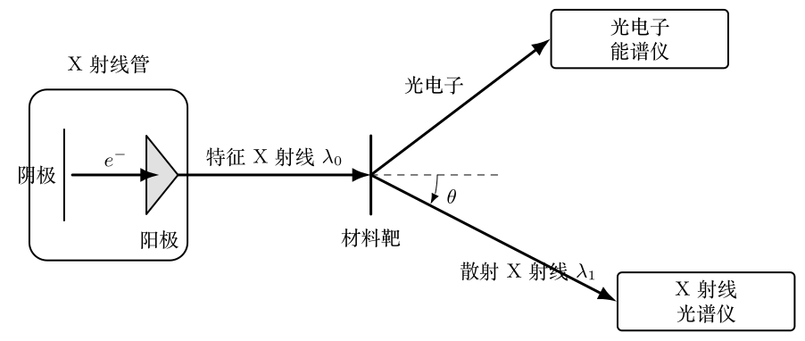
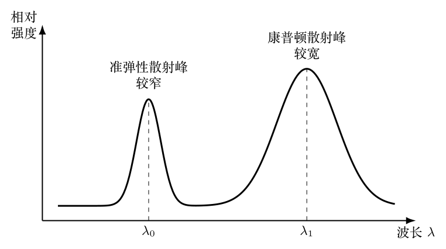

> 本文件由项目已校订的LaTeX题干、参考解答和TikZ图件生成。评分时以本文件为主要阅读文本；需核对原始措辞时查看包内对应届次原始PDF。

# 第40届复赛第8题：X射线谱与康普顿散射

## 题干

采用X射线光谱与光电子能谱方法研究物质结构，仪器结构如图所示。X射线管由电子枪阴极和金属阳极构成，阴极产生的电子经电压加速后撞击金属阳极，产生连续的轫致辐射谱和分立的特征谱。选取特定波长的特征X射线照射材料靶，分别探测出射X射线和光电子。已知 $$R_\infty=10973731\ \mathrm{m^{-1}},\qquad hc=1240\ \mathrm{nm\cdot eV}.$$

#### （1）X射线管。

金属阳极原子的K壳层电子能量为$-20.1\ \mathrm{keV}$。 （i）求使K壳层电子电离并产生$K_\alpha$特征X射线所需的最小加速电压； （ii）求该电压下连续X射线的最短波长； （iii）已知$K_\alpha$光子能量为$17.44\ \mathrm{keV}$，求原子的核电荷数。

#### （2）康普顿散射。

波长为$\lambda_0$的$K_\alpha$射线照射材料靶。将靶电子视为初始静止、静质量为$m$的自由电子，散射光与入射光夹角为$\theta$。求散射光波长$\lambda_1$和光电子动能。

#### （3）散射光谱。

在$\theta=135^\circ$处测得图所示两个光谱峰，峰值波长分别为$\lambda_0$和$\lambda_1$。说明两个峰的来源，并解释$\lambda_1$峰比$\lambda_0$峰宽的原因。

## 参考解答整理

#### （1）（i）最小加速电压。

电子经电压$U$加速后动能为$T_e=eU$。使K壳层电子电离至少需要$20.1\ \mathrm{keV}$，故 $$\boxed{U_{\min}=20.1\ \mathrm{kV}}.$$

#### （1）（ii）连续谱最短波长。

电子动能全部转化为单个光子能量时波长最短： $$eU_{\min}=\frac{hc}{\lambda_{\min}},\qquad
\boxed{\lambda_{\min}=\frac{hc}{eU_{\min}}\approx0.0617\ \mathrm{nm}}.$$

#### （1）（iii）核电荷数。

以$Z^*$表示L壳层电子感受到的有效核电荷数。由莫塞莱关系 $$\frac{1}{\lambda_{K\alpha}}=R_\infty (Z^*)^2
\left(\frac{1}{1^2}-\frac{1}{2^2}\right),
\qquad E=\frac{hc}{\lambda_{K\alpha}},$$ 得到 $$Z^*=\sqrt{\frac{4E}{3hcR_\infty}}\approx41.35.$$ 因为$Z-1<Z^*<Z$且$Z$为整数，所以 $$\boxed{Z=42}.$$

#### （2）散射光波长与光电子动能。

设入射、散射光子的动量分别为$p_0=h/\lambda_0$和$p_1=h/\lambda_1$，散射后电子动量为$\boldsymbol p_2$、总能量为$E_2$。能量与动量守恒给出 $$E_0+mc^2=E_1+E_2,\qquad
\boldsymbol p_0=\boldsymbol p_1+\boldsymbol p_2,
\qquad E_2^2=m^2c^4+p_2^2c^2.$$ 消去电子能量和动量可得康普顿关系 $$\boxed{\lambda_1-\lambda_0
=\lambda_c(1-\cos\theta)
=2\lambda_c\sin^2\frac{\theta}{2}},
\qquad \lambda_c=\frac{h}{mc}.$$ 因此 $$\boxed{\lambda_1=\lambda_0+2\lambda_c\sin^2\frac{\theta}{2}},$$ 光电子动能为 $$\boxed{T_2=\frac{hc}{\lambda_0}-\frac{hc}{\lambda_1}
=\frac{hc\lambda_c(1-\cos\theta)}
{\lambda_0[\lambda_0+\lambda_c(1-\cos\theta)]}}.$$

#### （3）双峰来源与峰宽。

$\lambda_1$峰来自X射线光子与靶电子的康普顿散射，光子向电子传递能量和动量，因而散射光波长变长。$\lambda_0$峰来自光子与整个靶原子的准弹性散射；原子质量远大于电子质量，反冲能量很小，散射光波长近似不变。靶中电子并非全部静止，而具有一定的初始动量分布；不同初始动量使康普顿位移产生展宽，所以$\lambda_1$峰较宽。

## 转写与公式核对说明

题干按第40届试题第5页重排，解答按答案第21至23页整理，题图依据原图8a、8b重新绘制。原参考答案将题面第（3）问误标为"（4）"，本图册按题面编号统一为第（3）问。原参考答案式（20）印为$\lambda_1=\lambda_0-2\lambda_c\sin^2(\theta/2)$，但其前式、后文"散射光波长变长"以及康普顿关系均要求正号；此处保留可追溯说明并采用物理上自洽的正号。
