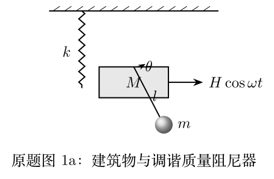

# 第41届复赛第1题：高楼调谐质量阻尼器的受迫振动

\[A=\frac{(\omega_0^2-\omega^2)H}{(\omega_0^2-\omega^2)(k-M\omega^2)-m\omega_0^2\omega^2},\quad \omega_0^2=g/l.\]
最优调谐 $l=Mg/k$。题面经视觉校对：第(2)问频率为 $\sqrt{0.99}$ 倍而非 OCR 误读值；质量比 $m/M=101/9900\approx1/100$。
