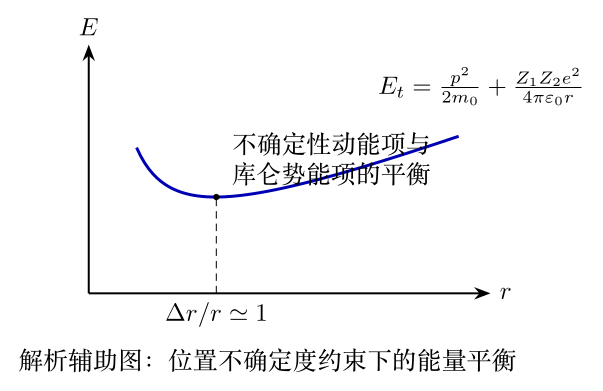

# 第41届复赛第4题：高能电子探测与质子散射的不确定度估计

200层断层扫描对应 $\Delta x=r/100$。由 $\Delta x\,\Delta p_x\geq\hbar/2$ 及相对论能量动量关系，

\[E_{k,\min}=\sqrt{\left(\frac{\hbar c}{2\Delta x}\right)^2+m_e^2c^4}-m_ec^2\approx11.6\,\mathrm{GeV}.\]

极端相对论近似与该结果的差异小于1%。答案页极端近似式的焦耳单位指数与其后的 GeV 值相冲突，本页未继承该冲突的焦耳数。

非相对论散射的总能量为

\[E_t=\frac{p^2}{2m_0}+\frac{Z_1Z_2e^2}{4\pi\varepsilon_0r},\qquad \frac{\Delta r}{r}=\sqrt{\frac{\varepsilon_0vh}{Z_1Z_2e^2}}.\]

两个质子且 $\Delta r/r\simeq1$ 时，入射质子速率为 $v\approx0.044\times10^8\,\mathrm{m\,s^{-1}}\approx0.015c$。原题无独立图件；本页两图均为 TikZ 解析辅助图。
