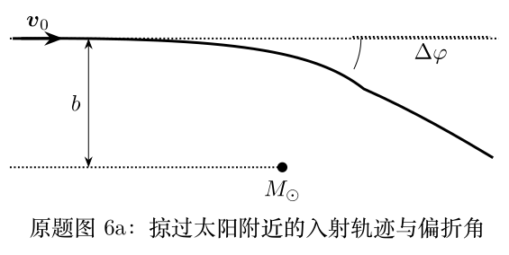

> 本文件由项目已校订的LaTeX题干、参考解答和TikZ图件生成。评分时以本文件为主要阅读文本；需核对原始措辞时查看包内对应届次原始PDF。

# 第41届复赛第6题：太阳引力场中的轨道偏折与星光弯曲

## 题干

题目先在牛顿动力学框架下讨论圆锥曲线轨道 $r(\theta)=p/(1+e\cos\theta)$，再分析以瞄准距离 $b$ 进入太阳系的陨石和掠日星光的偏折；最后借助弱场有效折射率和费马原理重新计算星光偏折。

## 参考解答整理

#### （1）双曲轨道的角度范围。

对 $e>1$，轨道可取范围由 $\cos\theta>-1/e$ 给出，故 $$\theta_{\max}=\arccos(-1/e),\qquad \frac\pi2<\theta_{\max}<\pi.$$

#### （2）用能量和角动量表示轨道参数。

以总能量 $E$ 和角动量 $L$ 表示的轨道参数为 $$p=\frac{L^2}{GMm^2},\qquad e=\sqrt{1+\frac{2EL^2}{G^2M^2m^3}}.$$

#### （3）牛顿框架下的陨石和星光偏折。

对速度 $v_0$、瞄准距离 $b$ 的入射陨石，在 $v_0^2b/(GM_\odot)\gg1$ 条件下，偏折角为 $$\boxed{\Delta\varphi_{\mathrm{meteor}}=\frac{2GM_\odot}{v_0^2b}}.$$ 令 $v_0=c$、$b=R_\odot$，牛顿框架下的星光偏折是 $$\Delta\varphi_{\mathrm{Newton}}=\frac{2GM_\odot}{c^2R_\odot}.$$

#### （4）弱场广义相对论框架下的星光偏折。

弱场广义相对论以 $n_{\mathrm{eff}}(r)=1-2\phi(r)/c^2$、$\phi(r)=-GM_\odot/r$ 描述光程。由费马原理导出的守恒式与无穷远边界条件给出最终偏折 $$\boxed{\Delta\varphi_{\mathrm{GR}}=\frac{4GM_\odot}{c^2R_\odot}=2\Delta\varphi_{\mathrm{Newton}}}.$$
