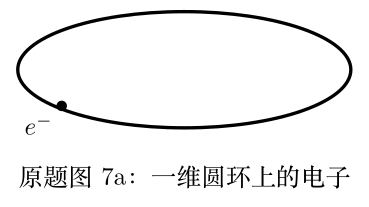
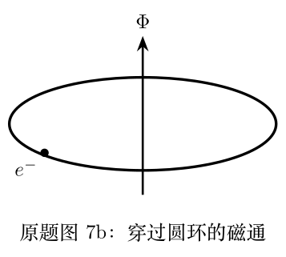

> 本文件由项目已校订的LaTeX题干、参考解答和TikZ图件生成。评分时以本文件为主要阅读文本；需核对原始措辞时查看包内对应届次原始PDF。

# 第41届复赛第7题：超导环磁通量子化与无相互作用电子

## 题干

题目以半径为 $R$ 的一维圆环为对象，电子波函数为 $\psi(x)=\exp(ipx/\hbar)$，其中 $x=R\theta$。（1）由波函数单值性求电子动量的可能取值。（2）向环中通入磁通 $\Phi$，求单电子能量。（3.1）规定任意两个电子动量不同，（3.2）并要求系统总能量最低，据此证明总能量随磁通周期性变化。（4）在 $-h/(2e)\leq\Phi\leq h/(2e)$ 内比较奇、偶电子数的平均能量。（5.1）分析双环体系中奇数或偶数电子分配与配对条件；（5.2）证明题定两种双环构型的平均能量比在电子数趋于无穷大时趋于1。

## 参考解答整理

#### （1）单值性与动量量子化。

圆环闭合使 $\psi(x+2\pi R)=\psi(x)$，因此动量量子化为 $$p_n=\frac{n\hbar}{R},\qquad n\in\mathbb Z.$$

#### （2）磁通中的单电子能级。

通入磁通后，$p'_n=p_n+eA$，且 $\Phi=2\pi RA$，故单电子能量为 $$E_n(\Phi)=\frac{\hbar^2}{2mR^2}\left(n+\frac{e\Phi}{h}\right)^2.$$

#### （3.1）与（3.2）多电子约束及总能量周期。

多电子系统取互不相同的动量量子数并使总能量最小。将磁通平移一个 $h/e$ 时，可用 $n\mapsto n+1$ 保持求和范围不变，因而 $$E_{\mathrm{tot}}\left(\Phi+\frac{h}{e}\right)=E_{\mathrm{tot}}(\Phi).$$

#### （4）奇偶电子数的平均能量。

当 $N=2M+1$ 为奇数且 $-h/(2e)\leq\Phi<h/(2e)$ 时，平均能量可写成 $$\bar E(\Phi)=\frac{e^2\Phi^2}{4\pi^2}\frac{1}{2mR^2}+\frac{\hbar^2}{2mR^2}\frac{M(M+1)}{3}.$$ 故奇数电子数时 $\Phi=0$ 处的平均能量低于 $|\Phi|=h/(2e)$ 处；偶数电子数时结论相反，平均能量在 $|\Phi|=h/(2e)$ 附近取较小值。

#### （5.1）双环电子分配与配对条件。

最后引入配对约束：动量为 $p'$ 和 $-p'$ 的电子必须同时存在或同时不存在。答案表明，两个环电子数均为奇数时，电子数差最小且 $\Phi=0$ 的构型能量最低；两个环电子数均为偶数时，对应最低点在 $\lvert\Phi\rvert=h/(2e)$。对于题设的两种双环构型，常数项分别为

#### （5.2）两种双环构型的平均能量比。

$$C_1=\frac{M(M+1)}{3},\qquad C_2=\frac{M(M+1)}{3}+\frac14,$$ 所以 $\lim_{M\to\infty}C_1/C_2=1$，两种构型的电子平均能量之比也趋于 $1$。
