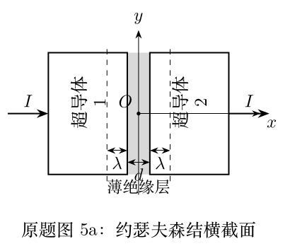
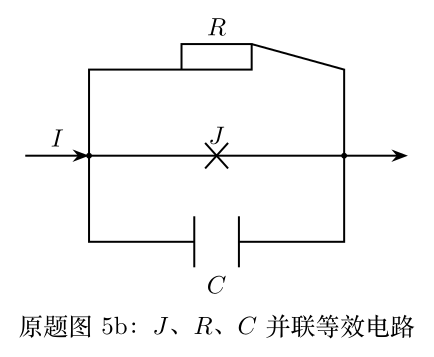

> 本文件由项目已校订的LaTeX题干、参考解答和TikZ图件生成。评分时以本文件为主要阅读文本；需核对原始措辞时查看包内对应届次原始PDF。

# 第42届复赛第5题：约瑟夫森结的相位动力学

## 题干

题目以超导体--薄绝缘层--超导体结构为对象，给出约瑟夫森关系 $$j=j_0\sin\delta,\qquad \frac{\partial\delta}{\partial t}=\frac{2e}{\hbar}U.$$ （1）讨论恒定电压下的交流约瑟夫森效应。（2.1）求外磁场造成的相位空间分布和总电流；（2.2）计入自生磁场并导出约瑟夫森穿透深度。（3.1）建立 $J$、$R$、$C$ 并联模型的相位方程；（3.2）求等效相位势阱、稳定点和小振动频率；（3.3）求最大等离子体频率对应的传播速率比值。

## 参考解答整理

#### （1）交流约瑟夫森效应。

恒定电压 $U_0$ 下， $$\delta(t)=\frac{2eU_0}{\hbar}t+\delta(0),\qquad j(t)=j_0\sin\!\left(\frac{2eU_0}{\hbar}t+\delta(0)\right),\qquad T=\frac{\pi\hbar}{eU_0}.$$

#### （2.1）外磁场中的相位分布与总电流。

若外场 $B_z=B_0$ 且 $U=0$，相位沿结宽的变化为 $$\delta(y)=\delta(0)+\frac{2e(d+2\lambda)B_0}{\hbar}y.$$ 积分电流密度可得总电流的干涉因子；非零的零点外场满足 $$B_0=\frac{n\pi\hbar}{e(d+2\lambda)Y},\qquad n=\pm1,\pm2,\ldots$$

#### （2.2）自生磁场与约瑟夫森穿透深度。

计入自生磁场时， $$\frac{\mathrm d^2\delta}{\mathrm dy^2}=\frac{1}{\lambda_J^2}\sin\delta,\qquad
\lambda_J=\sqrt{\frac{\hbar}{2e\mu_0j_0(d+2\lambda)}}.$$

#### （3.1）RCSJ相位方程。

在RCSJ模型中，三支路电流相加给出 $$C\frac{\hbar}{2e}\frac{\mathrm d^2\delta}{\mathrm dt^2}+\frac{\hbar}{2eR}\frac{\mathrm d\delta}{\mathrm dt}+I_0\sin\delta=I.$$

#### （3.2）相位势阱与小振动频率。

忽略电阻支路时，等效势可取 $$V(\delta)=-\frac{2e}{\hbar C}\left(I\delta+I_0\cos\delta\right)+\text{常量}.$$ 势阱存在条件为 $|I|<I_0$，稳定底部为 $\delta_0=\arcsin(I/I_0)+2n\pi$；小振动满足 $$\omega^2=\frac{2eI_0}{\hbar C}\sqrt{1-\left(\frac{I}{I_0}\right)^2}.$$

#### （3.3）结区电磁波传播速率。

最大等离子体频率对应的传播速率比值为 $$\frac{\bar c}{c}=\sqrt{\frac{d}{\epsilon_r(d+2\lambda)}}=0.055.$$
