# 已完成题目的TikZ图件总览

本页集中展示当前已完成图册条目的原题图和解析辅助图。图片均由 tikz 目录中的可编辑源文件生成。

## 第35届复赛第2题：弹簧--摩擦阻尼往返运动

**原题图：** CPHO35-Q02-figure1.tex

## 第35届复赛第3题：细杆打击中心与撤轴后运动

**原题图：** CPHO35-Q03-figure1.tex

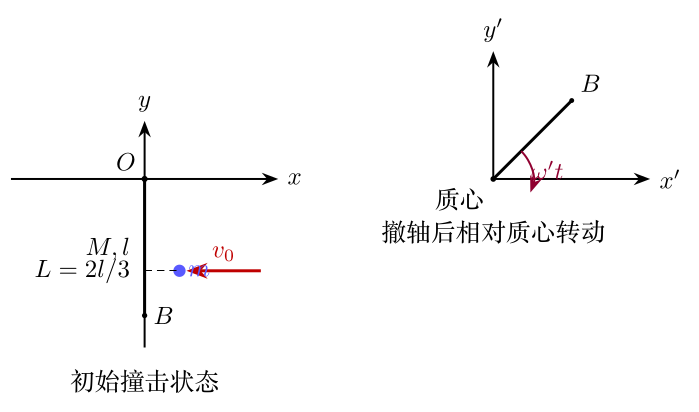

## 第35届复赛第4题：Ioffe--Pritchard 磁阱

**原题图：** CPHO35-Q04-figure1.tex

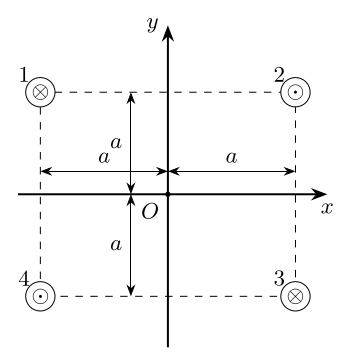

## 第35届复赛第6题：同心球壳辐射与导热

**原题图：** CPHO35-Q06-figure1.tex

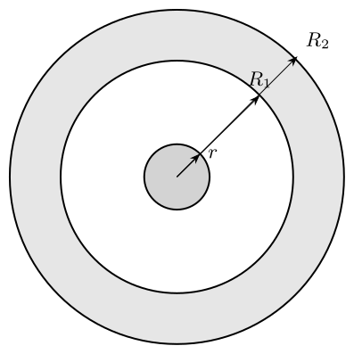

## 第35届复赛第7题：弹簧衍射与DNA X射线衍射类比

**原题图：** CPHO35-Q07-figure1.tex

## 第36届复赛第1题：旅行车三脚圆凳与茶水杯稳定性

**原题图：** CPHO36-Q01-figure1.tex

**解析辅助图：** CPHO36-Q01-solution-forces.tex

## 第36届复赛第2题：农用平板车碰撞与摩擦运动

**原题图：** CPHO36-Q02-figure1.tex

**解析辅助图：** CPHO36-Q02-solution-forces.tex

**解析辅助图：** CPHO36-Q02-solution-geometry.tex

## 第36届复赛第3题：电磁轨道炮加速模型

**原题图：** CPHO36-Q03-figure1.tex

## 第36届复赛第4题：微孔竹板亥姆霍兹共振吸声

**原题图：** CPHO36-Q04-figure1.tex

## 第36届复赛第5题：阶跃型光纤耦合与全反射

**原题图：** CPHO36-Q05-figure1.tex

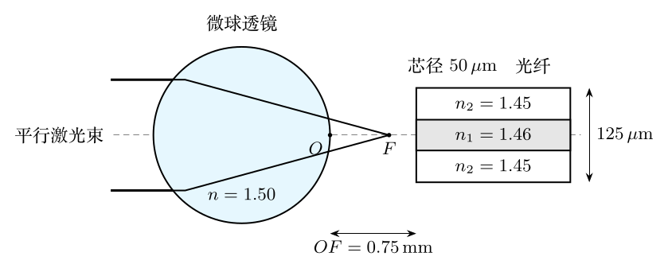

**解析辅助图：** CPHO36-Q05-solution-figures.tex

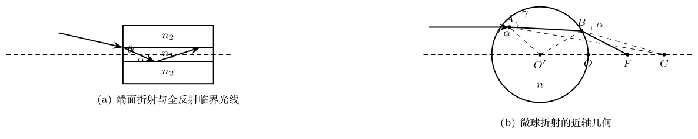

## 第36届复赛第7题：闪电、电离层光环与球形闪电模型

**原题图：** CPHO36-Q07-figure1.tex

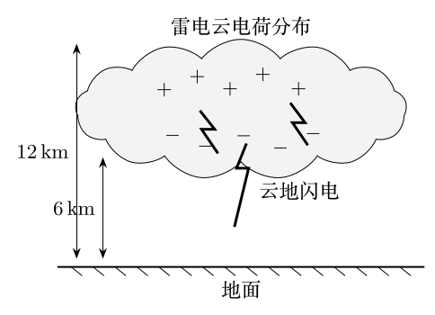

**原题图：** CPHO36-Q07-figure2.tex

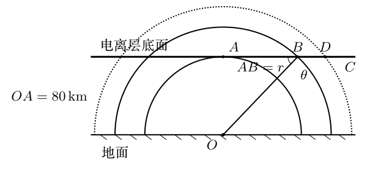

## 第37届复赛第1题：高铁空气弹簧劲度系数模型

**原题图：** CPHO37-Q01-figure1.tex

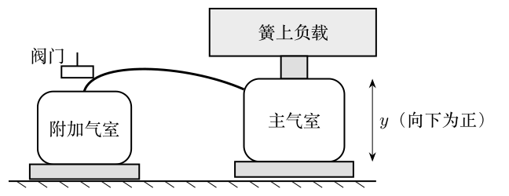

## 第37届复赛第3题：负微分电阻RLC振荡电路

**原题图：** CPHO37-Q03-figure1.tex

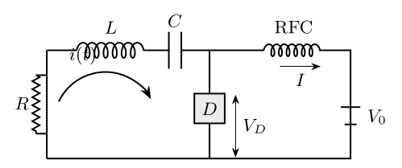

## 第37届复赛第5题：相对论飞行器信号与货物发射

**原题图：** CPHO37-Q05-figure5a.tex

## 第37届复赛第6题：光纤陀螺仪与Sagnac效应

**原题图：** CPHO37-Q06-figure6a.tex

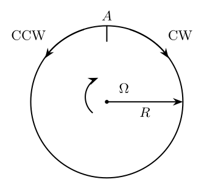

**原题图：** CPHO37-Q06-figure6b.tex

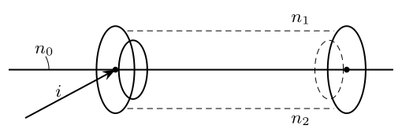

**解析辅助图：** CPHO37-Q06-solution-sagnac.tex

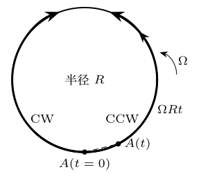

## 第37届复赛第7题：LIGO双黑洞引力波辐射估算

**原题图：** CPHO37-Q07-figure7a.tex

## 第37届复赛第8题：电光调制器与调制效率

**原题图：** CPHO37-Q08-figures.tex

## 第38届复赛第1题：平凸/平凹透镜曲面设计

**原题图：** CPHO38-Q01-figure1a.tex

**解析辅助图：** CPHO38-Q01-solution-figures.tex

## 第38届复赛第2题：玻璃管水银封闭气体加热过程

**原题图：** CPHO38-Q02-figure2a.tex

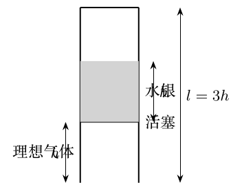

## 第38届复赛第3题：超球与平行硬板的连续弹性碰撞

**原题图：** CPHO38-Q03-figure3a.tex

## 第38届复赛第4题：两枚小永磁针的相互作用与平衡

**原题图：** CPHO38-Q04-figure4a.tex

## 第38届复赛第5题：原子激光制冷与塞曼减速

**原题图：** CPHO38-Q05-figure5a.tex

## 第38届复赛第6题：同轴带电圆筒与电磁角动量

**原题图：** CPHO38-Q06-figure6a.tex

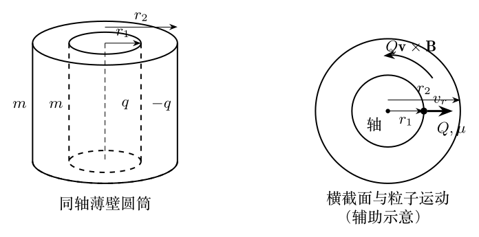

## 第38届复赛第7题：汽车斜坡加速与车轮附着条件

**原题图：** CPHO38-Q07-figure7a.tex

## 第38届复赛第8题：电动汽车电机与加速效率

**原题图：** CPHO38-Q08-figure8a.tex

## 第39届复赛第1题：迈克尔逊干涉仪的相位突变与折射率测量

**原题图：** CPHO39-Q01-figures.tex

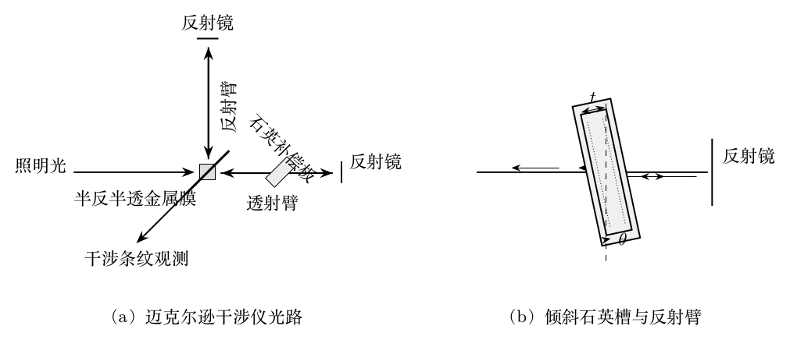

**解析辅助图：** CPHO39-Q01-solution-refraction.tex

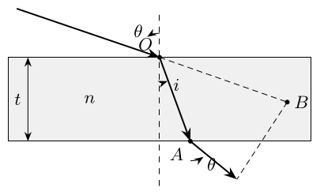

## 第39届复赛第2题：通电螺线管弹簧的平衡与等效劲度

**原题图：** CPHO39-Q02-spring-circuits.tex

## 第39届复赛第3题：斜面上实心球的反复弹性碰撞

**原题图：** CPHO39-Q03-figures.tex

## 第39届复赛第4题：旋转圆环上铰接细杆的平衡与稳定性

**解析辅助图：** CPHO39-Q04-solution-cot.tex

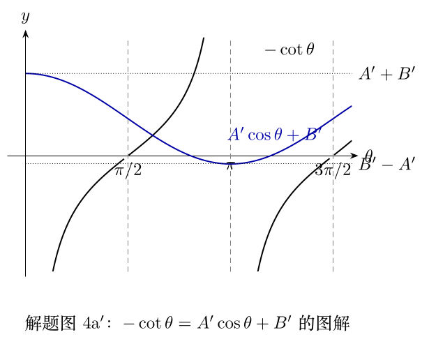

**解析辅助图：** CPHO39-Q04-solution-forces-iii.tex

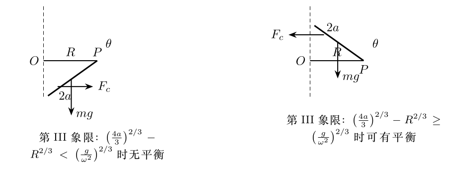

**解析辅助图：** CPHO39-Q04-solution-forces-iv.tex

**解析辅助图：** CPHO39-Q04-solution-forces-upper.tex

**解析辅助图：** CPHO39-Q04-solution-tan.tex

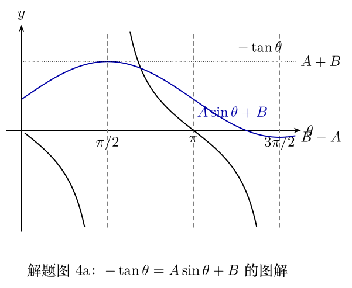

**原题图：** CPHO39-Q04-structure.tex

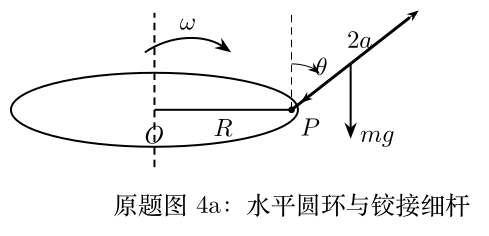

## 第39届复赛第5题：快慢拉动双弹簧断裂模型

**原题图：** CPHO39-Q05-model.tex

**原题图：** CPHO39-Q05-phase.tex

## 第39届复赛第6题：金属温差电效应的经典模型

**解析辅助图：** CPHO39-Q06-solution-chain.tex

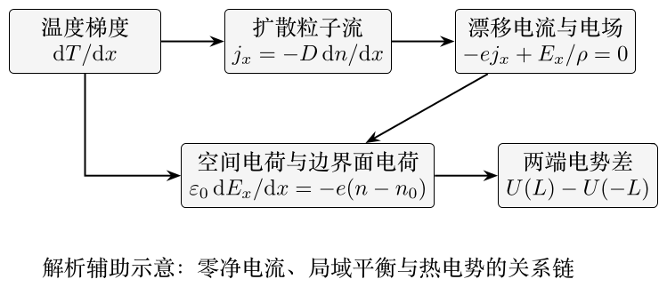

**原题图：** CPHO39-Q06-structure.tex

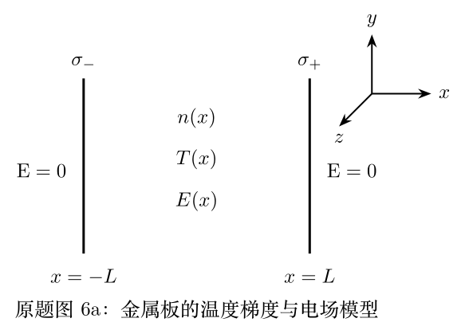

## 第39届复赛第7题：高能铅核碰撞夸克物质状态方程

**解析辅助图：** CPHO39-Q07-solution-angle.tex

**解析辅助图：** CPHO39-Q07-solution-collision.tex

## 第40届复赛第1题：手机镜头的主点与等效焦距

**原题图：** CPHO40-Q01-figure1.tex

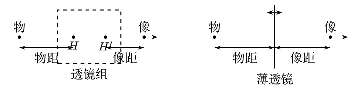

## 第40届复赛第2题：半圆管中活塞的稳定性与临界温度

**原题图：** CPHO40-Q02-figure1.tex

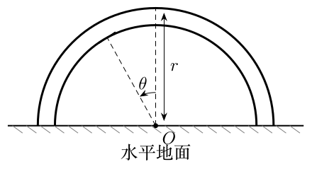

## 第40届复赛第3题：楔块上匀质圆球的滚动与滑动

**原题图：** CPHO40-Q03-figure1.tex

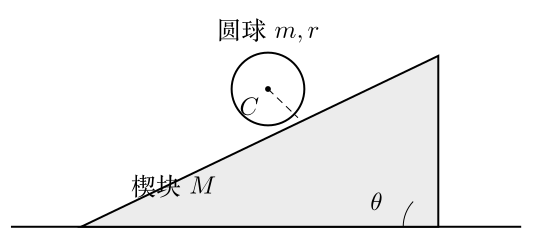

## 第40届复赛第4题：编木拱桥的几何与静力平衡

**原题图：** CPHO40-Q04-context.tex

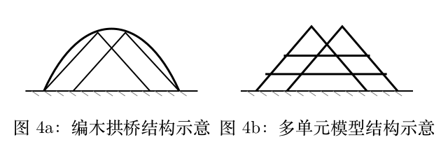

**原题图：** CPHO40-Q04-forces.tex

**原题图：** CPHO40-Q04-structure.tex

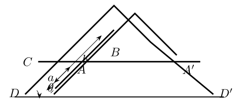

## 第40届复赛第5题：电偶极子场中点电荷运动

**解析辅助图：** CPHO40-Q05-solution-orbits.tex

**原题图：** CPHO40-Q05-structure.tex

## 第40届复赛第6题：交变磁场中导体球涡电流悬浮与热效应

**原题图：** CPHO40-Q06-structure.tex

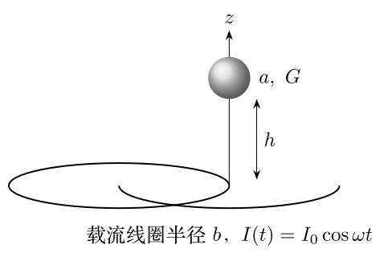

## 第40届复赛第7题：大气分层、声速与声波传播

**原题图：** CPHO40-Q07-figure1.tex

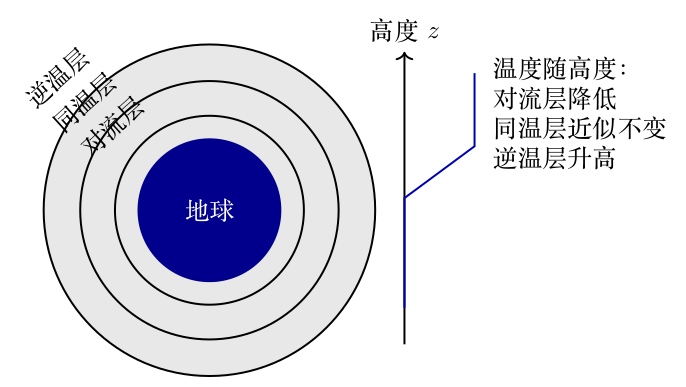

## 第41届复赛第1题：高楼调谐质量阻尼器的受迫振动

**原题图：** CPHO41-Q01-structure.tex

## 第41届复赛第2题：台球弹性碰撞、滑动摩擦与30度经验规则

**原题图：** CPHO41-Q02-figure2a.tex

**原题图：** CPHO41-Q02-figure2b.tex

**原题图：** CPHO41-Q02-figure2c.tex

**解析辅助图：** CPHO41-Q02-solution-geometry.tex

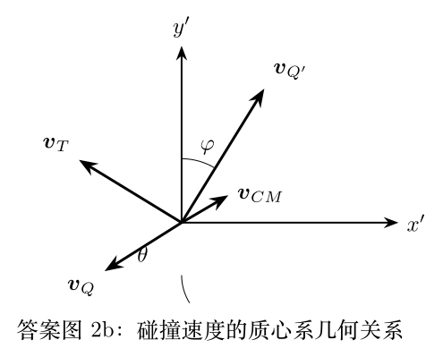

## 第41届复赛第3题：油水混合物的表面张力与微观表面层模型

**原题图：** CPHO41-Q03-mixing.tex

**原题图：** CPHO41-Q03-surface-layer.tex

## 第41届复赛第4题：高能电子探测与质子散射的不确定度估计

**原题图：** CPHO41-Q04-resolution.tex

**原题图：** CPHO41-Q04-uncertainty.tex

## 第41届复赛第5题：Ioffe磁阱与蒸发冷却

**原题图：** CPHO41-Q05-evaporation.tex

**原题图：** CPHO41-Q05-figure5a.tex

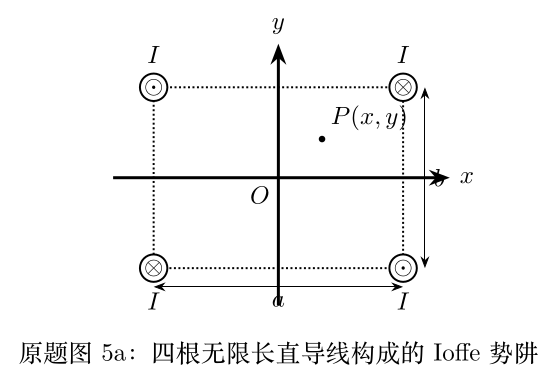

## 第41届复赛第6题：太阳引力场中的轨道偏折与星光弯曲

**原题图：** CPHO41-Q06-figure6a.tex

## 第41届复赛第7题：超导环磁通量子化与无相互作用电子

**原题图：** CPHO41-Q07-figure7a.tex

**原题图：** CPHO41-Q07-figure7b.tex

## 第42届复赛第1题：磁光阱原子气的自由下落测温

**解析辅助图：** CPHO42-Q01-solution-release.tex

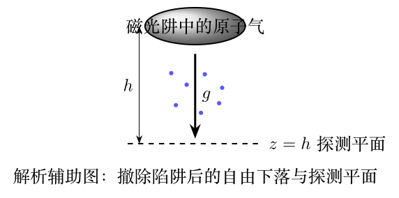

## 第42届复赛第2题：重离子束探针与平行板能量分析器

**原题图：** CPHO42-Q02-figure2a.tex

**原题图：** CPHO42-Q02-figure2b.tex

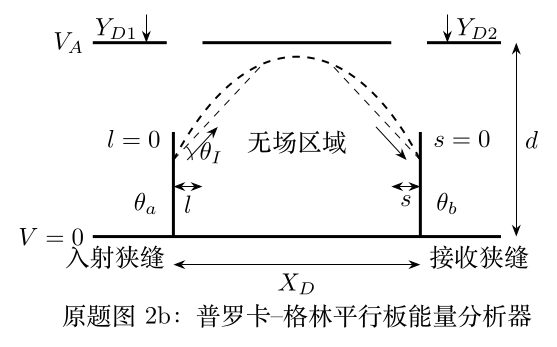

## 第42届复赛第3题：量子霍尔器件的接触电阻与并联测量

**原题图：** CPHO42-Q03-figure3a.tex

**原题图：** CPHO42-Q03-figure3b.tex

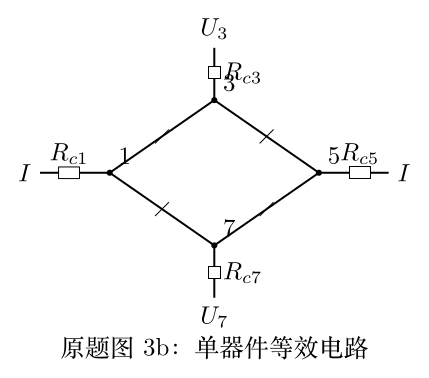

**原题图：** CPHO42-Q03-figure3c.tex

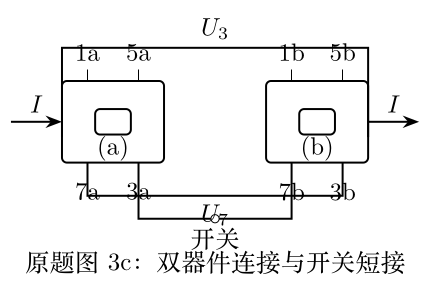

**原题图：** CPHO42-Q03-figure3d.tex

