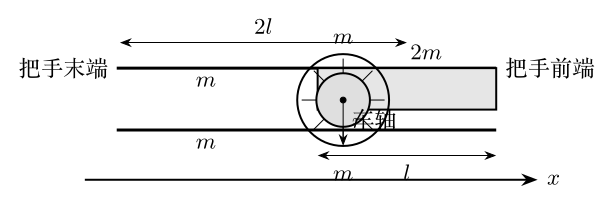
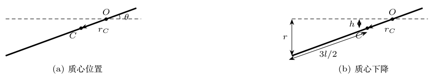
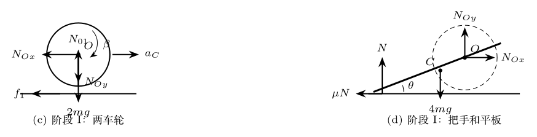

> 本文件由项目已校订的LaTeX题干、参考解答和TikZ图件生成。评分时以本文件为主要阅读文本；需核对原始措辞时查看包内对应届次原始PDF。

# 第36届复赛第2题：农用平板车碰撞与摩擦运动

## 题干

农用平板车结构如图。两车轮半径均为 $r$、质量均为 $m$；平板长为 $l$、质量为 $2m$；两把手均为长 $2l$、质量 $m$ 的细杆。平板、把手和车轴固连，车轮可绕轴转动。（1）车轮被卡住而不能平移时，将水平把手由静止释放，求其与地面碰撞前的角速度。（2）在碰撞前撤去卡轮装置、碰撞时锁死车轮、碰后立即解锁；把手末端竖直方向不反弹，且把手和车轮与地面的滑动摩擦系数均为 $\mu$。求车轮开始运动至静止时车轴移动的距离。

## 参考解答整理

#### （1）把手落地前的角速度。

把手、平板整体相对车轴的转动惯量和质心距分别为 $$J=\frac43ml^2,\qquad r_C=\frac l4.$$ 质心下降高度为 $h=r/6$。由机械能守恒 $$\frac12J\omega^2=4mgh,$$ 其中 $r_C$ 与 $h$ 的几何关系见图。

故 $$\boxed{\omega=\sqrt{\frac{gr}{l}}.}$$

#### （2）碰撞后的起动条件。

碰前整体质心速率为 $$v_{C1}=\omega r_C=\frac{\sqrt{grl}}4.$$ 令把手方向与速度分解所用夹角为 $\theta$，有 $$\sin\theta=\frac{2r}{3l},\qquad
\cos\theta=\frac{\sqrt{9l^2-4r^2}}{3l}.$$ 由碰撞期间的动量定理，碰后系统水平初速度为 $$v_0=\frac23(\sin\theta-\mu\cos\theta)v_{C1}
=\frac{\sqrt{gr}}6(\sin\theta-\mu\cos\theta).$$ 若 $$\boxed{\mu\ge\tan\theta=\frac{2r}{\sqrt{9l^2-4r^2}},}$$ 则碰后不发生运动，$s=0$。

#### 阶段I：又滑又滚。

当 $\mu<\tan\theta$ 时，总滑动摩擦力为 $f=-6\mu mg$，整体质心加速度 $$a_C=-\mu g.$$ 两车轮与把手--平板整体的受力关系见图上排。 由把手--平板与两车轮的受力、转动方程可得车轮角加速度 $$\beta=\frac{8\mu g}{3r}.$$ 车轮达到纯滚动时的速度为 $$v_1=\frac4{33}\sqrt{gr}(\sin\theta-\mu\cos\theta).$$ 该阶段车轴位移为 $$s_1=\frac{57r}{78408\mu l^2}
\left(2r-\mu\sqrt{9l^2-4r^2}\right)^2.$$

#### 阶段II：纯滚动至停止。

纯滚动阶段的质心加速度为 $$a_{C2}=-\frac{\mu g}{11\mu\tan\theta+12}.$$ 静摩擦方向改变后的受力关系见图下排。

由 $0-v_1^2=2a_{C2}s_2$，得 $$s_2=\frac{16r}{9801\mu}
\left(2r-\mu\sqrt{9l^2-4r^2}\right)^2
\frac{11\mu r+6\sqrt{9l^2-4r^2}}{9l^2-4r^2}.$$ 因此在 $\mu<\tan\theta$ 时，车轴总位移为 $$\boxed{s=s_1+s_2.}$$
