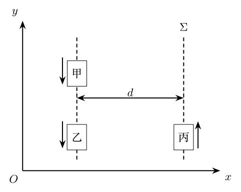

> 本文件由项目已校订的LaTeX题干、参考解答和TikZ图件生成。评分时以本文件为主要阅读文本；需核对原始措辞时查看包内对应届次原始PDF。

# 第37届复赛第5题：相对论飞行器信号与货物发射

## 题干

星际飞行器甲、乙、丙如图所示。在惯性系 $\Sigma$（坐标系 $O$--$xy$）中，甲、乙在同一直线上沿 $y$ 轴负方向匀速飞行，丙在另一条平行直线上沿 $y$ 轴正方向匀速飞行；两条飞行直线相距 $d$。三艘飞行器的速度分别为 $$\boldsymbol v_{\text{甲}\Sigma}=-\frac{2c}{3}\hat{\boldsymbol y},\qquad
\boldsymbol v_{\text{乙}\Sigma}=-\frac{c}{3}\hat{\boldsymbol y},\qquad
\boldsymbol v_{\text{丙}\Sigma}=\frac{2c}{3}\hat{\boldsymbol y}.$$ 飞行器尺寸远小于 $d$。

（1）甲向乙发射一个光信号，乙收到后立即反射回甲。甲上原子钟测得光信号往返时间为 $T$。求惯性系 $\Sigma$ 和乙上观测者测得的光信号往返时间；再求从甲收到返回光信号到甲追上乙所需的时间。

（2）当甲、丙在惯性系 $\Sigma$ 中相距最近时，甲发射一个小货物。货物在 $\Sigma$ 系中的速率为 $3c/4$。为使丙接收到货物，求甲上观测者测得的货物发射速度大小和方向；再求乙上观测者测得的货物飞行时间。

## 参考解答整理

#### （1）光信号往返与甲追上乙。

甲上原子钟的 $T$ 是固有时，故在 $\Sigma$ 系中 $$\boxed{(\Delta t_{\text{光}})_\Sigma
=\frac{T}{\sqrt{1-v_{\text{甲}\Sigma}^2/c^2}}
=\frac{3\sqrt5}{5}T.}$$ 甲相对于乙的速度为 $$v_{\text{甲乙}}
=\frac{v_{\text{甲}\Sigma}-v_{\text{乙}\Sigma}}
{1-v_{\text{甲}\Sigma}v_{\text{乙}\Sigma}/c^2}
=-\frac{3c}{7}.$$ 于是乙上观测者测得的往返时间为 $$\boxed{(\Delta t_{\text{光}})_\text{乙}
=\frac{T}{\sqrt{1-v_{\text{甲乙}}^2/c^2}}
=\frac{7\sqrt{10}}{20}T.}$$ 在甲系，信号返回时甲、乙之间的距离为 $$l=\frac12\left(cT-\left|v_{\text{乙甲}}\right|T\right)=\frac{2cT}{7}.$$ 因此，甲随后追上乙所需时间为 $$\boxed{\Delta t=\frac{l}{|v_{\text{乙甲}}|}=\frac23T.}$$

#### （2）货物速度与飞行时间。

为使货物与丙相遇，货物在 $\Sigma$ 系中的 $y$ 分量须与丙相同： $$(v_{\text{货}\Sigma})_y=\frac{2c}{3}.$$ 由货物速率 $3c/4$ 得横向分量（取由甲指向丙的正向） $$(v_{\text{货}\Sigma})_x
=\sqrt{\left(\frac{3c}{4}\right)^2-\left(\frac{2c}{3}\right)^2}
=\frac{\sqrt{17}}{12}c.$$ 从 $\Sigma$ 系变换到甲系，取 $v_{\Sigma\text{甲}}=2c/3$，有 $$(v_{\text{货甲}})_x
=\frac{(v_{\text{货}\Sigma})_x\sqrt{1-v_{\Sigma\text{甲}}^2/c^2}}
{1+(v_{\text{货}\Sigma})_yv_{\Sigma\text{甲}}/c^2}
=\frac{\sqrt{85}}{52}c,$$ $$(v_{\text{货甲}})_y
=\frac{(v_{\text{货}\Sigma})_y+v_{\Sigma\text{甲}}}
{1+(v_{\text{货}\Sigma})_yv_{\Sigma\text{甲}}/c^2}
=\frac{12}{13}c.$$ 故甲上观测者测得的发射速率和与甲运动方向的夹角分别为 $$\boxed{v_{\text{货甲}}=\frac{\sqrt{2389}}{52}c,\qquad
\theta=\frac\pi2+\arctan\frac{48}{\sqrt{85}}
=2.95\,\mathrm{rad}\approx169^\circ.}$$ 货物在 $\Sigma$ 系中的飞行时间和沿 $y$ 轴位移为 $$(\Delta t_{\text{货}})_\Sigma=\frac{12d}{\sqrt{17}c},
\qquad
(\Delta y_{\text{货}})_\Sigma=\frac{8d}{\sqrt{17}}.$$ 再对乙系作洛伦兹时间变换，得到 $$\boxed{(\Delta t_{\text{货}})_\text{乙}
=\frac{(\Delta t_{\text{货}})_\Sigma-v_{\text{乙}\Sigma}(\Delta y_{\text{货}})_\Sigma/c^2}
{\sqrt{1-v_{\text{乙}\Sigma}^2/c^2}}
=\frac{11\sqrt{34}}{17}\frac dc.}$$
