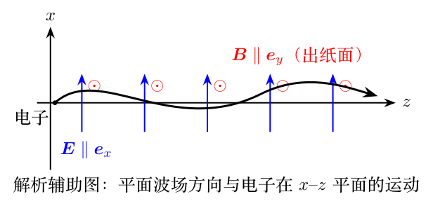

> 本文件由项目已校订的LaTeX题干、参考解答和TikZ图件生成。评分时以本文件为主要阅读文本；需核对原始措辞时查看包内对应届次原始PDF。

# 第42届复赛第4题：平面激光场中的相对论电子加速

## 题干

题目把强激光脉冲简化为沿 $z$ 轴传播、沿 $x$ 轴线偏振的单色平面电磁波： $$\boldsymbol E=E_0\cos(kz-\omega t)\boldsymbol e_x,\qquad
\boldsymbol B=\frac{E_0}{c}\cos(kz-\omega t)\boldsymbol e_y.$$ 电子初始静止时，要求由相对论动力学求动量、能量和位置的隐函数关系；随后讨论给定初始能量、沿 $x$--$z$ 平面入射时的最大增能；最后按给定强度和波长估计辐射阻尼造成的一个周期相对能量损失。

## 参考解答整理

洛伦兹力方程为 $$\frac{\mathrm d\boldsymbol p}{\mathrm dt}=-e(\boldsymbol E+\boldsymbol v\times\boldsymbol B),\qquad
\epsilon=\sqrt{m_e^2c^4+p^2c^2}.$$ 由 $kc=\omega$ 和初始静止条件，答案给出横向动量 $$p_x=\frac{eE_0}{\omega}\sin(kz-\omega t),\qquad p_y=0.$$ 能量与纵向动量满足守恒关系 $\epsilon-cp_z=m_ec^2$，于是 $$p_z=\frac{p_x^2}{2m_ec},\qquad
\epsilon=m_ec^2+\frac{e^2E_0^2\sin^2(kz-\omega t)}{2m_e\omega^2}.$$ 令 $\tau=z-ct$，电子位置可写成隐函数；其中 $$x=\frac{eE_0[\cos(kz-\omega t)-1]}{m_e\omega^2},\qquad y=0,$$ 并由 $\int_0^\tau\sin^2(k\tau)\,\mathrm d\tau=\tau/2-\sin(2k\tau)/(4k)$ 得到 $z$ 的相应关系。第（2）问在固定初始能量下，以 $\theta_0$ 参数化初始动量并对相位取极值；完整长式见答案第12至13页，本整理不转抄未经逐项排版复核的长分式。

第（3）问先由能流密度的周期平均得到 $$I=\left\langle|\boldsymbol S|\right\rangle=\frac{E_0^2}{2\mu_0c},\qquad E_0^2=2\mu_0cI.$$ 代入辐射阻尼率并积分一个周期，答案写为 $$\frac{\Delta\epsilon}{\epsilon_0}=-\frac{1}{1+\dfrac{2\pi m_e^4c^5}{e^4\mu_0^2I\epsilon_0\lambda}}\approx-40\%.$$
