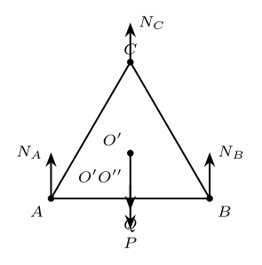
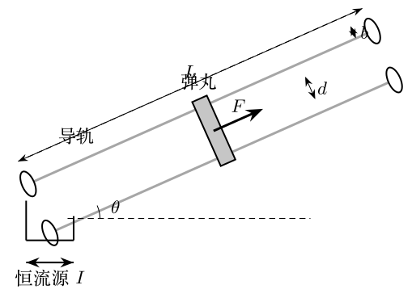
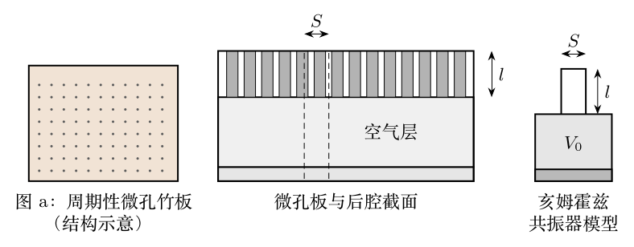

# 第36届复赛试题与参考解答

对应原始文件：`03_corpus/raw_papers/cpho_36_2019_fusai_paper_solution_candidate.pdf`

> 以下文字来自已经校订的逐题LaTeX文本，不使用原PDF的低质量自动文本层。

> 本文件由项目已校订的LaTeX题干、参考解答和TikZ图件生成。评分时以本文件为主要阅读文本；需核对原始措辞时查看包内对应届次原始PDF。

# 第36届复赛第1题：旅行车三脚圆凳与茶水杯稳定性

## 题干

半径为 $R$ 的三脚圆凳置于旅行车内，三只凳脚端点构成边长为 $a$ 的水平等边三角形，凳子质心位于轴上 $G$ 点。半径为 $r$、总质量为 $m$ 的圆筒形薄壁茶杯放在凳面中心 $O$ 处；杯底质量为 $m/5$，杯高为 $H$，茶水密度为 $\rho$。求：（1）在茶水尽可能多且保持足够稳定的条件下，茶水的最佳高度；（2）杯底边缘滑移至与凳面边缘内切于 $D$ 点，且 $OD\perp AC$ 时，底板对三只凳脚支持力相对于杯子在中心时的改变量。

## 参考解答整理

#### （1）最佳茶水高度。

以凳面中心为原点、竖直向上为 $y$ 轴。茶杯及茶水整体质心为 $$y_{\mathrm{CM}}=
\frac{\dfrac{4m}{5}\dfrac H2+\rho\pi r^2h\dfrac h2}
{m+\rho\pi r^2h}.$$ 令 $\lambda=\rho\pi r^2$，在质心最低处满足 $\mathrm dy_{\mathrm{CM}}/\mathrm dh=0$。舍去负根得到 $$\boxed{
h_{\max}=\frac{m}{\rho\pi r^2}
\left[\sqrt{1+\frac{4\pi\rho r^2H}{5m}}-1\right].
}$$

#### （2）凳脚支持力的改变量。

记凳子质量为 $M$，并设

$$Q=(m+\lambda h_{\max})g,\qquad P=Mg,\qquad R'=R-r.$$ 杯子滑移后，几何关系和对称性给出 $$O'A=O'B=\frac{a}{\sqrt3},\qquad
O'O''=\frac{a}{2\sqrt3},\qquad N_A=N_C.$$ 竖直方向和绕对称轴的平衡方程为 $$N_A+N_B+N_C=Q+P,$$ $$Q R'+N_B\frac{a}{\sqrt3}-2N_A\frac{a}{2\sqrt3}=0.$$ 与滑移前的平均支持力 $(P+Q)/3$ 比较，得到 $$\boxed{
\Delta N_B=-\frac{2\sqrt3}{3}\frac{R-r}{a}
\sqrt{1+\frac{4\pi\rho r^2H}{5m}}\,mg,
}$$ $$\boxed{
\Delta N_A=\Delta N_C=\frac{\sqrt3}{3}\frac{R-r}{a}
\sqrt{1+\frac{4\pi\rho r^2H}{5m}}\,mg.
}$$ 即靠近滑移方向对侧的凳脚 $B$ 支持力减小，另外两脚的支持力等量增加。

> 本文件由项目已校订的LaTeX题干、参考解答和TikZ图件生成。评分时以本文件为主要阅读文本；需核对原始措辞时查看包内对应届次原始PDF。

# 第36届复赛第2题：农用平板车碰撞与摩擦运动

## 题干

农用平板车结构如图。两车轮半径均为 $r$、质量均为 $m$；平板长为 $l$、质量为 $2m$；两把手均为长 $2l$、质量 $m$ 的细杆。平板、把手和车轴固连，车轮可绕轴转动。（1）车轮被卡住而不能平移时，将水平把手由静止释放，求其与地面碰撞前的角速度。（2）在碰撞前撤去卡轮装置、碰撞时锁死车轮、碰后立即解锁；把手末端竖直方向不反弹，且把手和车轮与地面的滑动摩擦系数均为 $\mu$。求车轮开始运动至静止时车轴移动的距离。

## 参考解答整理

#### （1）把手落地前的角速度。

把手、平板整体相对车轴的转动惯量和质心距分别为 $$J=\frac43ml^2,\qquad r_C=\frac l4.$$ 质心下降高度为 $h=r/6$。由机械能守恒 $$\frac12J\omega^2=4mgh,$$ 其中 $r_C$ 与 $h$ 的几何关系见图。

故 $$\boxed{\omega=\sqrt{\frac{gr}{l}}.}$$

#### （2）碰撞后的起动条件。

碰前整体质心速率为 $$v_{C1}=\omega r_C=\frac{\sqrt{grl}}4.$$ 令把手方向与速度分解所用夹角为 $\theta$，有 $$\sin\theta=\frac{2r}{3l},\qquad
\cos\theta=\frac{\sqrt{9l^2-4r^2}}{3l}.$$ 由碰撞期间的动量定理，碰后系统水平初速度为 $$v_0=\frac23(\sin\theta-\mu\cos\theta)v_{C1}
=\frac{\sqrt{gr}}6(\sin\theta-\mu\cos\theta).$$ 若 $$\boxed{\mu\ge\tan\theta=\frac{2r}{\sqrt{9l^2-4r^2}},}$$ 则碰后不发生运动，$s=0$。

#### 阶段I：又滑又滚。

当 $\mu<\tan\theta$ 时，总滑动摩擦力为 $f=-6\mu mg$，整体质心加速度 $$a_C=-\mu g.$$ 两车轮与把手--平板整体的受力关系见图上排。 由把手--平板与两车轮的受力、转动方程可得车轮角加速度 $$\beta=\frac{8\mu g}{3r}.$$ 车轮达到纯滚动时的速度为 $$v_1=\frac4{33}\sqrt{gr}(\sin\theta-\mu\cos\theta).$$ 该阶段车轴位移为 $$s_1=\frac{57r}{78408\mu l^2}
\left(2r-\mu\sqrt{9l^2-4r^2}\right)^2.$$

#### 阶段II：纯滚动至停止。

纯滚动阶段的质心加速度为 $$a_{C2}=-\frac{\mu g}{11\mu\tan\theta+12}.$$ 静摩擦方向改变后的受力关系见图下排。

由 $0-v_1^2=2a_{C2}s_2$，得 $$s_2=\frac{16r}{9801\mu}
\left(2r-\mu\sqrt{9l^2-4r^2}\right)^2
\frac{11\mu r+6\sqrt{9l^2-4r^2}}{9l^2-4r^2}.$$ 因此在 $\mu<\tan\theta$ 时，车轴总位移为 $$\boxed{s=s_1+s_2.}$$

> 本文件由项目已校订的LaTeX题干、参考解答和TikZ图件生成。评分时以本文件为主要阅读文本；需核对原始措辞时查看包内对应届次原始PDF。

# 第36届复赛第3题：电磁轨道炮加速模型

## 题干

如图，两根半径为 $b$、长度为 $L$、单位长度电阻为 $\lambda$ 的圆柱形平行导轨，所在对称面与水平面的夹角为 $\theta$。两导轨间的最近距离为 $d$（$d$ 很小）。质量为 $m$、直径为 $d$、电阻为 $R$ 的薄片状金属弹丸与导轨良好接触。导轨下端经同轴硬导线接入电流为 $I$ 的理想恒流源。忽略空气阻力、摩擦阻力和恒流源内部能量损耗，真空磁导率为 $\mu_0$。弹丸从导轨下端由静止开始加速，求：（1）弹丸所受磁场力；（2）出射速度；（3）加速过程中与出射时恒流源两端电压；（4）恒流源所做的功；（5）当 $\theta=0$ 且导轨、弹丸电阻均忽略时，出射动能与电源做功之比。

## 参考解答整理

#### （1）安培力。

弹丸直径很小，可将两根载流导轨近似为半无限长直导线。弹丸上一点到一侧导轨轴线的距离为 $r'$ 时，磁感应强度为 $$B=\frac{\mu_0 I}{4\pi r'}+\frac{\mu_0 I}{4\pi(d+2b-r')}.$$ 对弹丸横向积分（$b\le r'\le d+b$），得沿导轨向上的安培力 $$\boxed{F=\frac{\mu_0 I^2}{2\pi}\ln\frac{d+b}{b}.}$$

#### （2）出射速度。

沿导轨列牛顿第二定律： $$F-mg\sin\theta=ma,
\qquad
a=\frac{\mu_0 I^2}{2\pi m}\ln\frac{d+b}{b}-g\sin\theta.$$ 弹丸做匀加速直线运动，因而 $$\boxed{v_{\max}=\sqrt{2L\left(\frac{\mu_0 I^2}{2\pi m}\ln\frac{d+b}{b}-g\sin\theta\right)}.}$$

#### （3）恒流源电压。

设弹丸到导轨下端的距离为 $l$、速度为 $v=\mathrm{d}l/\mathrm{d}t$。回路中的磁通量和感应电动势为 $$\Phi=\frac{\mu_0 I l}{\pi}\ln\frac{d+b}{b},
\qquad
\varepsilon=-\frac{\mu_0 Iv}{\pi}\ln\frac{d+b}{b}.$$ 由全电路欧姆定律 $U+\varepsilon=2\lambda lI+IR$，并代入 $v=at$、$l=at^2/2$，得到任意时刻的电压 $$\boxed{U=\lambda Iat^2+IR+\frac{\mu_0 I}{\pi}\ln\frac{d+b}{b}\,at.}$$ 加速时间 $T=\sqrt{2L/a}$，故出射时 $$\boxed{U_{\rm 出}=2\lambda IL+IR+\frac{\sqrt2\mu_0 I}{\pi}\ln\frac{d+b}{b}\sqrt{a}.}$$

#### （4）电源做功。

由 $W=\int_0^T UI\,\mathrm{d}t$，将三项分别积分，得到 $$W=W_1+W_2+W_3,$$ $$W_1=\frac{2\sqrt2\lambda I^2}{3}L^{3/2}a^{-1/2},\qquad
W_2=I^2R\sqrt{2L}\,a^{-1/2},$$ $$\boxed{W_3=\frac{\mu_0 I^2L}{\pi}\ln\frac{d+b}{b}.}$$ 其中 $a$ 为第（2）问所得的加速度，故上式共同给出整个加速过程的电源做功。

#### （5）无电阻、水平导轨的极限。

当 $\theta=0$ 且电阻可忽略时， $$E_{\max}=\frac{\mu_0 I^2L}{2\pi}\ln\frac{d+b}{b},
\qquad
W=\frac{\mu_0 I^2L}{\pi}\ln\frac{d+b}{b}.$$ 因此 $$\boxed{\eta=\frac{E_{\max}}{W}=50\%.}$$

> 本文件由项目已校订的LaTeX题干、参考解答和TikZ图件生成。评分时以本文件为主要阅读文本；需核对原始措辞时查看包内对应届次原始PDF。

# 第36届复赛第4题：微孔竹板亥姆霍兹共振吸声

## 题干

微孔竹板上的周期性长方形微孔可使孔中空气柱发生简谐振动；单个微孔及其后方空气层可简化为亥姆霍兹共振器，如图。微孔深度为 $l$，孔横截面积为 $S$，单孔后腔体体积为 $V_0$。声波传播视为绝热过程，满足 $v_s=\sqrt{\kappa/\rho}$，其中 $\kappa=-V\Delta p/\Delta V$。已知标准状态 $T=273\,\mathrm{K}$、$p=1.01\times10^5\,\mathrm{Pa}$，空气摩尔质量 $M_{\rm mol}=29.0\,\mathrm{g/mol}$、热容比 $\gamma=7/5$、气体常量 $R=8.31\,\mathrm{J/(K\cdot mol)}$。求：（1）标准状态下空气的密度和声速；（2）共振器吸收声波的频率；（3）吸收 $120\,\mathrm{Hz}$ 和 $200\,\mathrm{Hz}$ 时两种微孔面积之比。

## 参考解答整理

#### （1）标准状态下的密度与声速。

理想气体状态方程为 $$pV=\frac{M}{M_{\rm mol}}RT,
\qquad
\rho=\frac{M}{V}=\frac{M_{\rm mol}p}{RT}.$$ 故标准状态空气密度为 $$\boxed{\rho_0=1.29\,\mathrm{kg/m^3}.}$$ 绝热过程满足 $pV^\gamma=\text{常量}$。微分后可得 $$\kappa=-V\frac{\Delta p}{\Delta V}=\gamma p,
\qquad
v_s=\sqrt{\frac{\gamma p}{\rho}}.$$ 因此标准状态下 $$\boxed{v_{s0}=\sqrt{\frac{(7/5)\times1.01\times10^5}{1.29}}=331\,\mathrm{m/s}.}$$

#### （2）亥姆霍兹共振频率。

微孔内空气柱质量为 $m=\rho Sl$。令空气柱向外位移为 $x$，则腔体体积改变量为 $\Delta V=Sx$，压强变化和回复力为 $$\Delta p=-\frac{\gamma pSx}{V},
\qquad
F=S\Delta p=-\frac{\gamma pS^2}{V}x.$$ 由 $m\ddot{x}=F$ 得 $$\ddot{x}=-\omega^2x,
\qquad
\omega=\sqrt{\frac{\gamma pS}{\rho lV}}.$$ 将 $V=V_0$ 与 $v_s=\sqrt{\gamma p/\rho}$ 代入，得到 $$\boxed{f_0=\frac{v_s}{2\pi}\sqrt{\frac{S}{lV_0}}.}$$

#### （3）两种孔面积之比。

在 $l$、$V_0$ 和 $v_s$ 相同的条件下，$f\propto\sqrt S$，所以 $$\frac{S_1}{S_2}=\left(\frac{f_{01}}{f_{02}}\right)^2
=\left(\frac{120}{200}\right)^2.$$ 故 $$\boxed{\frac{S_1}{S_2}=0.36.}$$

> 本文件由项目已校订的LaTeX题干、参考解答和TikZ图件生成。评分时以本文件为主要阅读文本；需核对原始措辞时查看包内对应届次原始PDF。

# 第36届复赛第5题：阶跃型光纤耦合与全反射

## 题干

阶跃型光纤内芯直径为 $50\,\mu\mathrm{m}$、折射率 $n_1=1.46$；玻璃外包层外径为 $125\,\mu\mathrm{m}$、折射率 $n_2=1.45$。现用直径 $D=3.00\,\mathrm{mm}$、折射率 $n=1.50$ 的微球透镜将氦氖激光器输出的圆柱形平行光束耦合入光纤，空气折射率 $n_0=1.00$，激光束轴、透镜球心和光纤轴重合，如图。求：（1）光纤端面的最大入射角；（2）平行光刚好会聚在光纤端面时，微球后表面顶点 $O$ 与端面的距离；（3）满足长距离传输条件的平行入射光束最大直径。

## 参考解答整理

#### （1）端面最大入射角。

设端面最大入射角为 $\theta$，进入纤芯后的折射角为 $\alpha$。由端面折射和芯--包层界面的全反射临界条件， $$n_0\sin\theta=n_1\sin\alpha,
\qquad
n_1\cos\alpha=n_2.$$ 相应的端面折射与芯--包层全反射临界光线见图左图。 消去 $\alpha$，得 $$\sin\theta=\sqrt{\left(\frac{n_1}{n_0}\right)^2-\left(\frac{n_2}{n_0}\right)^2}
=\sqrt{1.46^2-1.45^2}\approx0.17.$$ 因此 $$\boxed{\theta_{\max}=\arcsin(0.17)\approx9.8^\circ.}$$

#### （2）微球后顶点到端面的距离。

对微球前表面，平行光经球面折射后的一次像距为 $$\frac{n_0}{o_1}+\frac{n}{i_1}=\frac{n-n_0}{r},
\qquad o_1=\infty,\quad r=\frac D2,$$ 故 $$i_1=\frac{nD}{2(n-n_0)}=4.5\,\mathrm{mm}.$$ 相对于后表面顶点 $O$，该像为虚物， $$o_2=i_1-D=\frac{(n-2n_0)D}{2(n-n_0)}=-1.50\,\mathrm{mm},
\qquad r_2=-\frac D2.$$ 再对后表面应用球面折射公式，得到二次像距 $$\boxed{i_2=\frac{(2n_0-n)D}{4(n-n_0)}=0.75\,\mathrm{mm}.}$$ 因此 $O$ 到光纤端面的距离为 $0.75\,\mathrm{mm}$。几何近轴解法同样给出 $OF=D/4=0.75\,\mathrm{mm}$。

#### （3）可耦合的最大光束直径。

微球的等效焦距为 $$f_e=\frac{nD}{4(n-n_0)}=2.25\,\mathrm{mm}.$$ 当边缘光线在光纤端面的入射角恰为 $\theta_{\max}$ 时，利用近轴几何关系（忽略 $O[(d/D)^3]$ 项）有 $$d_{\max}=\frac{nD\sin\theta_{\max}}{2(n-n_0)}.$$ 代入参数， $$\boxed{d_{\max}=0.76\,\mathrm{mm}.}$$ 故平行入射激光束的直径不能超过 $0.76\,\mathrm{mm}$。

> 本文件由项目已校订的LaTeX题干、参考解答和TikZ图件生成。评分时以本文件为主要阅读文本；需核对原始措辞时查看包内对应届次原始PDF。

# 第36届复赛第6题：$\pi$介子衰变与$\mu$子相对论寿命

## 题干

高速 $\pi$ 介子发生衰变 $$\pi\rightarrow\mu+\bar\nu_\mu.$$ 已知 $m_\pi=139.57061\,\mathrm{MeV}/c^2$、$m_\mu=105.65837\,\mathrm{MeV}/c^2$，反中微子静止质量可忽略。实验室系中 $\pi$ 介子速度为 $v=0.965c$，其中 $c=3.00\times10^8\,\mathrm{m/s}$。求：（1）衰变产生的 $\mu$ 子最大和最小速率；（2）$\mu$ 子从距地面 $h=10000\,\mathrm{m}$ 高空竖直下落时，若静止 $\mu$ 子半衰期 $T_{1/2}^{(0)}=1.523\,\mu\mathrm{s}$，地面观察者观测到 $\mu$ 子的最大概率。

## 参考解答整理

#### （1）$\pi$介子静止系中的$\mu$子速度。

在相对于 $\pi$ 介子静止的 $S'$ 系中，动量和能量守恒分别为 $$\boldsymbol p'_\mu+\boldsymbol p'_{\bar\nu}=0,
\qquad
E'_\mu+E'_{\bar\nu}=m_\pi c^2.$$ 反中微子质量近似为零，联立相对论能量--动量关系可得 $$\boxed{u'_\mu=\frac{m_\pi^2-m_\mu^2}{m_\pi^2+m_\mu^2}c=0.2714c.}$$

#### （2）实验室系中的速度极值。

$\mu$ 子相对 $\pi$ 介子运动方向与母粒子飞行方向平行、反平行时，实验室系速率分别取最大、最小值。由一维相对论速度变换， $$u_{\mu,\max}=\frac{u'_\mu+v}{1+u'_\mu v/c^2},
\qquad
u_{\mu,\min}=\frac{-u'_\mu+v}{1-u'_\mu v/c^2}.$$ 代入 $u'_\mu=0.2714c$、$v=0.965c$，得到 $$\boxed{u_{\mu,\max}=0.980c=2.94\times10^8\,\mathrm{m/s},}$$ $$\boxed{u_{\mu,\min}=0.940c=2.82\times10^8\,\mathrm{m/s}.}$$

#### （3）地面处的最大存活概率。

最大速率对应最短飞行时间： $$(\Delta t)_{\min}=\frac{h}{u_{\mu,\max}}
=\frac{10000}{0.980\times3.00\times10^8}
=3.40\times10^{-5}\,\mathrm{s}.$$ 由时间膨胀，地面系中半衰期为 $$T_{1/2}=\frac{T_{1/2}^{(0)}}{\sqrt{1-u_{\mu,\max}^2/c^2}}
=0.765\times10^{-5}\,\mathrm{s}.$$ 使用半衰期形式的衰变律 $P=2^{-\Delta t/T_{1/2}}$，得 $$\boxed{P_{\max}=2^{-(\Delta t)_{\min}/T_{1/2}}=0.0459\approx4.59\%.}$$ 等价地，取静止平均寿命 $\tau_0=T_{1/2}^{(0)}/\ln2=2.197\,\mu\mathrm{s}$，经时间膨胀后代入 $P=\exp(-\Delta t/\tau)$，得到同一量级的 $4.55\%$ 至 $4.59\%$ 结果。

> 本文件由项目已校订的LaTeX题干、参考解答和TikZ图件生成。评分时以本文件为主要阅读文本；需核对原始措辞时查看包内对应届次原始PDF。

# 第36届复赛第7题：闪电、电离层光环与球形闪电模型

## 题干

雷电云中上部带正电、下部带负电，云地闪电把云底负电荷释放到地面，如图。题目依次给定圆柱形雷电云的均匀电场 $E=0.15\,\mathrm{MV/m}$、半径 $r=2.5\,\mathrm{km}$、高度 $d=1.0\,\mathrm{km}$；负电荷层距地 $h=6.0\,\mathrm{km}$；闪电通道总电荷 $2.5\,\mathrm C$ 和空气击穿阈值 $3.0\,\mathrm{MV/m}$；电离层底面高度约 $80\,\mathrm{km}$、光环半径 $100\,\mathrm{km}$；以及在 $12\,\mathrm{km}$ 高空悬浮 $50\,\mathrm{kg}$ 载荷的氦气球参数。求雷电云的电势差、电荷和能量，地表电场，闪电通道直径及电荷密度分布，电离层光环扩展速度和气球体积。

## 参考解答整理

#### （1）圆柱雷电云的电学量。

将带电区域近似为平行板电容器，面积 $S=\pi r^2$，有 $$C=\frac{\varepsilon_0S}{d},\qquad U=Ed=150\,\mathrm{MV}.$$ 从而 $$\boxed{Q=CU=26\,\mathrm C,\qquad W=\frac12QU=2.0\times10^9\,\mathrm J.}$$

#### （2）云正下方的地表电场。

把地面看作平面导体，采用镜像法并先以点电荷近似，有 $$E=\frac{Q}{2\pi\varepsilon_0}\left[\frac1{(h+d)^2}-\frac1{h^2}\right]
\approx-3.5\,\mathrm{kV/m}.$$ 负号表示场方向垂直地面向上。将两电荷层按有限带电圆盘积分，可得到更精确的估算 $$\boxed{E_{\rm 地面}\approx-2.8\,\mathrm{kV/m}.}$$

#### （3）闪电通道尺度与径向电荷密度。

通道长度取 $h=6.0\,\mathrm{km}$ 时，线电荷密度 $$\eta=\frac Qh=4.2\times10^{-4}\,\mathrm{C/m}.$$ 通道外电场 $E(r')=\eta/(2\pi\varepsilon_0r')$。令柱面场达到击穿阈值，得通道直径 $$\boxed{D\approx\frac{\eta}{\pi\varepsilon_0E_{\rm 击穿}}=5.0\,\mathrm m.}$$ 对通道内同轴高斯柱面应用高斯定律，并忽略中心放电细路径的尺度， $$r\varepsilon_0E_{\rm 击穿}=\int_0^r r'\rho(r')\,\mathrm dr',$$ 故 $$\boxed{\rho(r)=\frac{\varepsilon_0E_{\rm 击穿}}{r}.}$$

#### （4）电离层底部光环。

无线电波自近地闪电点 $O$ 以球面波传播；波前掠过而不能进入电离层底面，交线形成向外扩展的光环，如图。设 $OA=80\,\mathrm{km}$、$AB=r$，则 $$\cos\theta=\frac{AB}{OB}=\frac{AB}{\sqrt{OA^2+AB^2}},
\qquad
v_{\rm 环}=\frac{c}{\cos\theta}
=c\frac{\sqrt{OA^2+AB^2}}{AB}.$$ 当 $AB=100\,\mathrm{km}$ 时， $$\boxed{v_{\rm 环}=1.28c=3.8\times10^8\,\mathrm{m/s}.}$$ 这是球面波与电离层平面的交线所呈现的几何扩展速度，并非物质或信息以超光速传播。

#### （5）$12\,\mathrm{km}$高空气球体积。

悬浮条件为 $$m_{\rm 载荷}g+\rho_{\rm He}Vg=\rho_1Vg,
\qquad V=\frac{m_{\rm 载荷}}{\rho_1-\rho_{\rm He}}.$$ 温度递减关系 $T=T_0-az$（$a=5.0\times10^{-3}\,\mathrm{K/m}$）与静力平衡、理想气体状态方程共同给出 $$p=p_0\left(1-\frac{az}{T_0}\right)^{Mg/(aR)},
\qquad
\rho=\rho_0\left(1-\frac{az}{T_0}\right)^{Mg/(aR)-1}.$$ 在 $z=12\,\mathrm{km}$ 处取 $\rho_1\approx0.31\,\mathrm{kg/m^3}$，代入 $m_{\rm 载荷}=50\,\mathrm{kg}$、$\rho_{\rm He}=0.18\,\mathrm{kg/m^3}$，得到 $$\boxed{V\approx3.8\times10^2\,\mathrm{m^3}.}$$
