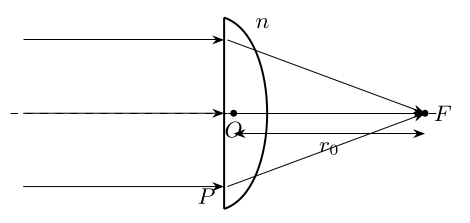
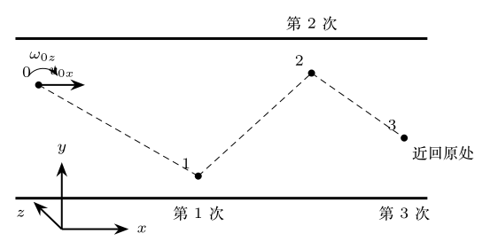
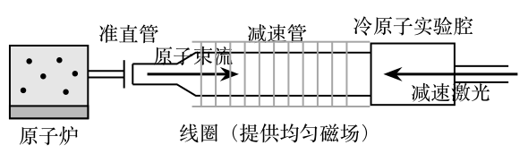
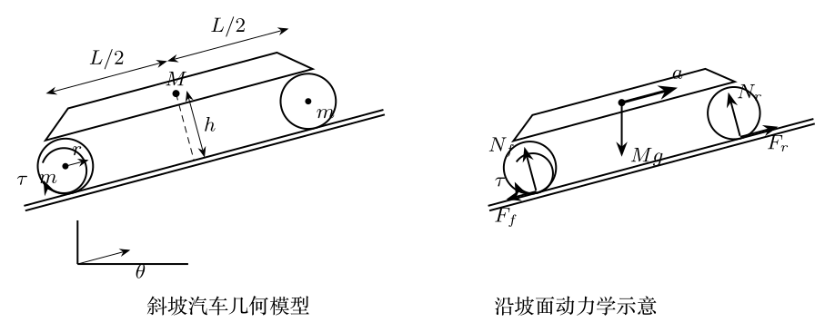
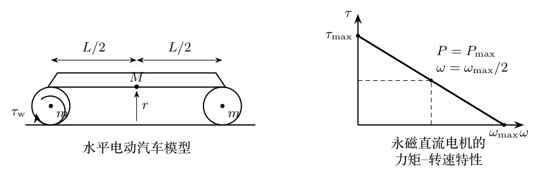

# 第38届复赛试题与参考解答

对应原始文件：`03_corpus/raw_papers/cpho_38_2021_fusai_paper_solution_candidate.pdf`

> 以下文字来自已经校订的逐题LaTeX文本，不使用原PDF的低质量自动文本层。

> 本文件由项目已校订的LaTeX题干、参考解答和TikZ图件生成。评分时以本文件为主要阅读文本；需核对原始措辞时查看包内对应届次原始PDF。

# 第38届复赛第1题：平凸/平凹透镜曲面设计

## 题干

宽束平行光正入射到折射率为 $n$ 的平凸透镜平面侧后汇聚于焦点 $F$；透镜顶点 $O$ 到 $F$ 的距离为 $r_0$，如图。求凸面形状。随后插入折射率为 $n'$、顶点到 $F$ 的距离为 $r_0'$ 的平凹透镜，使出射光重新平行，求凹面形状及入、出平行圆光束半径比。

## 参考解答整理

#### （1）平凸透镜的凸面形状。

以 $F$ 为极点，有等光程关系 $$r=n(r\cos\theta-r_0)+r_0,
\qquad r=\frac{(1-n)r_0}{1-n\cos\theta}.$$ 以从 $F$ 指向 $O$ 的方向为 $x$ 轴，凸面满足 $$\boxed{\frac{\left(x-\frac{n}{n+1}r_0\right)^2}{\left(\frac{r_0}{n+1}\right)^2}-\frac{y^2}{\left(\frac{\sqrt{n^2-1}}{n+1}r_0\right)^2}=1.}$$ 因此凸面为旋转双曲面。对平凹透镜完全类似：

#### （2）（i）平凹透镜的凹面形状。

$$r'=\frac{(1-n')r_0'}{1-n'\cos\theta},$$ $$\boxed{\frac{\left(x-\frac{n'}{n'+1}r_0'\right)^2}{\left(\frac{r_0'}{n'+1}\right)^2}-\frac{y^2}{\left(\frac{\sqrt{n'^2-1}}{n'+1}r_0'\right)^2}=1.}$$ 凹面也是旋转双曲面。

#### （2）（ii）入射与出射圆光束的半径比。

若汇聚光最大夹角为 $\theta_{\max}$，半径比为 $$\boxed{k=\frac{(1-n)(1-n'\cos\theta_{\max})r_0}{(1-n')(1-n\cos\theta_{\max})r_0'}.}$$

> 本文件由项目已校订的LaTeX题干、参考解答和TikZ图件生成。评分时以本文件为主要阅读文本；需核对原始措辞时查看包内对应届次原始PDF。

# 第38届复赛第2题：玻璃管水银封闭气体加热过程

## 题干

竖直薄壁玻璃管上端开口，长度 $l=75.0\,\mathrm{cm}$、横截面积 $S=10.0\,\mathrm{cm^2}$。水银借绝热轻活塞封闭理想气体，初始气柱和水银柱高度均为 $h=25.0\,\mathrm{cm}$，如图。已知 $T_0=400\,\mathrm K$、$C_V=5R/2$。

（1）过程A：缓慢加热，直至水银上液面恰好到达管口，求封闭气体对外所做的功。

（2）过程B：继续缓慢加热，直至水银恰好全部流出、薄活塞与管口平齐。通过计算说明该过程能否缓慢稳定地发生，并求封闭气体吸收的热量。

## 参考解答整理

#### （1）过程A的做功。

初态 $V_1=Sh$、$p_1=p_0+\rho gh=4\rho gh$；水银上液面到达管口时 $V_2=2Sh$、$p_2=p_1$，故为等压过程，$T_2=2T_0$， $$\boxed{W_1=p_1(V_2-V_1)=4\rho ghSh=33.3\,\mathrm J.}$$

#### （2）过程B的稳定性与吸热量。

设水银柱高度为 $x$，则 $$p=3\rho gh+\rho gx,\qquad V=S(3h-x).$$ 由状态方程得 $$9h^2-x^2=4h^2\frac{T}{T_0},\qquad x=h\sqrt{9-4T/T_0}.$$ 从 $T=2T_0$ 到 $T=9T_0/4$，$x$ 单调降至零，故过程B可缓慢稳定发生。其内能增加和做功为 $$\Delta U=20.8\,\mathrm J,\qquad W_2=29.2\,\mathrm J,$$ 从而 $$\boxed{Q=\Delta U+W_2=50.0\,\mathrm J.}$$

> 本文件由项目已校订的LaTeX题干、参考解答和TikZ图件生成。评分时以本文件为主要阅读文本；需核对原始措辞时查看包内对应届次原始PDF。

# 第38届复赛第3题：超球与平行硬板的连续弹性碰撞

## 题干

如图，半径为 $r$、质量为 $m$ 的均质超球在上下两个固定的平行硬板之间运动，连续碰撞3次后几乎返回原处。取 $x$ 轴水平向右、$y$ 轴竖直向下，$z$ 轴正向按右手螺旋确定。初始球心水平速度为 $v_{0x}$，绕平行于 $z$ 轴的角速度为 $\omega_{0z}$，且 $\omega_{0z}<v_{0x}/r$；不计重力。求第1、2、3次碰撞后球心水平速度分量和角速度。已知 $$J_z=\frac25mr^2.$$ 球与硬板的反弹视为完全弹性，接触点无滑动；切向和法向形变相互独立，所对应的弹力分别为保守力。

## 参考解答整理

#### （1）第1次碰撞。

下板对球的摩擦力冲量和力矩给出 $$m(v_{1x}-v_{0x})=-\int_{t_0}^{t_1}f_x\,\mathrm dt,\qquad
J_z(\omega_{1z}-\omega_{0z})=
r\int_{t_0}^{t_1}f_x\,\mathrm dt.$$ 法向弹性使竖直速度反向，切向弹性与无滑动条件使接触点水平速度反向： $$v_{1x}-r\omega_{1z}=-(v_{0x}-r\omega_{0z}).$$ 代入 $J_z=2mr^2/5$，得 $$\boxed{v_{1x}=\frac37v_{0x}+\frac47r\omega_{0z},\qquad
\omega_{1z}=\frac{10}{7}\frac{v_{0x}}r-\frac37\omega_{0z}.}$$

#### （2）第2次碰撞。

球在上板反弹时，摩擦力矩方向相对第1次反号，递推式为 $$v_{2x}=\frac37v_{1x}-\frac47r\omega_{1z},\qquad
\omega_{2z}=-\frac{10}{7}\frac{v_{1x}}r-\frac37\omega_{1z}.$$ 代入第1次结果， $$\boxed{v_{2x}=-\frac{31}{49}v_{0x}+\frac{24}{49}r\omega_{0z},\qquad
\omega_{2z}=-\frac{60}{49}\frac{v_{0x}}r-\frac{31}{49}\omega_{0z}.}$$

#### （3）第3次碰撞。

第3次回到下板，递推关系恢复为 $$v_{3x}=\frac37v_{2x}+\frac47r\omega_{2z},\qquad
\omega_{3z}=\frac{10}{7}\frac{v_{2x}}r-\frac37\omega_{2z}.$$ 因此 $$\boxed{v_{3x}=-\frac{333}{343}v_{0x}-\frac{52}{343}r\omega_{0z},\qquad
\omega_{3z}=-\frac{130}{343}\frac{v_{0x}}r+\frac{333}{343}\omega_{0z}.}$$ 由于 $333/343$ 已接近1，且 $\omega_{0z}<v_{0x}/r$，三次碰撞后球的水平运动状态接近反向，符合"几乎返回原处"的题设描述。

> 本文件由项目已校订的LaTeX题干、参考解答和TikZ图件生成。评分时以本文件为主要阅读文本；需核对原始措辞时查看包内对应届次原始PDF。

# 第38届复赛第4题：两枚小永磁针的相互作用与平衡

## 题干

一枚小永磁针可视为半径很小的电流环，其磁矩大小为 $\mu=IS$，其中 $I$ 为环电流强度、$S=\pi R^2$，磁矩方向与电流环平面垂直并满足右手螺旋关系。两枚小磁针 $A$、$B$ 的磁矩大小均为 $\mu$、质量均为 $m$。取竖直向下为 $z$ 轴正向，$A$ 固定在原点 $O$，磁矩沿 $x$ 轴正向；$B$ 位于 $A$ 正下方。已知真空磁导率 $\mu_0$ 和重力加速度大小 $g$。

设 $B$ 的质心坐标为 $(0,0,z)$，且 $z\gg R$；其磁矩与 $x$ 轴夹角为 $\theta$。求：（1）$A$、$B$ 间的相互作用势能；（2）在 $z$ 不变时的稳定平衡角 $\theta_{\text{稳}}$；（3）当 $\theta=\theta_{\text{稳}}$ 而 $z$ 可变化时的受力平衡位置，并判断其稳定性。

## 参考解答整理

#### （1）远场磁场与相互作用势能。

把 $A$ 看作磁偶极子。由毕奥--萨伐尔定律在 $z\gg R$ 下展开并对环积分，$B$ 所在位置的磁场为 $$\mathbf B_A=-\frac{\mu_0\mu}{4\pi z^3}\,\mathbf e_x.$$ 取 $\boldsymbol\mu_B$ 与磁场垂直时的势能为零，则 $$\boxed{E_p=-\boldsymbol\mu_B\cdot\mathbf B_A
=\frac{\mu_0\mu^2\cos\theta}{4\pi z^3}.}$$

#### （2）磁矩指向的稳定平衡。

在 $z$ 固定时，重力势能不影响对 $\theta$ 的判定，总势能可写为 $$V(\theta)=\frac{\mu_0\mu^2\cos\theta}{4\pi z^3}-mgz.$$ 外力矩大小为 $$M=-\frac{\mathrm dV}{\mathrm d\theta}
=\frac{\mu_0\mu^2\sin\theta}{4\pi z^3}.$$ 因此可能的平衡角为 $\theta=0,\pi$。又有 $$\frac{\mathrm d^2V}{\mathrm d\theta^2}
=-\frac{\mu_0\mu^2\cos\theta}{4\pi z^3}.$$ 在 $\theta=0$ 处二阶导数为负，在 $\theta=\pi$ 处为正，故 $$\boxed{\theta_{\text{稳}}=\pi.}$$

#### （3）竖直方向的受力平衡。

令 $\theta=\pi$，以竖直向下为 $z$ 正向。由 $F=-\mathrm dV/\mathrm dz$ 得 $$F=-\frac{3\mu_0\mu^2}{4\pi z^4}+mg.$$ 令 $F=0$，受力平衡位置为 $$\boxed{z_0=\left(\frac{3\mu_0\mu^2}{4\pi mg}\right)^{1/4}.}$$ 在该处 $$\frac{\mathrm d^2V}{\mathrm dz^2}
=-\frac{3\mu_0\mu^2}{\pi z_0^5}<0.$$ 故该点为势能极大值，对竖直扰动不稳定：$B$ 下移时重力占优而继续下落，上移时磁吸引占优而趋向 $A$。

> 本文件由项目已校订的LaTeX题干、参考解答和TikZ图件生成。评分时以本文件为主要阅读文本；需核对原始措辞时查看包内对应届次原始PDF。

# 第38届复赛第5题：原子激光制冷与塞曼减速

## 题干

原子激光制冷利用与原子束反向传播的单频激光，使原子反复吸收光子并各向同性发射，从而减小原子束流速度。塞曼减速装置利用空间变化的磁场补偿原子减速时的多普勒失谐，使原子在减速管中保持共振散射，如图所示。

考虑经准直的 ${}^{40}\mathrm K$ 原子束，其初始运动只有一个自由度，原子气体温度为 $350\,{}^\circ\mathrm C$。共振时散射速率 $\Gamma=5.00\times10^6\,\mathrm{s^{-1}}$，减速激光波长 $\lambda=670\,\mathrm{nm}$。跃迁频率随磁感应强度满足 $$f_0(B)=f_0(B=0)+\beta B,\qquad
\beta=-1.00\times10^{10}\,\mathrm{Hz/T}.$$ 求：（1）原子的方均根速率；（2）共振减速的加速度和减速至静止的距离；（3）无磁场时使相向运动原子共振所需的激光降频量；（4）以准直管出口 $z=0$ 处 $B=0$ 为条件，实现沿程共振的 $B(z)$。

## 参考解答整理

#### （1）准直原子的初始速率。

准直后只保留一个自由度，能量均分给出 $$\frac12mv_0^2=\frac12k_\mathrm BT.$$ 取 $$m=40\times1.66\times10^{-27}\,\mathrm{kg}=6.64\times10^{-26}\,\mathrm{kg},
\qquad T=(350+273)\,\mathrm K=623\,\mathrm K,$$ 得到 $$\boxed{v_0=360\,\mathrm{m/s}.}$$

#### （2）光子散射产生的减速。

单个光子动量为 $p_{\mathrm{single}}=h/\lambda$。在时间 $\Delta t$ 内，原子共振吸收 $N=\Gamma\Delta t$ 个反向光子，故 $$a=\frac{F}{m}=\frac{\Gamma h}{\lambda m}
=7.45\times10^4\,\mathrm{m/s^2}.$$ 恒减速度减速至静止的距离为 $$\boxed{s=\frac{v_0^2}{2a}=0.87\,\mathrm m.}$$

#### （3）无磁场时的多普勒失谐。

相向运动时，原子参考系中的激光频率为 $$f'=f\sqrt{\frac{1+v/c}{1-v/c}}.$$ 在 $v\ll c$ 下，共振条件 $f'=f_0$ 给出 $$\Delta f\equiv f_0-f=\frac{v}{c}f_0=\frac{v}{\lambda}.$$ 因此，当 $v=v_0$ 时，激光应降低的频率为 $$\boxed{\Delta f=\frac{v_0}{\lambda}=537\,\mathrm{MHz}.}$$

#### （4）塞曼补偿磁场。

沿减速管，原子速度满足 $$v(z)=\sqrt{v_0^2-2az}.$$ 要保持共振，磁场导致的跃迁频率变化必须抵消多普勒失谐的变化。由 $B(0)=0$、$f_0(z)=f_0(0)+\beta B(z)$，得 $$\boxed{
B(z)=-\frac{v_0-\sqrt{v_0^2-2az}}{\beta\lambda}
=-\frac{v_0}{\beta\lambda}
\left[1-\sqrt{1-\frac{2\Gamma h z}{\lambda m v_0^2}}\right].}$$ 代入题给数据， $$\boxed{B(z)=0.0537\left(1-\sqrt{1-1.15z}\right)\,\mathrm T,}$$ 其中 $z$ 以米为单位，$0\le z\le0.869\,\mathrm m$，相应地 $0\le B\le0.0537\,\mathrm T$。

> 本文件由项目已校订的LaTeX题干、参考解答和TikZ图件生成。评分时以本文件为主要阅读文本；需核对原始措辞时查看包内对应届次原始PDF。

# 第38届复赛第6题：同轴带电圆筒与电磁角动量

## 题干

真空中有两个同轴、无限长、均匀带电的薄壁圆筒，半径分别为 $r_1$、$r_2$。沿轴向单位长度内，两圆筒的质量均为 $m$，内、外圆筒的电荷分别为 $q$ 和 $-q$（$q>0$），两筒均可绕轴自由旋转，如图。真空介电常量和磁导率分别为 $\varepsilon_0$、$\mu_0$。

求：（1）距轴 $r$ 处的电场；（2）两筒以相同角速度 $\omega$ 同向旋转时的磁场；（3）质量为 $\mu$、电荷量为 $Q$ 且 $Q$ 与 $q$ 同号的点电荷从 $r=r_1$ 处静止释放，能够到达 $r=r_2$ 的 $\omega$ 条件；（4）两筒初始静止，对外筒施加外力矩，待外筒角速度达到 $\Omega$ 时，求内筒角速度、外力矩总冲量矩和两筒总机械角动量。

## 参考解答整理

#### （1）电场分布。

由圆柱对称性和高斯定理，电场沿径向， $$\boxed{
E(r)=
\begin{cases}
\dfrac{q}{2\pi\varepsilon_0r},&r_1<r<r_2,\\[4pt]
0,&\text{其他区域}.
\end{cases}}$$

#### （2）磁场分布。

内筒旋转形成的轴向单位长度等效电流为 $I=q\omega/(2\pi)$。内、外筒等效电流大小相同、方向相反。以题解规定的轴向为正， $$\boxed{
B(r)=
\begin{cases}
-\dfrac{\mu_0q\omega}{2\pi},&r_1<r<r_2,\\[4pt]
0,&\text{其他区域}.
\end{cases}}$$

#### （3）点电荷到达外筒的条件。

设点电荷的径向速度为 $v_r=\dot r$，绕轴机械角动量为 $\ell$。磁场力矩满足 $$\frac{\mathrm d\ell}{\mathrm dt}=QB r\dot r,
\qquad
\ell=\frac12QB(r^2-r_1^2),$$ 其中使用了 $\ell(r_1)=0$。电场做功给出 $$E_k=\frac{qQ}{2\pi\varepsilon_0}\ln\frac r{r_1}
=\frac12\left(\mu v_r^2+\frac{\ell^2}{\mu r^2}\right).$$ 在 $r=r_2$ 处要求径向动能非负，代入 $|B|=\mu_0q|\omega|/(2\pi)$，得到 $$\boxed{
\omega^2\le
\frac{16\pi\mu r_2^2}
{\varepsilon_0\mu_0^2qQ(r_2^2-r_1^2)^2}
\ln\frac{r_2}{r_1}.}$$

#### （4）外筒驱动时的角动量传递。

记内、外筒在自身内部产生的磁场为 $$B_1=\frac{\mu_0q\omega}{2\pi},
\qquad
B_2=-\frac{\mu_0q\Omega}{2\pi}.$$ 变化磁场在 $r=r_1$ 处产生切向感应电场。由法拉第定律和内筒转动方程， $$E_1=-\frac{\mu_0qr_1}{4\pi}\frac{\mathrm d}{\mathrm dt}(\omega-\Omega),
\qquad
mr_1^2\frac{\mathrm d\omega}{\mathrm dt}=qE_1r_1.$$ 初态两筒均静止，积分得 $$\boxed{\omega=\alpha\Omega,\qquad
\alpha\equiv\frac{\mu_0q^2}{4\pi m+\mu_0q^2}.}$$

在 $r=r_2$ 处，感应电场对外筒的力矩为 $$M_2=\frac{\mu_0q^2}{4\pi}
\left(r_1^2\frac{\mathrm d\omega}{\mathrm dt}
-r_2^2\frac{\mathrm d\Omega}{\mathrm dt}\right).$$ 因此感应力矩的冲量矩为 $$J_{\text{电场}}=\frac{\mu_0q^2}{4\pi}(\alpha r_1^2-r_2^2)\Omega.$$ 外筒的机械角动量为 $L_2=mr_2^2\Omega$，由 $J+J_{\text{电场}}=L_2$ 得外力矩总冲量矩 $$\boxed{J=\left[mr_2^2-\frac{\mu_0q^2}{4\pi}
(\alpha r_1^2-r_2^2)\right]\Omega.}$$ 两筒总机械角动量为 $$\boxed{L=m(r_1^2\omega+r_2^2\Omega)
=m\Omega(\alpha r_1^2+r_2^2).}$$

> 本文件由项目已校订的LaTeX题干、参考解答和TikZ图件生成。评分时以本文件为主要阅读文本；需核对原始措辞时查看包内对应届次原始PDF。

# 第38届复赛第7题：汽车斜坡加速与车轮附着条件

## 题干

如图，一简化汽车在倾角为 $\theta$ 的斜坡上运动。前轮（两个前轮合并视为质量 $m$ 的物体）和后轮（两个后轮合并视为质量 $m$ 的物体）均为半径 $r$ 的均质圆柱刚体，前后轮轴相距 $L$；车身质量为 $M$，质心位于两轴正中，距轮轴平面高度为 $h$。轮胎与地面的摩擦系数为 $\mu$，最大静摩擦力按滑动摩擦力处理；忽略空气阻力及车轴摩擦。每个车轮组的转动惯量为 $$J=\frac12mr^2.$$

求：（1）无滑动上坡加速时前、后轮正压力 $N_{\text{前}}$、$N_{\text{后}}$ 及前轮不离地的最大安全加速度；（2）发动机向后轮施加顺时针力矩 $\tau_{\text{轮}}$ 时的车身加速度；（3）对给定 A 型电动汽车，分别计算水平路面和 $30^\circ$ 上坡时的最大加速度，并给出不发生滑动所需的最小摩擦系数。给定 $M=1.8\times10^3\,\mathrm{kg}$、$h=0.10\,\mathrm m$、$r=0.40\,\mathrm m$、$L=2.9\,\mathrm m$、$\tau=4.0\times10^2\,\mathrm{N\,m}$、$r_i=10$，车轮质量相对车身质量可忽略，$g=9.8\,\mathrm{m/s^2}$。

## 参考解答整理

#### （1）正压力与安全加速度。

取 $x$ 轴沿坡面向上、$y$ 轴垂直坡面向上。前、后轮轴对车身的支撑力满足 $$F_{x}=M(a+g\sin\theta),\qquad
F_{y,\text{前}}+F_{y,\text{后}}=Mg\cos\theta,$$ 并有相对车身质心的力矩平衡 $$F_{y,\text{前}}\frac L2+F_xh-F_{y,\text{后}}\frac L2=0.$$ 代入 $F_{y,\text{前}}=N_{\text{前}}-mg\cos\theta$、$F_{y,\text{后}}=N_{\text{后}}-mg\cos\theta$，得 $$\boxed{N_{\text{前}}=mg\cos\theta+\frac12Mg\cos\theta
-\frac hL M(a+g\sin\theta),}$$ $$\boxed{N_{\text{后}}=mg\cos\theta+\frac12Mg\cos\theta
+\frac hL M(a+g\sin\theta).}$$ 令 $N_{\text{前}}=0$，前轮刚好离地，对应安全上限为 $$\boxed{a_{\text{安全}}=
\frac{(2m+M)L}{2Mh}g\cos\theta-g\sin\theta.}$$

#### （2）无滑动驱动时的加速度。

以逆时针为车轮转动的正方向。无滑动约束给出 $$\alpha_{\text{前}}=\alpha_{\text{后}}=-\frac ar.$$ 前轮转动方程与 $J=mr^2/2$ 给出 $$F_{x,\text{前}}r=J\alpha_{\text{前}},
\qquad F_{x,\text{前}}=-\frac m2a.$$ 整车沿斜面方向的运动方程和后轮转动方程为 $$F_{x,\text{前}}+F_{x,\text{后}}-(M+2m)g\sin\theta=(M+2m)a,$$ $$-\tau_{\text{轮}}+F_{x,\text{后}}r=J\alpha_{\text{后}}.$$ 联立可得 $$\boxed{a=\frac{\tau_{\text{轮}}/r-(M+2m)g\sin\theta}{M+3m}.}$$

#### （3）数值结果与附着条件。

变速器效率为 $100\%$ 时，传递给车轮的力矩为 $$\tau_{\text{轮}}=\frac{\tau\omega}{\omega_{\text{轮}}}=\tau r_i.$$ 对 A 型车，$m\ll M$，因而 $$\boxed{a(0^\circ)=5.6\,\mathrm{m/s^2},\qquad
a(30^\circ)=0.66\,\mathrm{m/s^2}.}$$ 前、后轮不打滑应分别满足 $$|F_{x,\text{前}}|\le\mu N_{\text{前}},\qquad
|F_{x,\text{后}}|\le\mu N_{\text{后}}.$$ 在 $m\ll M$ 的近似下，前轮摩擦力为零。题解代入后轮受力得到 $$N_{\text{后}}\big|_{\theta=0}=9.2\times10^3\,\mathrm N,
\qquad F_{x,\text{后}}\big|_{\theta=0}=1.0\times10^4\,\mathrm N,$$ $$N_{\text{后}}\big|_{\theta=30^\circ}=8.0\times10^3\,\mathrm N,
\qquad F_{x,\text{后}}\big|_{\theta=30^\circ}=1.0\times10^4\,\mathrm N.$$ 因此两种路况分别要求 $$\boxed{\mu_{\min}(0^\circ)=1.09,\qquad
\mu_{\min}(30^\circ)=1.25.}$$

> 本文件由项目已校订的LaTeX题干、参考解答和TikZ图件生成。评分时以本文件为主要阅读文本；需核对原始措辞时查看包内对应届次原始PDF。

# 第38届复赛第8题：电动汽车电机与加速效率

## 题干

如图，简化电动汽车的前、后轮各合并视为半径 $r$、质量 $m$ 的均质圆柱刚体，刚体车身质量为 $M$，质心位于两轮轴中点。忽略空气阻力和车轴摩擦。永磁直流电机的动子线圈在匀强磁场 $B$ 中转动；线圈导线总长度为 $l$，转动轨迹半径为 $r_{\mathrm c}$，线圈电阻为 $R_{\text{线圈}}$，电池开路电压和内阻分别为 $V$、$R_{\text{内}}$。

求：（1）电机输出力矩 $\tau$ 与转速 $\omega$ 的关系、$\tau_{\max}$、$\omega_{\max}$ 及 $P_{\max}$；（2）变速比为 $r_i$、无滑动且变速器效率为 $100\%$ 时，车速 $v(t)$ 与时间的关系；（3）取 A 型车 $M=1.8\times10^3\,\mathrm{kg}$、$r=0.40\,\mathrm m$、$\tau_{\max}=4.0\times10^2\,\mathrm{N\,m}$、$r_i=10$、$P_{\max}=2.0\times10^2\,\mathrm{kW}$，求从静止加速至 $100\,\mathrm{km/h}$ 的时间、电池能量消耗及电能转化为机械能的效率。车轮质量相对车身质量可忽略，任一车轮组转动惯量 $J=mr^2/2$。

## 参考解答整理

#### （1）永磁直流电机的力矩--转速关系。

令总电阻为 $R_{\text{总}}=R_{\text{内}}+R_{\text{线圈}}$。线圈受磁场力矩、反电动势和电流分别为 $$\tau=BIlr_{\mathrm c},\qquad
\varepsilon=B\omega r_{\mathrm c}l,\qquad
I=\frac{V-\varepsilon}{R_{\text{总}}}.$$ 因此 $$\tau(\omega)=\frac{Br_{\mathrm c}l\left(V-Br_{\mathrm c}l\omega\right)}{R_{\text{总}}}.$$ 输出功率 $P=\tau\omega$ 在 $Br_{\mathrm c}l\omega=V/2$ 时最大，从而 $$\boxed{P_{\max}=\frac{V^2}{4R_{\text{总}}},\qquad
\omega_{\max}=\frac{V}{Br_{\mathrm c}l},\qquad
\tau_{\max}=\frac{4P_{\max}}{\omega_{\max}}.}$$ 写成后续计算方便的形式， $$\boxed{\tau(\omega)=\tau_{\max}\left(1-\frac{\omega}{\omega_{\max}}\right).}$$

#### （2）车速随时间的演化。

无滑动时 $\omega_{\text{轮}}=v/r$，电机转速为 $$\omega=\omega_{\text{轮}}r_i=\frac vr r_i.$$ 变速器无功率损失，传给后轮的力矩为 $$\tau_{\text{轮}}=\tau r_i
=\tau_{\max}\left(1-\frac{r_iv}{r\omega_{\max}}\right)r_i.$$ 结合题给加速度关系 $a=(\tau_{\text{轮}}/r)/(M+3m)$，得到一阶微分方程，其解可写为 $$\boxed{v(t)=v_{\max}\left(1-\exp\left(-\frac{a_{\max}t}{v_{\max}}\right)\right),}$$ 其中 $$\boxed{v_{\max}=\frac{r\omega_{\max}}{r_i},\qquad
a_{\max}=\frac{\tau_{\max}r_i}{(M+3m)r}.}$$

#### （3）A 型车的时间、能耗和效率。

忽略车轮质量后， $$\omega_{\max}=\frac{4P_{\max}}{\tau_{\max}}
=2.0\times10^3\,\mathrm{rad/s},$$ $$v_{\max}=80\,\mathrm{m/s},\qquad
a_{\max}=5.6\,\mathrm{m/s^2}.$$ 目标速度 $v_f=100/3.6\,\mathrm{m/s}$ 对应的加速时间为 $$\boxed{t_f=-\frac{v_{\max}}{a_{\max}}
\ln\left(1-\frac{v_f}{v_{\max}}\right)=6.1\,\mathrm s.}$$ 电池瞬时功率为 $P_{\text{电池}}=4P_{\max}(1-v/v_{\max})$，积分得 $$\Delta E_{\text{电池}}
=\frac{4P_{\max}v_f}{a_{\max}}
\approx4.0\times10^6\,\mathrm J
\approx1.1\,\mathrm{kWh}.$$ 增加的机械能为 $\Delta E_{\text{机械能}}=\frac12(M+3m)v_f^2$，所以 $$\boxed{\eta=\frac{\Delta E_{\text{机械能}}}{\Delta E_{\text{电池}}}
=\frac{(M+3m)a_{\max}v_f}{8P_{\max}}
\approx18\%.}$$
