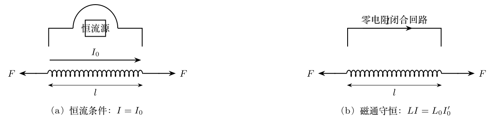
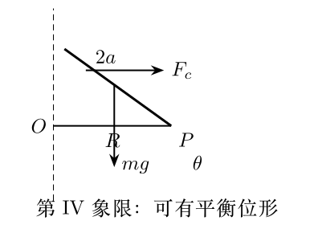
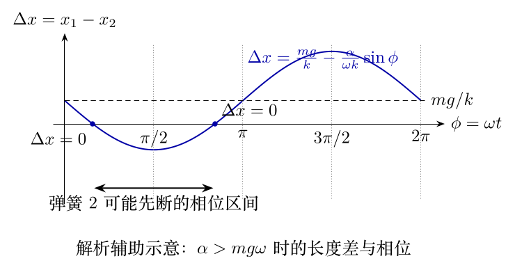
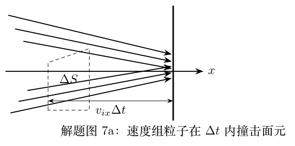
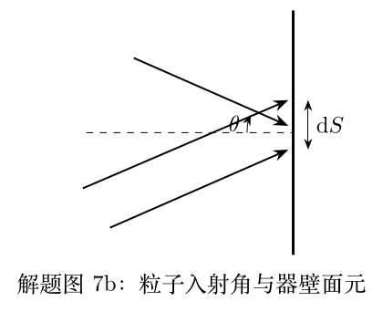

# 第39届复赛试题与参考解答

对应原始文件：`03_corpus/raw_papers/cpho_39_2022_fusai_paper_solution_candidate.pdf`

> 以下文字来自已经校订的逐题LaTeX文本，不使用原PDF的低质量自动文本层。

> 本文件由项目已校订的LaTeX题干、参考解答和TikZ图件生成。评分时以本文件为主要阅读文本；需核对原始措辞时查看包内对应届次原始PDF。

# 第39届复赛第1题：迈克尔逊干涉仪的相位突变与折射率测量

## 题干

迈克尔逊干涉仪的光路如图（a）所示。单色激光经半反半透镜分为相互垂直的反射臂与透射臂，两臂端各有可沿臂移动的反射镜。两束返回光在空间重叠；对发散光源，观察到同心圆环条纹。开始时，中心为亮斑，最外侧为亮圆环，共有 $20$ 个亮条纹（计及中心亮斑）。缓慢移动一个反射镜后，圆环变稀疏；中心明暗变化 $23$ 个周期，最外侧明暗变化 $20$ 个周期。

半反半透镜由石英基板和金属膜构成；两束反射光因反射界面不同有相位突变差 $\Delta\varphi$。求：（1）$\Delta\varphi$；（2）移动后亮条纹数；（3）将内壁间距 $t=2.00\,\mathrm{mm}$ 的扁平石英槽置入一个臂，先使槽面相对臂转过 $\theta=5.00^\circ$，空槽时中心变化 $10$ 个周期；注入待测液体后再将石英槽复位，中心变化 $17$ 个周期。已知 $\lambda=633\,\mathrm{nm}$、空气折射率为 $1.00$，求液体折射率。

## 参考解答整理

#### （1）由条纹周期确定相位突变。

设初始两臂光学长度差为 $d$，最大倾角为 $\gamma_M$。中心和最外侧均为亮纹，分别有 $$\frac{2\pi}{\lambda}2d+\Delta\varphi=2k\pi,\qquad
\frac{2\pi}{\lambda}2d\cos\gamma_M+\Delta\varphi=2(k-19)\pi.$$ 反射镜移动 $\Delta d$ 后，中心与最外侧的条纹变化给出 $$\frac{2\pi}{\lambda}2\Delta d=23\times2\pi,\qquad
\frac{2\pi}{\lambda}2\Delta d\cos\gamma_M=20\times2\pi.$$ 因而 $\cos\gamma_M=20/23$、$\Delta d=23\lambda/2$，并由初始条纹数得到 $$2d=\frac{23\times19}{3}\lambda=145\frac23\lambda.$$ 代回中心亮纹条件，得到 $$\boxed{\Delta\varphi=\frac{2\pi}{3}\pmod{2\pi}.}$$

#### （2）移动后的亮条纹数。

仍以中心和最外侧为亮纹，设亮条纹总数为 $m$，则 $$\frac{2\pi}{\lambda}2(d-\Delta d)(1-\cos\gamma_M)=(m-1)2\pi,$$ 故 $\boxed{m=17}$。

#### （3）由倾斜石英槽的光程差求折射率。

图画出答案使用的折射路径。设液体折射率为 $n$、折射角为 $i$，折射定律为 $$\sin\theta=n\sin i.$$ 与空槽相比，光线在倾角 $\theta$ 下往返通过石英槽的光程差为 $$\Delta L(\theta)=2nt\sqrt{1-\frac{\sin^2\theta}{n^2}}-2t\cos\theta.$$ 将其同 $\theta=0$ 的结果比较，并用 $\Delta N=N_2-N_1=17-10=7$，有 $$2nt\left(1-\sqrt{1-\frac{\sin^2\theta}{n^2}}\right)-2t(1-\cos\theta)=-\lambda\Delta N.$$ 题解按小角度展开，得到 $$\boxed{n=\frac{t\sin^2\theta}{2t(1-\cos\theta)-\lambda\Delta N}=1.41.}$$

> 本文件由项目已校订的LaTeX题干、参考解答和TikZ图件生成。评分时以本文件为主要阅读文本；需核对原始措辞时查看包内对应届次原始PDF。

# 第39届复赛第2题：通电螺线管弹簧的平衡与等效劲度

## 题干

某长直弹簧由涂绝缘漆的磷铜细丝绕成 $N$ 匝，可视为横截面半径为 $r$ 的均匀密绕长直螺线管。弹簧原长为 $l_0\gg r$，劲度系数为 $k$；形变中横截面半径不变，忽略边缘效应、漏磁和重力，真空磁导率为 $\mu_0$。

（1）用恒流源使电流保持为 $I_0$，起初以外力使弹簧不变形，缓慢撤去外力后平衡长度为 $l_p$。求 $l_p$ 的代数方程、平衡位置附近的等效劲度系数 $k_{\mathrm{eff}}$，以及可实现平衡的 $I_0$ 范围。

（2）改为零电阻理想导线闭合的回路，初始加载电流为 $I'_0$，撤去外力后平衡长度为 $l'_p$。求 $l'_p$ 与 $k'_{\mathrm{eff}}$。

## 参考解答整理

#### （1）恒流条件。

长度为 $l$、电流为 $I$ 时，螺线管的磁感应强度、磁通匝链数与电感分别为 $$B=\frac{\mu_0NI}{l},\qquad
\Psi=\frac{\mu_0N^2\pi r^2I}{l},\qquad
L=\frac{\mu_0N^2\pi r^2}{l}.$$ 恒流源做功须计入等效势能。弹簧势能、磁能和恒流源项合并为 $$W=\frac12k(l-l_0)^2-\frac{\mu_0N^2\pi r^2I_0^2}{2l}.$$ 故维持平衡所需外力为 $$F=k(l-l_0)+\frac{\mu_0\pi N^2r^2I_0^2}{2l^2}.$$ 撤去外力后的平衡条件为 $$\boxed{k(l_p-l_0)+\frac{\mu_0\pi N^2r^2I_0^2}{2l_p^2}=0.}$$ 令 $l=l_p+\delta l$，一阶展开得到 $$\boxed{k_{\mathrm{eff}}=k-\frac{\mu_0\pi N^2r^2I_0^2}{l_p^3}.}$$ 由平衡方程和平均值不等式，恒流的范围为 $$\boxed{0\le I_0\le\sqrt{\frac{8kl_0^3}{27\mu_0\pi N^2r^2}}.}$$

#### （2）零电阻闭合回路。

回路电阻为零时磁通守恒，满足 $$LI=L_0I'_0=\frac{\mu_0\pi N^2r^2}{l_0}I'_0.$$ 此时磁能正比于 $l$，系统能量为 $$W=\frac12k(l-l_0)^2+\frac{\mu_0N^2\pi r^2I_0'^2}{2l_0^2}l.$$ 平衡条件给出 $$\boxed{l'_p=l_0-\frac{\mu_0\pi N^2r^2I_0'^2}{2kl_0^2},\qquad k'_{\mathrm{eff}}=k.}$$

> 本文件由项目已校订的LaTeX题干、参考解答和TikZ图件生成。评分时以本文件为主要阅读文本；需核对原始措辞时查看包内对应届次原始PDF。

# 第39届复赛第3题：斜面上实心球的反复弹性碰撞

## 题干

如图（a），质量为 $m$、半径为 $R$ 的匀质实心球从倾角为 $\theta$ 的无限长固定斜面上发射。球心初速度垂直斜面、大小为 $V$，初始角速度为零。取 $x$ 轴沿斜面向下、$y$ 轴垂直斜面向上。碰撞弹性、碰撞时间极短，碰撞前后垂直斜面的速度大小相同；斜面足够粗糙，使接触点无相对滑动。已知 $I=2mR^2/5$。

求：（1）首次碰撞前的球心速度与角速度；（2）首次碰撞后的球心速度与角速度；（3）第 $n$ 次碰撞后的 $x$ 向速度和角速度；（4）前 $n$ 次碰撞中斜面对球的总冲量。

## 参考解答整理

#### （1）首次碰撞前。

飞行阶段仅受重力，故 $$a_x=g\sin\theta,\qquad a_y=-g\cos\theta,$$ $$v_x=gt\sin\theta,\qquad v_y=V-gt\cos\theta.$$ 由 $y(T)=0$ 得 $T=2V/(g\cos\theta)$，因而首次碰撞前 $$\boxed{v_x=2V\tan\theta,\qquad v_y=-V,\qquad \omega=0.}$$ 记每段飞行增加的沿坡速度为 $w=2V\tan\theta$。

#### （2）粗糙弹性碰撞映射。

设某次碰撞前、后的 $x$ 向速度为 $v_i,v_f$，角速度为 $\omega_i,\omega_f$。摩擦冲量、角动量定理和动能守恒给出 $$v_f-v_i=-\frac25R(\omega_f-\omega_i),$$ $$v_f^2-v_i^2=-\frac25R^2(\omega_f^2-\omega_i^2).$$ 除去无摩擦的平凡根后，碰撞映射为 $$v_f=\frac37v_i+\frac47R\omega_i,\qquad
R\omega_f=\frac{10}{7}v_i-\frac37R\omega_i.$$ 首次碰撞后由 $v_i=w$、$\omega_i=0$ 得 $$\boxed{v_1=\frac67V\tan\theta,\qquad \omega_1=\frac{20}{7R}V\tan\theta,}$$ 且球心速度为 $V[(6/7)\tan\theta\,\hat{x}+\hat{y}]$。

#### （3）第 $n$ 次碰撞后的递推结果。

在相邻两次碰撞间，$x$ 向速度增量为 $w$，因而 $$v_n=\frac37(v_{n-1}+w)+\frac47R\omega_{n-1},\qquad
R\omega_n=\frac{10}{7}(v_{n-1}+w)-\frac37R\omega_{n-1}.$$ 答案给出等价的奇偶结果： $$\boxed{\begin{aligned}
n\ \text{为偶数}:&\quad v_n=\frac{10}{7}nV\tan\theta,\quad \omega_n=\frac{10}{7R}nV\tan\theta;\\
n\ \text{为奇数}:&\quad v_n=\frac27(5n-2)V\tan\theta,\quad \omega_n=\frac{10}{7R}(n+1)V\tan\theta.
\end{aligned}}$$ 答案另给出线性组合、两步递推及矩阵三种等价求法，其中矩阵 $$A=\frac17\begin{pmatrix}3&4\\10&-3\end{pmatrix},\qquad A^2=\mathrm{I}.$$

#### （4）前 $n$ 次碰撞的总冲量。

每次碰撞的 $y$ 向冲量为 $2mV$，而 $x$ 向冲量求和后为 $J_x=mv_n-nmw$。因此 $$\mathbf J=m(v_n-nw)\hat{x}+2nmV\hat{y}.$$ 代入上式后： $$\boxed{\begin{aligned}
n\ \text{为偶数}:&\quad \mathbf J=\frac27nmV(-2\tan\theta\,\hat{x}+7\hat{y});\\
n\ \text{为奇数}:&\quad \mathbf J=\frac27nmV\left[-2\left(1+\frac1n\right)\tan\theta\,\hat{x}+7\hat{y}\right].
\end{aligned}}$$

> 本文件由项目已校订的LaTeX题干、参考解答和TikZ图件生成。评分时以本文件为主要阅读文本；需核对原始措辞时查看包内对应届次原始PDF。

# 第39届复赛第4题：旋转圆环上铰接细杆的平衡与稳定性

## 题干

如图，长度为 $2a$、质量为 $m$ 的匀质刚性细杆的一端以小孔套在半径为 $R$ 的水平圆环固定点 $P$ 上。圆环及 $P$ 点以角速度 $\omega$ 绕过圆心 $O$ 的竖直轴转动；细杆可绕 $P$ 无摩擦转动，并始终位于 $OP$ 所在竖直平面内。细杆与竖直方向夹角为 $\theta$，重力加速度为 $g$。

求：（1）分别在实验室系 $L$ 与随 $OP$ 转动的参考系 $S$ 中写出细杆机械能；（2）在 $S$ 系导出平衡条件；（3）图解分析四个象限中平衡位形数及参数条件；（4）分象限画出对 $P$ 点力矩有贡献的受力示意并检验图解结论；（5）讨论各平衡位形的稳定性。

## 参考解答整理

#### （1）两参考系的机械能。

细杆质心到转轴的距离为 $R+a\sin\theta$。以圆环平面为重力势能零点，实验室系机械能可写为 $$E_L=mga\cos\theta+\frac23ma^2\dot\theta^2
+\frac12m\left[(R+a\sin\theta)^2+\frac13a^2\sin^2\theta\right]\omega^2.$$ 在随 $OP$ 转动的 $S$ 系中，杆绕端点的转动惯量为 $I_P=4ma^2/3$；还应计入离心势能。因此 $$\boxed{E_S=\frac23ma^2\dot\theta^2+mga\cos\theta
-\frac12m\left[(R+a\sin\theta)^2+\frac13a^2\sin^2\theta\right]\omega^2.}$$

#### （2）平衡条件。

令有效势能对 $\theta$ 的导数为零，或直接令相对 $P$ 的合力矩为零，均得 $$mga\sin\theta+ma\omega^2\left(R+\frac43a\sin\theta\right)\cos\theta=0,$$ 即 $$\boxed{\tan\theta+\frac{4a\omega^2}{3g}\sin\theta+\frac{R\omega^2}{g}=0.}$$

#### （3）图解判定。

令 $A=4a\omega^2/(3g)$、$B=R\omega^2/g$，则 $A,B>0$，平衡方程化为 $$-\tan\theta=A\sin\theta+B.$$ 图重绘答案的图解曲线。另将原方程写为 $$-\cot\theta=A'\cos\theta+B',\qquad A'=\frac{4a}{3R},\quad B'=\frac{g}{R\omega^2},$$ 也得到图的等价图解。

由曲线交点可知：第I象限无平衡位形；第II、IV象限各恰有一个。第III象限可能有 $0$、$1$ 或 $2$ 个。临界时两曲线相切，故 $$A^{2/3}=B^{2/3}+1,
\qquad
\boxed{\left(\frac{4a}{3}\right)^{2/3}-R^{2/3}=\left(\frac{g}{\omega^2}\right)^{2/3}.}$$ 左端小于右端时第III象限无平衡位形；等号时有一个临界位形；左端大于右端时有两个。

#### （4）受力检验。

图按答案解题图4b重绘。重力 $mg$ 作用于杆的中点；离心力是分布力，图中以对 $P$ 点力矩等效的合力 $F_c$ 表示。各象限的力矩方向与上面的交点结论相符。

#### （5）稳定性。

在平衡位置 $\theta_E$ 附近令 $\theta=\theta_E+\Delta\theta$。若微小偏移后合力矩为恢复力矩，则平衡稳定。答案的微扰法和有效势能二阶导数法给出一致判断：第II象限位形稳定，第IV象限位形不稳定；第III象限有两个位形时，较大的根稳定、较小的根不稳定；临界相切时 $\theta_E=\theta_0$ 是势能拐点，亦不稳定。

> 本文件由项目已校订的LaTeX题干、参考解答和TikZ图件生成。评分时以本文件为主要阅读文本；需核对原始措辞时查看包内对应届次原始PDF。

# 第39届复赛第5题：快慢拉动双弹簧断裂模型

## 题干

两根相同的理想轻弹簧，劲度系数均为 $k$、自然长度均为零；中间以质量为 $m$ 的小球相连。弹簧1上端固定在天花板，系统自然下垂且初始静止。任一弹簧拉伸到临界长度（大于 $mg/k$）即断裂。对弹簧2下端施加随时间变化的外力 $F(t)$。

设 $F(t)=0$（$t<0$），$F(t)=\alpha t$（$t\ge0$），其中 $\alpha>0$ 表示加载快慢。求：（1）弹簧1长度的运动方程；（2）$x_1(t),x_2(t)$；（3）两根弹簧先断的条件及其与 $\alpha$ 的关系；（4）临界长度为 $L$ 时确保弹簧2先断的 $\alpha$ 条件，以及同时断裂的条件。

## 参考解答整理

#### （1）运动方程。

以弹簧1的长度 $x_1(t)$ 描述小球的竖直位置。牛顿第二定律与胡克定律给出 $$\boxed{m\ddot{x}_1=-kx_1+mg+F(t).}$$

#### （2）线性加载下的长度。

令 $\omega^2=k/m$，以 $mg/k$ 平移坐标并代入 $F(t)=\alpha t$。由初始条件 $x_1(0)=mg/k$、$\dot{x}_1(0)=0$，得到 $$\boxed{x_1(t)=\frac{mg}{k}+\frac{\alpha}{k}t-\frac{\alpha}{\omega k}\sin\omega t,}
\qquad
\boxed{x_2(t)=\frac{\alpha}{k}t.}$$ 后式直接由 $F(t)=kx_2(t)$ 得到。

#### （3）先断条件与快慢加载。

两弹簧长度差为 $$\Delta x=x_1-x_2=\frac{mg}{k}-\frac{\alpha}{\omega k}\sin\omega t.$$ 因此当 $\alpha<mg\omega=g\sqrt{km}$ 时，任何时刻均有 $\Delta x>0$，弹簧1必先断。若 $\alpha\ge mg\omega$，弹簧1先断需满足 $$\sin(\omega t_0)<\frac{mg\omega}{\alpha};$$ 弹簧2先断则需满足相反的不等式，且必须有 $\alpha>mg\omega$。图将该长度差的相位判定画出：加载越快，满足弹簧2先断的相位区间越宽，这解释了快速拉动下弹簧2更可能断裂的现象。

#### （4）给定临界长度 $L$。

弹簧2达到临界长度的时刻为 $t_0=kL/\alpha$。要确保其先断，应满足 $$\boxed{\sin\left(\frac{kL}{\alpha}\sqrt{\frac{k}{m}}\right)
>\frac{mg}{\alpha}\sqrt{\frac{k}{m}}.}$$ 存在同时断裂的情形，其临界条件只需将上式的不等号改为等号。

> 本文件由项目已校订的LaTeX题干、参考解答和TikZ图件生成。评分时以本文件为主要阅读文本；需核对原始措辞时查看包内对应届次原始PDF。

# 第39届复赛第6题：金属温差电效应的经典模型

## 题干

如图，厚度为 $2L$、在 $y,z$ 方向无限延展的金属平板位于 $-L<x<L$；两侧是真空，电场为零。金属中导电电子在均匀正电荷背景上运动。温度 $T(x)=T_0+\delta T(x)$ 会使电子数密度 $n(x)=n_0+\delta n(x)$ 略偏离均匀值，并产生小的 $x$ 向电场 $E_x(x)$；两内表面有面电荷密度 $\sigma_-$、$\sigma_+$。

已知扩散流满足 $j_x=-D\,\mathrm dn/\mathrm dx$，其中 $D=c\sqrt{T/n}$；电阻率 $\rho$ 为常量。求：（1）$E_x(x)$；（2）由高斯定理得到的方程与边界条件；（3）线性化的 $\delta n(x)$；（4）局域力学平衡下的 $\delta T(x)$；（5）Seebeck 系数 $S=[U(L)-U(-L)]/[T(L)-T(-L)]$。

## 参考解答整理

#### （1）零净电流条件。

电子扩散流与漂移电流抵消： $$-e j_x+\frac1\rho E_x=0,
\qquad
\boxed{E_x(x)=-e\rho c\sqrt{\frac{T(x)}{n(x)}}\frac{\mathrm dn}{\mathrm dx}.}$$

#### （2）高斯定理与边界条件。

金属内部净电荷密度为 $-e[n(x)-n_0]$，故 $$\varepsilon_0\frac{\mathrm dE_x}{\mathrm dx}=-e[n(x)-n_0],$$ 从而 $$\varepsilon_0\rho c\frac{\mathrm d}{\mathrm dx}
\left[\sqrt{\frac{T(x)}{n(x)}}\frac{\mathrm dn}{\mathrm dx}\right]=n(x)-n_0.$$ 真空侧电场为零，给出 $\varepsilon_0E_x(-L+0)=\sigma_-$、$\varepsilon_0E_x(L-0)=-\sigma_+$。

#### （3）密度偏离。

保留小量的一阶项，定义 $$\lambda=\sqrt{\frac{\varepsilon_0\rho cT_0}{n_0}},
\qquad
\frac{\mathrm d^2\delta n}{\mathrm dx^2}=\frac{1}{\lambda^2}\delta n.$$ 答案给出的等价形式为 $$\boxed{\delta n(x)=\frac{1}{\lambda e}\left[
\frac{\sigma_++\sigma_-}{2\sinh(L/\lambda)}\cosh\frac{x}{\lambda}
+\frac{\sigma_+-\sigma_-}{2\cosh(L/\lambda)}\sinh\frac{x}{\lambda}\right].}$$

#### （4）局域热平衡。

电子气压强 $p=nk_BT$，薄层力平衡满足 $\mathrm dp/\mathrm dx=-eE_xn$。线性化并代入前述关系后， $$\boxed{\delta T(x)=\frac{T_0}{n_0}\left(\frac{e^2\rho c}{k_BT_0}-1\right)\delta n(x).}$$

#### （5）Seebeck 系数。

由 $E_x=-\mathrm dU/\mathrm dx$，或直接比较两端的电势差和温度差，得到经典玩具模型中的 $$\boxed{S=\left(\frac{e}{k_B}-\frac{T_0}{e\rho c}\right)^{-1}.}$$ 题目附注指出：真实金属温差电效应必须考虑电子量子效应；以上仅为题设的经典简化模型。

> 本文件由项目已校订的LaTeX题干、参考解答和TikZ图件生成。评分时以本文件为主要阅读文本；需核对原始措辞时查看包内对应届次原始PDF。

# 第39届复赛第7题：高能铅核碰撞夸克物质状态方程

## 题干

高能铅核碰撞形成的高温球形"火球"近似由静止质量很小、速度接近光速的夸克组成。夸克为无相互作用的经典粒子，速度分布各向同性，能量分布比例为 $e^{-E/(k_BT)}4\pi p^2\mathrm dp$。求：（1）$P$ 与能量密度 $u$ 的状态方程；（2）$P,n,T$ 的状态方程；（3）$C_V$ 与热容比 $\gamma$；（4）半径 $3.0\times10^{-15}\,\mathrm m$、温度从 $400\,\mathrm{MeV}/k_B$ 降至 $150\,\mathrm{MeV}/k_B$ 时的火球半径。

## 参考解答整理

#### （1）器壁动量通量。

对速度组 $i$，近光速近似给出 $\boldsymbol p_i\cdot\boldsymbol v_i\simeq E_i$。由各向同性，器壁压强 $$P=\frac13\sum_i n_i\boldsymbol p_i\cdot\boldsymbol v_i=\boxed{\frac13u}.$$

#### （2）平均能量与状态方程。

用 $E\simeq pc$ 代入题设分布，积分比值给出 $\bar E=3k_BT$。故 $$\boxed{P=\frac13n\bar E=nk_BT}.$$

#### （3）热容。

一摩尔内能 $U_m=N_A\bar E=3RT$，所以 $$\boxed{C_V=3R,\qquad C_P=4R,\qquad \gamma=\frac43}.$$

#### （4）绝热膨胀。

准静态绝热过程 $TV^{\gamma-1}=\mathrm{const}$，代入 $\gamma=4/3$ 和 $V=4\pi r^3/3$ 得 $Tr=\mathrm{const}$，故 $$\boxed{r=\frac{400}{150}\times3.0\times10^{-15}\,\mathrm m=8.0\times10^{-15}\,\mathrm m}.$$
