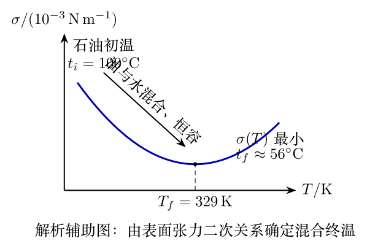
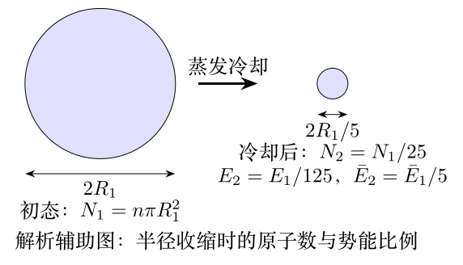

# 第41届复赛参考解答

对应原始文件：`03_corpus/raw_solutions/cpho_41_2024_fusai_solution_candidate.pdf`

> 以下文字来自已经校订的逐题LaTeX文本，不使用原PDF的低质量自动文本层。

# 参考解答

#### （1.1）稳定振幅。

小幅度下耦合方程为 $\ddot x+l\ddot\theta+g\theta=0$、$M\ddot x+kx-mg\theta=H\cos\omega t$。令 $\omega_0^2=g/l$，稳定位移振幅为 $$A=\frac{(\omega_0^2-\omega^2)H}{(\omega_0^2-\omega^2)(k-M\omega^2)-m\omega_0^2\omega^2}.$$

#### （1.2）共振频率与调谐条件。

无阻尼建筑物在 $\omega=\sqrt{k/M}$ 共振；为最大抑制该频率，可取 $$\boxed{l=Mg/k}.$$

#### （2）质量比。

当 $\omega=\sqrt{0.99k/M}$ 时，无阻尼振幅为 $100H/k$；按上述调谐条件将其降至1%需 $$\boxed{m/M=101/9900\approx1/100}.$$

#### （3）含阻尼时的非线性运动方程。

摆锤相对油的速度分量为 $$v'_x=l\dot\theta\cos\theta,
\qquad v'_y=-l\dot\theta\sin\theta.$$ 设摆杆张力为 $T$，对摆锤和大楼分别应用牛顿第二定律，得到 $$m\left(\ddot x+l\ddot\theta\cos\theta-l\dot\theta^2\sin\theta\right)
=-T\sin\theta-\gamma l\dot\theta\cos\theta,$$ $$m\left(-l\ddot\theta\sin\theta-l\dot\theta^2\cos\theta\right)
=mg-T\cos\theta+\gamma l\dot\theta\sin\theta,$$ $$M\ddot x=-kx+T\sin\theta+\gamma l\dot\theta\cos\theta+H\cos\omega t.$$ 这组三式没有使用小角近似。阻尼一方面抑制调谐系统可能出现的共振，另一方面持续耗散机械能，使风停后大楼和摆锤逐渐停振。

# 参考解答

#### （1）碰撞后的速度与角速度。

取碰撞连心线为 $y'$ 方向。由动量守恒和完全弹性条件，碰撞后的两球飞行方向满足 $$\boxed{\theta+\varphi=90^\circ},\qquad \boxed{\boldsymbol\omega=\boldsymbol\omega_0},$$ 且 $Q$ 球质心速度分量为 $v_{Qx}=v_0\sin\varphi\cos\varphi$、$v_{Qy}=v_0\sin^2\varphi$。答案中的质心系速度几何关系如图所示。

#### （2.1）碰撞后瞬间接触点速度。

碰撞后接触点的初速度为 $$\boldsymbol v_{C0}=(v_0\sin\varphi\cos\varphi-R\omega_{0y})\boldsymbol i+(v_0\sin^2\varphi+R\omega_{0x})\boldsymbol j,$$

#### （2.2）达到纯滚所需时间。

$$\Delta t=\frac{2|\boldsymbol v_{C0}|}{7\mu g}.$$

#### （2.3）与（2.4）纯滚前后的轨迹。

在滑动阶段，摩擦力方向与接触点速度相反，质心轨迹为抛物线；达到纯滚后摩擦力消失，质心作匀速直线运动。

#### （3）使开球后立即纯滚的击球高度。

开球冲量满足 $M=mv_0$、$(h-R)M=I\omega_0$。对均匀实心球 $I=2mR^2/5$，使开球即纯滚的击球高度为 $$\boxed{h=\frac{7R}{5}}.$$

#### （4.1）碰撞后至纯滚前的质心轨迹。

在第（3）问的击球条件下，滑动阶段有 $$x(t)=v_0\sin\varphi\cos\varphi\,t-\frac12\mu g\sin\varphi\,t^2,$$ $$y(t)=v_0\sin^2\varphi\,t+\frac12\mu g\cos\varphi\,t^2.$$

#### （4.2）纯滚后的最终方向。

答案给出 $$\tan\theta_f=\frac{\sin\varphi\cos\varphi}{\sin^2\varphi+\frac25}=\frac{5\sin2\varphi}{9-5\cos2\varphi}.$$

#### （4.3）最大方向角及邻近角度。

极大值出现于 $\cos2\varphi_m=5/9$，即 $\varphi_m=28.1^\circ$；相应 $\theta_m=33.7^\circ$。题目表格的五个结果为：

::: center
 $\varphi$ $\varphi_m$ $\varphi_m+5^\circ$ $\varphi_m+10^\circ$ $\varphi_m-5^\circ$ $\varphi_m-10^\circ$
 ------------ -------------- --------------------- ---------------------- --------------------- ---------------------- --
 $\theta_f$ $33.7^\circ$ $33.3^\circ$ $32.0^\circ$ $33.1^\circ$ $30.7^\circ$
:::

# 参考解答

#### （1）使表面张力最小的注入水温。

恒容条件给出 $dp=\beta\,dT$；又因参考状态有 $p=\beta T$，代入题设关系后得到 $$\frac{\sigma}{10^{-3}\,\mathrm{N\,m^{-1}}}=60-110\times10^{-3}\frac{T}{\mathrm K}+167\times10^{-6}\frac{T^2}{\mathrm K^2}.$$ 令 $d\sigma/dT=0$，有 $T_f=329\,\mathrm K$，即 $t_f\approx56^\circ\mathrm C$。该二次关系的极小点及混合过程由下图辅助说明；该图为解析辅助图，并非原题图。

对等体积的石油和水作热量守恒， $$c_i\rho_i(t_i-t_f)=c_w\rho_w(t_f-t_w).$$ 代入 $c_i=0.6c_w$、$\rho_i=0.8\rho_w$、$t_i=100^\circ\mathrm C$、$t_f\approx56^\circ\mathrm C$，得到注入水温 $$\boxed{t_w\approx35^\circ\mathrm C}.$$

#### （2）表面层微观模型。

设内部每个粒子有 $n$ 个邻近粒子，表面层有 $\zeta n$ 个。形成单位面积表面所需功对应表面层粒子的相互作用能减少；令特征粒子间距为 $D$，则 $D^2=\Delta A_S/N_S$。下图仅用于说明该微观模型的符号关系。

由 $L_m=N_A(|\epsilon|/2)n$、$D^3N_A=\mu/\rho$，最终获得 $$\boxed{\sigma=(1-\zeta)\frac{L_m}{N_A}\left(\frac{\rho N_A}{\mu}\right)^{2/3}}.$$

# 参考解答

200层扫描对应空间分辨率 $\Delta x=2r/200=r/100$。由不确定关系与相对论能量动量关系， $$\Delta x\,\Delta p_x\geq\frac{\hbar}{2},\qquad E_{k,\min}=\sqrt{\left(\frac{\hbar c}{2\Delta x}\right)^2+m_e^2c^4}-m_ec^2.$$ 代入 $\Delta x=r/100$ 后，答案给出的最小电子动能为 $$\boxed{E_{k,\min}\approx11.6\,\mathrm{GeV}}.$$ 极端相对论近似为 $E_{k,\min}\approx\hbar c/(2\Delta x)$，与狭义相对论结果的差别远小于1%。答案第9式的焦耳单位指数与同式的 GeV 值不一致，故此处不转写该冲突的焦耳数，仅保留两种表达式共同支持的 GeV 结论。

第（2）问中系统总能量为 $$E_t=\frac{p^2}{2m_0}+\frac{Z_1Z_2e^2}{4\pi\varepsilon_0r}.$$ 令 $p=m_0v$，结合 $\Delta p\geq\hbar/(2\Delta r)$ 和能量守恒条件，得到 $$\frac{\Delta r}{r}=\sqrt{\frac{\varepsilon_0vh}{Z_1Z_2e^2}}.$$ 对质子--质子情形 $Z_1=Z_2=1$，且 $\Delta r/r\simeq1$，答案给出 $$\boxed{v\approx0.044\times10^8\,\mathrm{m\,s^{-1}}\approx0.015c}.$$

# 参考解答

#### （1）原点附近的磁场。

无限长直导线在距导线 $r$ 处产生 $B=\mu_0I/(2\pi r)$。由四根导线的对称性，$O$ 点磁场为零。对 $x\ll a$、$y\ll b$，答案给出原点附近的领头阶近似 $$B_x=-\frac{16\mu_0abI}{\pi(a^2+b^2)^2}x,\qquad B_y=\frac{16\mu_0abI}{\pi(a^2+b^2)^2}y,$$ $$B=\frac{16\mu_0abI}{\pi(a^2+b^2)^2}\sqrt{x^2+y^2}.$$

#### （2）磁矩在外磁场中的势能。

电流圈受到的磁力矩为 $\boldsymbol M=\boldsymbol S\times\boldsymbol B$。磁矩从参考方向转至夹角 $\theta$ 时，外力矩所做功的负值给出势能变化： $$W_m(\theta)-W_m(\pi/2)=-\int_{\pi/2}^{\theta}SB\sin\theta'\,\mathrm d\theta'
=-SB\cos\theta.$$ 取参考常量为零，即得 $$\boxed{W_m=-\boldsymbol S\cdot\boldsymbol B}.$$

#### （3）磁矩反向时的约束力。

本题通过实验使磁矩始终与磁场反向，故以 $O$ 为势能零点时 $$W_m=\frac{16\mu_0abIS}{\pi(a^2+b^2)^2}\sqrt{x^2+y^2},$$ 且约束力指向原点： $$F_x=-\frac{16\mu_0abIS}{\pi(a^2+b^2)^2}\frac{x}{\sqrt{x^2+y^2}},\qquad F_y=-\frac{16\mu_0abIS}{\pi(a^2+b^2)^2}\frac{y}{\sqrt{x^2+y^2}}.$$

#### （4）蒸发冷却前后的能量。

半径为 $R_1$ 的均匀原子团有 $N_1=n\pi R_1^2$；其总势能和平均势能分别为 $$E_1=\frac{32\mu_0abISn}{3(a^2+b^2)^2}R_1^3,\qquad \bar E_1=\frac{32\mu_0abIS}{3\pi(a^2+b^2)^2}R_1.$$ 冷却后 $R_2=R_1/5$，故 $N_2=N_1/25$、$E_2=E_1/125$、$\bar E_2=\bar E_1/5$。下图为解析辅助图，不是原题图。

# 参考解答

#### （1）双曲轨道的角度范围。

对 $e>1$，轨道可取范围由 $\cos\theta>-1/e$ 给出，故 $$\theta_{\max}=\arccos(-1/e),\qquad \frac\pi2<\theta_{\max}<\pi.$$

#### （2）用能量和角动量表示轨道参数。

以总能量 $E$ 和角动量 $L$ 表示的轨道参数为 $$p=\frac{L^2}{GMm^2},\qquad e=\sqrt{1+\frac{2EL^2}{G^2M^2m^3}}.$$

#### （3）牛顿框架下的陨石和星光偏折。

对速度 $v_0$、瞄准距离 $b$ 的入射陨石，在 $v_0^2b/(GM_\odot)\gg1$ 条件下，偏折角为 $$\boxed{\Delta\varphi_{\mathrm{meteor}}=\frac{2GM_\odot}{v_0^2b}}.$$ 令 $v_0=c$、$b=R_\odot$，牛顿框架下的星光偏折是 $$\Delta\varphi_{\mathrm{Newton}}=\frac{2GM_\odot}{c^2R_\odot}.$$

#### （4）弱场广义相对论框架下的星光偏折。

弱场广义相对论以 $n_{\mathrm{eff}}(r)=1-2\phi(r)/c^2$、$\phi(r)=-GM_\odot/r$ 描述光程。由费马原理导出的守恒式与无穷远边界条件给出最终偏折 $$\boxed{\Delta\varphi_{\mathrm{GR}}=\frac{4GM_\odot}{c^2R_\odot}=2\Delta\varphi_{\mathrm{Newton}}}.$$

# 参考解答

#### （1）单值性与动量量子化。

圆环闭合使 $\psi(x+2\pi R)=\psi(x)$，因此动量量子化为 $$p_n=\frac{n\hbar}{R},\qquad n\in\mathbb Z.$$

#### （2）磁通中的单电子能级。

通入磁通后，$p'_n=p_n+eA$，且 $\Phi=2\pi RA$，故单电子能量为 $$E_n(\Phi)=\frac{\hbar^2}{2mR^2}\left(n+\frac{e\Phi}{h}\right)^2.$$

#### （3.1）与（3.2）多电子约束及总能量周期。

多电子系统取互不相同的动量量子数并使总能量最小。将磁通平移一个 $h/e$ 时，可用 $n\mapsto n+1$ 保持求和范围不变，因而 $$E_{\mathrm{tot}}\left(\Phi+\frac{h}{e}\right)=E_{\mathrm{tot}}(\Phi).$$

#### （4）奇偶电子数的平均能量。

当 $N=2M+1$ 为奇数且 $-h/(2e)\leq\Phi<h/(2e)$ 时，平均能量可写成 $$\bar E(\Phi)=\frac{e^2\Phi^2}{4\pi^2}\frac{1}{2mR^2}+\frac{\hbar^2}{2mR^2}\frac{M(M+1)}{3}.$$ 故奇数电子数时 $\Phi=0$ 处的平均能量低于 $|\Phi|=h/(2e)$ 处；偶数电子数时结论相反，平均能量在 $|\Phi|=h/(2e)$ 附近取较小值。

#### （5.1）双环电子分配与配对条件。

最后引入配对约束：动量为 $p'$ 和 $-p'$ 的电子必须同时存在或同时不存在。答案表明，两个环电子数均为奇数时，电子数差最小且 $\Phi=0$ 的构型能量最低；两个环电子数均为偶数时，对应最低点在 $\lvert\Phi\rvert=h/(2e)$。对于题设的两种双环构型，常数项分别为

#### （5.2）两种双环构型的平均能量比。

$$C_1=\frac{M(M+1)}{3},\qquad C_2=\frac{M(M+1)}{3}+\frac14,$$ 所以 $\lim_{M\to\infty}C_1/C_2=1$，两种构型的电子平均能量之比也趋于 $1$。
